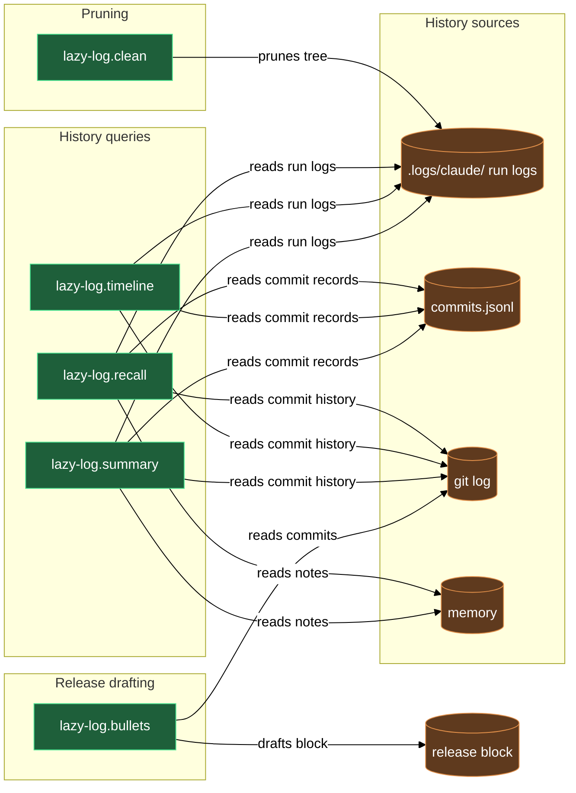

# Change history and run-log housekeeping

Every commit your project lands is recorded, and every skill or agent that opts into logging leaves a run log behind — but that record is only useful when the logs stay tidy and you can query them. This block covers both sides: `/lazy-log.clean` keeps the `.logs/claude/` tree free of orphaned directories left behind by renamed or retired skills, and three query agents answer "why", "when", and "tell me the whole story" across run logs, the raw commit journal, git log, and memory at once.

## What's in this block

**`lazy-log.clean`** is the interactive log-tree janitor. It resolves the live set of canonical skill, agent, and command names from your vault (and which of them still opt into logging), then classifies every subdirectory of `.logs/claude/` into buckets: canonical, unlogged (a live artifact that no longer opts into logging, so its folder is leftover residue), rename-candidate (fuzzy-matched against a known name), pattern-clustered orphan (anonymous `task-N` or `subagent-task-N` folders), and unknown. It walks the buckets one at a time and asks you what to do, one question per folder or cluster: canonical folders whose newest log is more than 30 days old can be kept or deleted; rename candidates can be merged into the canonical name, deleted, or left; pattern clusters can be deleted or left all at once, or decided folder by folder; unlogged folders can be deleted, left, or all deleted at once; unknown folders can be deleted or left. Each prompt shows how many logs the folder holds, the date range, and a preview of what the logs recorded. Every choice is applied in one final pass.

**`lazy-log.recall`** answers point-in-time questions: "why was X changed?" or "when did we touch Y?". You give it a natural-language query; it decomposes the query into keywords (including plural and singular variants and obvious synonyms), searches run logs, `.logs/commits.jsonl` (both the subject and the body of each commit), git log (both message and diff-content search), and project memory, ranks matches by source quality (a keyword hit in a run log's actions or result outranks a commit message, which outranks a diff-only hit, which outranks a memory note), deduplicates by commit SHA so one change corroborated by several sources appears once, and returns roughly the top ten as a table you can jump from with `git show <sha>`. It is read-only, and when your query is ambiguous it shows both interpretations rather than guessing.

**`lazy-log.timeline`** takes a date range or topic — or both combined — and produces a day-by-day listing, newest first, of everything that matches, merged from run logs, `.logs/commits.jsonl`, and git log (it does not read memory notes). Each entry is a short factual line with the SHA and, when known, the time; chore, refactor, and formatting commits are prefixed `(internal)` so you can skim past them, and a closing Coverage block states the date range, the sources searched, and how many entries remain after deduplication. It is the right tool when you want a "what happened when" overview rather than a specific answer. If no date range is given it defaults to the last 7 days.

**`lazy-log.summary`** aggregates every match for a topic and synthesizes a multi-paragraph narrative: why the work started, what was done, what issues came up, and where it ended up. Unlike `recall` (point-in-time) and `timeline` (chronological), `summary` reads the bodies of the most promising commits (about the top ten), clusters by sub-theme — design decisions, implementation phases, issues encountered, follow-up work — and writes prose for a reader who was not there, citing a SHA or log reference next to each claim. It ends with a supporting-references table and a Gaps section that flags periods where the record is silent, and it says so when the history is incomplete or contradictory rather than papering over it.

**`lazy-log.bullets`** is the release-time tool. You dispatch it with a plugin name, the commit range since the last release, the new version, and the date. It reads the commits, drops anything purely internal (chore, style, test, docs-sync), rewrites the survivors as outcome-led bullets grouped by scope (with any `#` token from a commit subject wrapped in backticks for tag safety), and returns a release block ready to prepend to `CHANGELOG.public.md`. Two rules keep the block honest. A reworded `description:` on a shipped skill, agent, or command is always kept as a bullet, because that field decides when the artifact gets picked for a request. And a repo-wide commit is judged by what it changed inside the plugin being released, not by its subject line, so a commit that reads like plumbing but changed this plugin's behavior still earns a bullet while one that only touched its README does not.

## How they work together

The block divides into two groups: **maintenance** and **querying**.

On the maintenance side, `/lazy-log.clean` is the keeper of record quality. Run it when `.logs/claude/` has accumulated folders from renamed or retired skills — it removes the noise without destroying historical value: a renamed skill's logs are merged into its current folder rather than lost, and anything you answer "leave" to is untouched and asked about again next run. The raw commit feed needs no maintenance: the `lazy-log.commit-recorder` hook appends one line to `.logs/commits.jsonl` after every successful commit — including commits made through a chained Bash command — and the runtime daemon keeps the journal within its size budget.

On the query side, the three search agents draw on run logs, raw commits, and git log — `lazy-log.recall` and `lazy-log.summary` also search project memory — and differ in the shape of question each answers:

| Agent | Best for |
|---|---|
| `lazy-log.recall` | A specific question: "who changed the auth middleware?" |
| `lazy-log.timeline` | A window in time: "what happened last week?" |
| `lazy-log.summary` | The full arc: "tell me the whole story of the logging refactor" |

All three return git SHAs so you can `git show <sha>` to inspect the exact change. `lazy-log.recall` broadens its search automatically by including plural and singular variants and obvious synonyms; narrow it by passing more specific keywords in a follow-up prompt.

`lazy-log.recall`, `lazy-log.timeline`, and `lazy-log.summary` all write their own prose in the project's configured language — the top-level `language` key in `.claude/lazy.settings.json`, falling back to English when the key is absent — before producing a single line of output. Only quoted source material stays as-is: commit subjects, file paths, SHAs, identifiers, and section names.

`lazy-log.bullets` sits outside the normal query flow. It is dispatched by the publish pipeline when drafting a release and needs the git commit range for one plugin translated into what a user installing the plugin would actually care about. Internal chore commits are filtered out automatically; what surfaces is a ready-to-paste release block. If every commit in the range is filtered out, it re-reads the per-plugin diffs once before declaring "no user-visible changes", since an empty block tells readers nothing changed for them. It never edits `CHANGELOG.public.md` or commits anything; prepending the block is the caller's job.

## Common adjustments

- Run logs exist only for artifacts whose frontmatter declares `logging: true`; a skill you expect to see under `.logs/claude/` and do not has simply not opted in — see the `lazy-log.logging` rule.
- `/lazy-log.clean` holds all merges and deletions until you have answered every prompt; if you change your mind mid-run, abort and re-run — no changes land until the final apply step. A merge or delete the final step cannot carry out (an invalid name, a folder that has vanished, a file already present in the merge target) is reported by name and left on disk.
- If `.logs/claude/` does not exist yet, `/lazy-log.clean` reports every step as absent; run any logging skill once to create it.
- `lazy-log.bullets` expects coordinate-style input (`plugin`, `plugin_dir`, `range`, `new_version`, `date`) and is typically dispatched by the publish pipeline rather than invoked directly.

## Where this fits

- [runtime](runtime.md) — the daemon that rotates `.logs/commits.jsonl` alongside its other journals.
- [memory](memory.md) — project memory notes are one of the sources `lazy-log.recall` and `lazy-log.summary` search.

## How the members fit together

