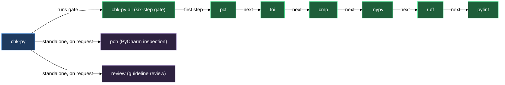
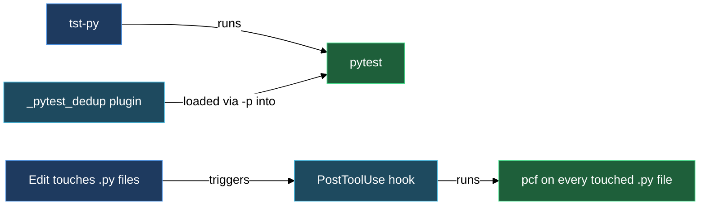
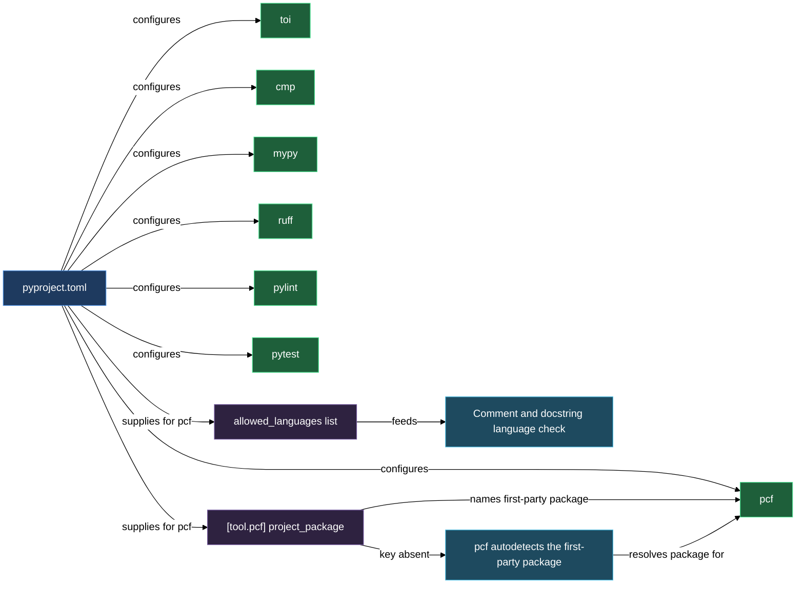
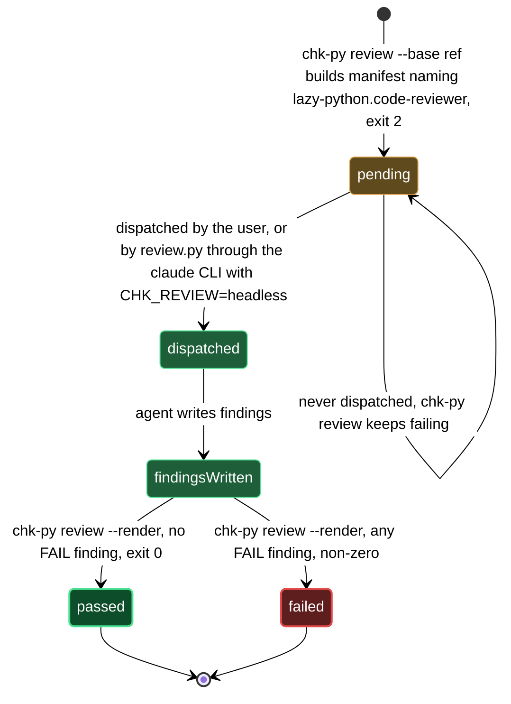
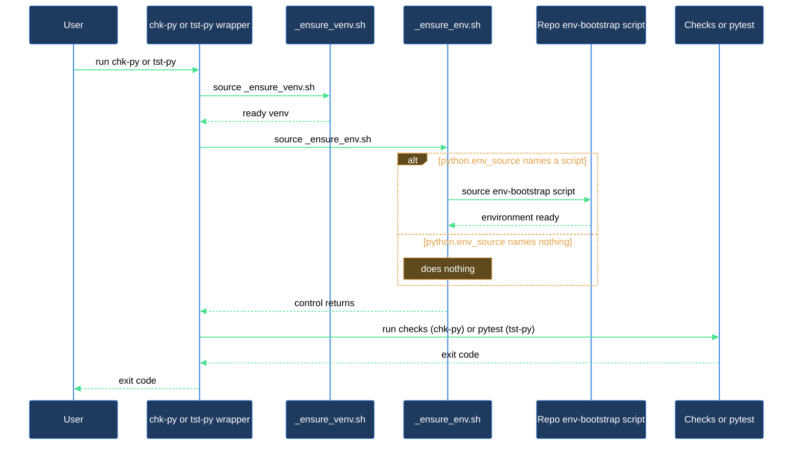

# Python checkers

`chk-py` and `tst-py` are the two commands you use every day in a project that has lazycortex-python installed; a third, `cfg-py`, creates and updates the project venv they run in. `chk-py` runs the style, type, and guideline pipeline — format rules, type-only import analysis, syntax checking, mypy, ruff, pylint, and a guideline review pass — against any path you point it at. `tst-py` runs pytest scoped to the module you name, or the whole `tests/` tree when you omit the argument. All three are thin wrappers in your project's `cli/` directory; they resolve the active lazycortex-python plugin at exec time rather than delegating to a path frozen at install time, so they keep working across plugin version updates without needing to be re-deployed. No `cli/` copy carries the executable bit — a mode-blind git client (obsidian-git on Android, any Windows checkout) strips it anyway, so the wrappers launch through the interpreter named on their own shebang line instead of relying on it. Call them as `bash ./cli/chk-py` / `bash ./cli/tst-py` / `bash ./cli/cfg-py` from the repo root, or install the `~/.local/bin/chk-py` / `~/.local/bin/tst-py` / `~/.local/bin/cfg-py` home wrappers (`/lazy-python.install` Step 2b) to get plain `chk-py` / `tst-py` / `cfg-py` from anywhere under the repo once `~/.local/bin` is on your `$PATH`. If a wrapper ever cannot find the plugin it prints a clear error directing you to re-run `/lazy-python.install`.

Behind both commands sits `_ensure_venv.sh`, a shared venv resolver that finds mypy, pylint, pytest, and ruff in an activated venv or in your project venv (a path in `pyproject.toml`, else `.venv/` in the repo root), and builds that venv from `pyproject.toml` when it is missing or out of date — without requiring any environment setup beyond a plain terminal. The same logic is what `cfg-py` runs on request. Right after the venv is active, both wrappers also source `_ensure_env.sh`, an optional hook that loads your project's own environment-bootstrap script when one is on record, so checks and tests run with the same secrets/config your project normally needs.

## What's in this block

**`chk`** is the style, type, and guideline aggregator wrapper. You call it as `chk-py <subcommand> [path ...]`. The `all` subcommand runs six checks in sequence — `pcf`, `toi`, `cmp`, `mypy`, `rf`, `pylint` — across every path you supply (defaulting to `.`). Each subcommand is also callable on its own, so `chk-py mypy src/` runs only mypy. When you name a directory explicitly (anything but a bare `.`), `chk-py mypy` expands it to its individual `.py` files before invoking mypy: mypy's own `exclude` config in `pyproject.toml` applies while it discovers files under a directory, but never to a file named directly on its command line, so without the expansion a directory that happened to match that exclude pattern would silently go unchecked even though you named it explicitly. A bare `.` keeps the recursive run, where the exclude config is the whole point. The `-q` flag is accepted as a no-op for compatibility with the `lazy-python.style.md` verification-order mandate. `pch` and `review` are both separate standalone subcommands that are NOT part of the `all` gate: `pch` (`chk-py pch <file>`) is also opt-in per repo via a `[tool.pch]` section in `pyproject.toml` — when that section is absent, `chk-py pch` prints a diagnostic and exits cleanly without affecting any other check; `review` (`chk-py review`) runs the guideline-review phase on its own cadence — see below.

**`pcf.py`** is the Python Code Format checker. It parses each `.py` file with the `ast` module and checks import block ordering (future → typing → stdlib → third-party → project → local → TYPE_CHECKING), blank-line rules between import blocks, required `from __future__ import annotations` and `if TYPE_CHECKING:` guards, docstring structure and banned phrases, line length, and code-level rules such as bare `assert` statements, magic literals, and purpose comments on code blocks. The stdlib recognition list backing that ordering check is a fixed name set built into `pcf.py` (patched from time to time as gaps are found — `fcntl` is one of the names now recognised) rather than something you configure. The `project` block in that ordering, and the parent-import check, key on the consumer's first-party package name: set it explicitly with `[tool.pcf] project_package = "<name>"`, or leave it unset and `pcf.py` autodetects a single top-level package under the repo root or `src/`; when neither the config nor autodetection resolves a name, both checks disable rather than guessing wrong. A parent-module import the ban would flag is exempt when it carries a `# waiver: <reason>` comment, the same convention the other checks honour. Configuration lives under `[tool.pcf]` in `pyproject.toml`; per-path overrides go in `[tool.pcf.overrides]`. `pcf.py` is also the tool the PostToolUse hook invokes on every `.py` edit — the hook passes the just-written file through `pcf.py --honor-excludes` and surfaces any violations as `additionalContext` in the next turn so style errors appear inline rather than at commit time. That flag is what keeps an edit under a `[tool.pcf] exclude` path a clean no-op inside the hook; called directly from the terminal without it, `pcf.py` checks any file you name explicitly regardless of config excludes, the same way naming a directory already does.

`check_block_comments` (on by default; set `check_block_comments = false` under `[tool.pcf]` to disable) requires that every code block inside a function or method body — any chunk of statements that follows a blank separator line, including branches nested inside `if`/`for`/`try`/`match` — opens with a comment on its first line. A `# waiver:`, `# noqa`, `# type:`, `# pylint:`, `# fmt:`, or `# noinspection` line does not count as a purpose comment; those exempt a checker rule, they don't state why the block exists. The body's opening statement is exempt (the docstring above it already carries the purpose), and a clause header (`elif`/`else`/`except`/`finally`/`case`) or a continuation line of a multi-line call never opens a block of its own. `pcf.py` only proves the comment is *present* — whether it actually says something, rather than restating the line below it, is judged by `chk-py review` (see below).

`pcf.py` also flags an `opt:`, `limit:`, or `Decision:` marker comment whose colon ends the line and carries no clause at all — `# opt:`, `# limit:`, or `# Decision:` with nothing after it. The whole value of each marker is the text after the colon: `opt:` names the assumption a performance-driven choice rests on — never the speed win itself, `limit:` names the ceiling of a deliberate simplification and the upgrade path past it, `Decision:` states the thesis of a recorded design fork (`chose X, not Y — why`, with overflow continuing on the following `#` lines and an optional `<asset-or-product path>#D-NNN` token linking to a decision record in the spec catalog). A marker that stops at the colon states none of them. As with block comments, `pcf.py` only proves the clause is *non-empty* — whether it names something real is `chk-py review`'s call, made by the `lazy-python.code-reviewer` agent. This check reads real comment tokens via the stdlib `tokenize` module, so the same text inside a string literal is not a marker, and inside a docstring it is a separate finding (the D7 marker-in-docstring check) rather than this one. The marker canon is `TODO:`, `TMP:`, `DBG:`, `ref:`, `opt:`, `guard:`, `limit:`, `Decision:`, `Contract:`, and `Domain(…):` — a marker's register encodes its category: CAPS markers (`TODO:`, `TMP:`, `DBG:`) are temporary and die before the work is done, Capitalized markers (`Domain(…):`, `Contract:`, `Decision:`) open standalone knowledge blocks, lowercase markers (`opt:`, `guard:`, `limit:`, `waiver:`, `ref:`) are one-line annotations. `REF:` renamed to `ref:` and `DOC(…):` renamed to `Domain(…):` to fold both into that lowercase/Capitalized split; `limit:` and `Decision:` are both covered by the D7 marker-in-docstring check the same way the rest of the set is.

`pcf.py` also requires an `# opt:` clause above any function or property decorated with a `functools` cache — `cache`, `lru_cache`, or `cached_property`, bare or qualified, called or not. The check looks for a non-empty `# opt:` clause in the comment block directly above the first decorator line; a `# waiver: <reason>` covering that same line, with the reach every waiver has, exempts the definition instead. A hand-rolled memo dict or precomputed table carries no decorator to key on, so this check does not reach it — that case is left to the review phase. As with the other marker checks, `pcf.py` only proves the clause is present — whether it names the real assumption the cache depends on is `chk-py review`'s call.

`pcf.py` separately checks that every `# Contract:` marker is followed by guarantee text. `Contract:` marks caller-visible guarantees — the marker line itself carries no text (a bare `# Contract:`, nothing after the colon), and the guarantee lives on the `#` lines that follow it. A `# Contract:` with no comment line after it, or with an empty one, is flagged as carrying no guarantee. `Contract:` comments are the source of truth for a docstring's `Guarantees` section — nothing lands there without tracing back to either a `Contract:` comment or the public protocol. As with the other marker checks, `pcf.py` only proves the guarantee text is present — whether it names a real caller-visible invariant is `chk-py review`'s call.

`pcf.py` also checks that every block marker — `Domain(…):`, a bare `Contract:`, or `Decision:` — opens a standalone comment block. These Capitalized markers are not a comment to a code line: every `#` line adjacent to one is read as the block's own body, so `pcf.py` requires a blank line above the marker and a blank line after the block's last `#` line. A marker glued directly below a code line or below a foreign comment is flagged as glued to the line above; a block whose last body line runs straight into the code below it is flagged as touching the code below its body. `# Contract: see hook-writing rules` (text trailing the colon) is prose referencing a contract, not the marker, so it opens no block and is exempt from this check; a one-line `Decision:` marker is still a block and still needs blank-line separation on both sides. Like the other marker checks, this one only proves the shape — whether the block's content is worth keeping is the review phase's call.

Several `[tool.pcf]` keys let your project register its own docstring conventions instead of only accepting the built-ins (`Responsibilities`, `Guarantees`, `Args`, `Attributes`, and the rest): `extra_docstring_sections` lets you declare a project-specific section by name, list style (`bulleted`, `definition`, or `plain`), and an `after`/`before` anchor that positions it relative to an existing section — add `ref_exempt = true` to shield the section's own `# ref:` lines from the phrasing and private-name checks, and a `definition`-style section is skipped by the private-name narrative scan the same way built-in definition sections (`Attributes`, `Args`, `Raises`) already are. `d2_exempt_marker_attrs` names class attributes whose declaration exempts that class from the private-label-in-`Attributes:` rule. `d2_exempt_attr_names` names individual private labels (like `_my_registry`) that may appear in the `Attributes:` section of any class; a private label is never exempt merely because the class declares it as a class-level constant — only because your project listed it by name. `private_name_allowlist` names specific private identifiers (like `_my_filters`) that are allowed to appear in docstring narrative even outside an exempted section. All of these default to empty — pcf ships with no built-in Generation Rules / Value Ranges / project-specific field-filter sections baked in, so a fresh install accepts only the stock sections until you register your own. Commented examples live in the `[tool.pcf]` block of the shipped `pyproject.toml` template. The shipped template's `allowed_languages` default is `["english"]` only; add `greek` (or any other language) yourself if your docstrings carry symbols such as π.

The magic-literal check's built-in trivial set — numeric values never flagged, currently `{-1, 0, 0.25, 0.5, 1, 2, 4}` — is a starting point, not the whole story. Two more `[tool.pcf]` keys extend it per project: `allowed_magic_numbers` and `allowed_magic_strings` each take a list of extra literal values that are merged onto (never replace) the built-in set, so a project with domain constants — angles like 45/90/180/270/360, or status strings like `ACTIVE`/`PENDING` — can register them once instead of waiving every occurrence.

`pcf.py` also checks that every comment and docstring is written in a configured language. `check_language` (on by default; set `check_language = false` under `[tool.pcf]` to disable) reads `[tool.pcf] allowed_languages` — a list of language names, defaulting to `["english"]` — and flags the first letter of a comment or docstring that belongs to no listed language's unicode script. Admission is by script rather than exact language, so one `russian` (or `cyrillic`) entry covers every Cyrillic-written language, and `greek`, `hebrew`, `arabic`, `chinese`, `japanese`, `korean`, and their siblings are available the same way by name; an unrecognised language name narrows the check rather than silently widening it. Punctuation, digits, symbols, and separator-line drawing carry no script and always pass, and string literals are never scanned — a quoted foreign word is data the code handles, not prose a reader follows. One finding per line names the offending letter and its script; add `# waiver: <reason>` above the line to exempt it. As with the other presence checks, `pcf.py` only proves the language — prose that is grammatically English but reads as a transliteration is a call the review phase makes, not this one.

`pcf.py` also flags an unwaived error-suppression comment — `# type: ignore`, `# noqa`, or `# pylint: disable` / `# pylint: disable-next` — reported as `error suppression comment found: '<directive>' -- fix root cause or add a '# waiver: <reason>' comment to exempt`. The check reads only real comment tokens via the stdlib `tokenize` module, so a directive-looking string inside a string literal — test fixture data, a docstring example — is data, not a suppression, and is never mistaken for one.

`pcf.py` ships one `[tool.pcf.overrides]` entry of its own, `"**/tests/**/test_*.py" = { check_assert = false, check_magic_literal = false }` — under pytest the bare `assert` statement is the check itself, and a literal in a test is the expected value being checked for, not a magic number or string standing in for one. Both checks still run on other files under `tests/` (helpers, `conftest.py`, fixtures not named `test_*.py`) unless your own `[tool.pcf.overrides]` entry covers them; a test tree that names its files after the source they test, say `tests/pkg/module.py`, adds `"tests/**/*.py" = { check_assert = false, check_magic_literal = false }`, documented below.

**`toi.py`** is the type-only import analyzer. It walks the AST and distinguishes names used at runtime from names used only in type annotations. For each import that is annotation-only, it emits a `file:line: note:` suggestion to move it into the `if TYPE_CHECKING:` block. This keeps the runtime import footprint lean and avoids circular-import problems caused by type-only dependencies. Configuration is under `[tool.toi]` in `pyproject.toml`. `toi.py` also honours the same `# waiver: <reason>` comment convention as `pcf.py`, for the case where a runtime library actually resolves a name from its annotation (`inspect.signature(eval_str=True)`, `get_type_hints`, pydantic, FastMCP/FastAPI) and moving the import would break it: place the comment above or inline on the imported name to silence just that name, or above/inline on the `from x import (` header line to silence every name in the block. An empty-reason `# waiver:` marker never suppresses the finding — `-v`/`--verbose` reports both the count of waived findings and any empty-reason markers, flagged as invalid.

**`review.py`** is the guideline review phase, invoked as its own subcommand (`chk-py review`) rather than as a step of `chk-py all` — one dispatch carries the entire guideline canon, so its cost is fixed per run rather than per file, and it belongs at the end of a unit of work rather than inside the edit loop. Unlike the six checks in `all`, it does not run a deterministic tool against your code; deterministic checkers can only prove what an AST walk proves (import order, syntax, types, and now — via `pcf.py`'s `check_block_comments` and `check_language` — whether a purpose comment or a configured-language sentence is present), and the project's other rules — whether a purpose comment actually states a purpose rather than restating the code below it, logical-block separation, naming semantics, your own overlay clauses — need a reader, not a parser. `chk-py review` resolves the scope (explicit paths, your current working-tree diff plus untracked files when you pass none, or everything since a named ref with `--base <ref>` so a unit of work with intermediate commits is reviewed whole rather than from its last commit), collects every applicable guideline layer in precedence order — the canon reference guidelines, your `docs/guidelines/` overlay, any `.claude/rules/*.md` whose frontmatter carries an `always_loaded` key or whose `paths` scope names a Python glob (a mere mention of `.py` in the rule body does not count), and `CLAUDE.md` — and writes a manifest under `.runtime/lazy-python/review/`. It then prints the manifest path and names the `lazy-python.code-reviewer` agent to dispatch against it, and exits `2` (a distinct `PENDING` code) so a manifested-but-undecided scope fails `chk-py review` — and any CI job that runs it — rather than passing silently. You (or the calling skill) run that agent, which writes a findings document; `chk-py review --render <findings.json>` prints those findings in the same `file:line: severity: message` shape as the other checkers and exits non-zero on a `FAIL`. One escape hatch exists for callers that cannot dispatch an agent mid-run: `CHK_REVIEW=headless` has `review.py` dispatch the reviewer agent itself through the `claude -p` CLI and render its findings in the same run, for CI or automation contexts where the CLI is installed but no one is present to dispatch manually. `headless` is the only value `review.py` reads; there is no `CHK_REVIEW=skip` — it existed only so nested writer agents could suppress a phase they had no way to resolve, and no writer agent triggers the phase any more. A caller that genuinely cannot dispatch asks the operator what to do with the pending scope. A scope that has not changed since its last review reuses those findings instead of asking you to re-dispatch; the scope covers both the reviewed files and the content of every guideline layer, so a guideline edit alone is enough to require a fresh review.

**`pch.py`** is the PyCharm offline inspection runner. It is opt-in per repo: `chk-py pch` only runs when `[tool.pch]` is present in `pyproject.toml`; without that section it prints a skip diagnostic and exits zero. When enabled, it locates `inspect.sh` (via `PYCHARM_HOME`, then known macOS paths), builds a sandbox config directory that symlinks your real PyCharm SDK and stubs while skipping exclusively-locked files, runs the inspection scoped to the path you supply, parses the XML results, filters them through `[tool.pch]` exclusions in `pyproject.toml`, and prints findings in the same `file:line: severity: description [inspection]` format as `pcf.py` and mypy. When PyCharm is not installed, the command prints a diagnostic and exits non-zero. A run counts as complete only when PyCharm produced result files: results with a non-zero exit mean findings were reported, while no results at all fails the run even if `inspect.sh` exited zero, because a clean run still writes result files. When several PyCharm settings directories exist, the one whose name sorts highest as plain text is used, so a community-edition directory can outrank a newer professional one. Because `pch` is slow and depends on an optional external IDE, it is invoked manually rather than being part of the `all` gate. The install adds `[tool.pch]` to `pyproject.toml` automatically when PyCharm is present on the machine (and omits it otherwise — no prompt); if you install PyCharm later, add the section by hand to enable `pch` for the repo.

**`tst`** is the test runner aggregator wrapper. You call it as `tst-py [module]`. With no argument, or with `all` named explicitly, it runs `pytest -q tests/` — `tst-py all` and a bare `tst-py` are the same whole-suite run. With any other module name it runs `pytest -q tests/<module>/`, and refuses up front — naming the modules that actually exist under `tests/` — when that directory doesn't exist, rather than handing pytest a path it cannot find. The `-q` flag is accepted as a no-op for compatibility. Pytest configuration lives under `[tool.pytest.ini_options]` in `pyproject.toml`. `tst-py` also always loads `_pytest_dedup.py` (via `pytest -p _pytest_dedup`) — it de-duplicates tests collected twice through re-export shims, keeping the first occurrence of each test and printing a one-line summary when it removes any; in a repo with no re-export shims it is a silent no-op.

**`cfg`** is the project-venv configurator, called as `cfg-py`. It creates the venv — or brings an existing one up to date — from what `pyproject.toml` (and `.python-version`) asks for: an interpreter that satisfies `requires-python`, every entry of `[project].dependencies`, every extra, every `[dependency-groups]` group, and on top of those the checker tools (mypy, pylint, pytest, ruff, pytest-clarity, pytest-sugar). The target is `[tool.lazy-python] venv` when set, else `.venv/` in the repo root. An existing venv whose interpreter no longer satisfies the project's Python requirement is recreated; otherwise its packages are updated in place. It needs `uv` on `PATH` and a venv on Python 3.11 or newer (the requirements are read with `tomllib`). A successful run records a digest of exactly those requirement inputs in `.lazy-python-cfg` inside the venv. In protected mode (`LAZYCORTEX_PROTECTED` set to anything but empty or `0`) `cfg-py` installs nothing and exits non-zero — run it from an interactive session or console. `-q` is accepted as a no-op; no other argument is.

**`_ensure_venv.sh`** is sourced by both `chk` and `tst` before invoking any tool. It resolves the project root (Claude Code's project directory when set, else `git rev-parse --show-toplevel`, else `$PWD`), then decides in order: (1) `$VIRTUAL_ENV`, when it is set and carries mypy, pylint, pytest, ruff, pytest-clarity, and pytest-sugar, is used as is — your explicit choice, with no freshness check and nothing installed; (2) the target venv (`[tool.lazy-python] venv`, else `<project>/.venv/`) is activated when it is fresh, meaning it carries those tools and its `.lazy-python-cfg` stamp matches the current requirement digest. Editing an unrelated `pyproject.toml` section such as `[tool.ruff]` keeps the venv fresh; changing `requires-python`, dependencies, extras, dependency groups, or `.python-version` makes it stale, and a venv with no stamp counts as stale. A missing or stale venv is then handled one of three ways: in protected mode the run fails with a message telling you to run `cfg-py` outside protected mode, and nothing is installed; with `bootstrap-fallback = false` under `[tool.lazy-python]` it fails and points at `cfg-py` or an activated venv; otherwise it runs the same configure logic as `cfg-py` and then activates the venv. Once configured, later runs find the venv fresh and skip the work. Using the git-derived root means the venv always lands at the repo root, even when you run `chk-py` from a subdirectory. `review` is the one subcommand that skips this resolver entirely — it is pure stdlib, by design, so the guideline-review phase also works from pre-commit and CI where no venv is set up.

**`mypy_protected_access.py`** is the `protected-access` mypy plugin, loaded by the `mypy` step of `chk-py`. It reports an access to a protected class member — a name starting with an underscore — made from outside the class hierarchy that declares it. Reading, writing, and calling a protected member is allowed only from code lexically inside a class whose MRO contains the declaring class; module-level code and unrelated classes are reported under the `protected-access` error code, as `Access to protected member "<name>" of "<class>" from outside its class hierarchy`. Names that only look protected are public: dunder names (`__x__`), sunder names (`_x_`, as the enum hooks use), and, on a namedtuple class only, its five documented API names (`_asdict`, `_fields`, `_field_defaults`, `_make`, `_replace`) — the same names on any other class stay protected. Exempt paths are never reported in: they come from `[tool.protected_access] exempt_paths` in `pyproject.toml`, a list of repo-relative globs, and the shipped default `["**/tests/**/*.py"]` covers every file under a directory named exactly `tests` inside the project, at any depth (a file named `tests.py` or a directory such as `tests_util` is checked as usual); a file outside the project root is matched on its path as given, so a `tests` directory anywhere in that path exempts it; a change of the list invalidates mypy's cache for the plugin. The plugin only reports — it never changes the type mypy inferred — and it stays silent for a receiver typed `Any`, access through `getattr` with a string name, a bound method referenced without a call, and a method call or class-object access whose receiver is typed as a `TypeVar`, as `Self`, or as a tuple. It depends on mypy internals outside the plugin API and is verified against mypy 2.1.0; if mypy cannot supply the checker it needs, the plugin raises an error rather than skipping the check silently. Editing the plugin file invalidates the mypy cache automatically.

**`mypy-protected-access-shim.py`** is the small consumer-side wrapper that makes the plugin reachable. `/lazy-python.install` copies it verbatim to `cli/mypy/protected_access.py` and merges `plugins = ["cli/mypy/protected_access.py"]` into `[tool.mypy]` in `pyproject.toml`. At mypy start-up the shim locates the live lazycortex-python install — the dev plugin directories, then the dev-vault checkout, then Claude Code's installed-plugins manifest (an install made for this repository beats a user install, then the highest version wins) — and delegates to the plugin there, so the entry survives plugin version bumps without a frozen path. If no install is found it fails at import with an error naming every place it searched; re-run `/lazy-python.install`.

## How they work together

`chk-py all` is the canonical gate you run before committing. It executes the six-step pipeline in order: `pcf` (import, format, and block-comment rules), `toi` (type-only import suggestions), `cmp` (`py_compile` syntax check), `mypy` (type checking, with the `protected-access` plugin loaded through the `cli/mypy/protected_access.py` shim), `rf` (ruff lint), `pylint` (semantic lint). Each step runs to completion before the next begins; if any step exits non-zero, the overall command exits non-zero. `chk-py review` is a separate command with its own cadence — run it at the end of a unit of work (or from CI as its own step), not chained inside `all`. A printed `review: PENDING` line means that command — and any CI job built around it — fails until you close it: dispatch the named `lazy-python.code-reviewer` agent against the printed manifest, then run `chk-py review --render <findings.json>` to get the real verdict, which exits non-zero on a `FAIL`. Set `CHK_REVIEW=headless` to have `review.py` dispatch the reviewer agent itself via the `claude` CLI and render its findings without a manual step — useful for CI runners that have the CLI installed. That is the only `CHK_REVIEW` value the script reads, and it does not waive the review; it performs it. Pass `chk-py review --base <ref>` when a unit of work landed intermediate commits, so the whole thing is reviewed rather than only the tail since the last commit.

`chk-py pch` is a separate, slower flow. Because PyCharm's offline inspection requires `inspect.sh` from a PyCharm installation and takes noticeably longer than the other checks, it is invoked on demand rather than as part of the `all` gate. It also requires an explicit `[tool.pch]` section in `pyproject.toml` to activate for your repo — without it the command skips cleanly. Run it when you want the depth of PyCharm's cross-file and semantic analysis, particularly for inspections that mypy and pylint do not cover.

Both `chk-py` and `tst-py` source `_ensure_venv.sh` before doing anything else, so they always run against the same Python environment. The resolver's order means an activated shell venv carrying the tools takes priority, the project venv comes next if it is fresh, and a missing or stale one is configured from `pyproject.toml` last — making the commands safe to call from any terminal, CI runner, or Claude skill without pre-activating an environment. Where installing is forbidden (protected mode, `bootstrap-fallback = false`) they fail loudly instead, and you run `cfg-py` yourself. Right after the venv resolves, both wrappers also source `_ensure_env.sh` in the same shell — so if your project records `python.env_source`, every checker subcommand and every pytest run picks up that environment automatically, with no extra flag or manual sourcing on your part.

`tst-py` additionally loads `_pytest_dedup.py` on every run, so the dedup pass happens automatically alongside the venv and env resolution — you don't call it separately, and in a repo without re-export shims it makes no difference to the output.

The PostToolUse hook slots into this block at the `pcf` level: on every `.py` edit it runs `pcf.py --honor-excludes` against the touched file (that flag is what makes a `[tool.pcf] exclude` path a no-op inside the hook) and returns violations as `additionalContext`. This gives you format feedback inline after each write rather than only at the end of a session.

## Where this fits

The `install-and-audit` block is what puts `cfg-py`, `chk-py` and `tst-py` in your project's `cli/` directory (and makes sure `.venv/` is gitignored). The wrappers are self-resolving: each time you run one, it locates the active lazycortex-python install (checking the dev source tree first, then the daemon-provided plugin-dirs env, then the Claude Code plugin manifest) rather than delegating to a path frozen at install time. This means the wrappers keep working across plugin version updates — the versioned cache dir changes on every `/plugin update`, but the wrapper finds the new location automatically. If the wrapper cannot locate the plugin — for example after an unusual cache clear — it prints `chk-py: cannot locate the lazycortex-python plugin` and directs you to re-run `/lazy-python.install`. That install's Step 2b additionally deploys `~/.local/bin/cfg-py`, `~/.local/bin/chk-py` and `~/.local/bin/tst-py` — the only files this plugin ever marks executable, since they live outside any git-tracked tree and no mode-blind git client can strip their bit. Each home wrapper walks up from your current directory to the nearest `cli/chk-py` (or `cli/tst-py`) and runs it through `bash`, so the same `chk-py <subcommand>` you'd type at the repo root also works from any subdirectory once `~/.local/bin` is on your `$PATH`; the install skill checks `command -v chk-py` after this step and reports a `path-warning` when it fails, but it never edits your shell rc files, so adding the directory to `$PATH` is on you. The install also seeds the `[tool.pcf]`, `[tool.toi]`, and `[tool.ruff]` sections in `pyproject.toml` that these checkers read (plus `[tool.pch]` when PyCharm is present on the machine), and it is the same install step that records `python.env_source` when your repo ships an environment-bootstrap script. The `discipline` block documents the rules and guidelines that `pcf.py` enforces and that the writer agents consult when generating or reviewing code — the same canon and overlay layers `review.py` collects into its manifest.

## Common adjustments

**Excluding directories from pcf or toi.** Add paths to the `exclude` list under `[tool.pcf]` or `[tool.toi]` in `pyproject.toml`. The install wizard seeds these sections with defaults (`.venv`, `.claude`, `tests`, `~archive`, `~sandbox`); extend them for project-specific generated directories. When you explicitly target a directory that is normally excluded — `chk-py pcf tests/` — `pcf.py` drops that directory's exclusion entry so the scan runs as requested.

**Per-path pcf overrides.** Add entries to `[tool.pcf.overrides]` for paths that need relaxed rules, for example `"tools" = { check_magic_literal = false }` or `"tests/**/*.py" = { check_assert = false, check_magic_literal = false }`. A key is a repo-relative glob (`**` spans directories, `*` and `?` stay within one segment) or a plain path prefix naming a directory or file and everything below it. The last matching key wins, and your entries merge after the shipped `"**/tests/**/test_*.py"` default — redefine that key to change what it does.

**Registering a project-specific docstring section.** Add a `[[tool.pcf.extra_docstring_sections]]` table to `pyproject.toml` naming the section, its list style, and an `after`/`before` anchor, for example a `Field Semantics` bulleted section placed after `Guarantees`. Set `ref_exempt = true` if the section cites code via `# ref:` lines that should not trip the banned-phrase or private-name checks.

**Allowing a private name in docstring narrative.** Add the identifier to `private_name_allowlist` under `[tool.pcf]` in `pyproject.toml` (name the class attribute that should exempt a whole class's `Attributes:` section in `d2_exempt_marker_attrs`, or list a private label that may appear in any class's `Attributes:` section in `d2_exempt_attr_names`). All of these default to empty, so nothing is allowlisted until your project opts in.

**Widening the magic-literal allowlist.** Add values to `allowed_magic_numbers` or `allowed_magic_strings` under `[tool.pcf]` in `pyproject.toml` when a project has its own trivial constants — angle values, status-code strings, and the like — so `pcf.py` stops flagging them project-wide instead of you adding a `# waiver:` comment at every occurrence. Both lists merge onto the built-in trivial sets; they never replace them.

**Naming the project's first-party package.** Set `project_package = "<name>"` under `[tool.pcf]` in `pyproject.toml` when your package layout doesn't autodetect cleanly. A single top-level package under the repo root or `src/` autodetects on its own — no action needed. With neither a configured name nor a clean autodetect, the project-import-block and the parent-import check both disable rather than guessing wrong.

**Keeping a justified parent-module import.** Add a `# waiver: <reason>` comment on or directly above the import `pcf.py` flags as importing from a parent module. The waiver exempts that one import from the parent-import ban, so you no longer have to disable the whole check.

**Allowing another source language.** Add language names to `allowed_languages` under `[tool.pcf]` in `pyproject.toml` — the default is `["english"]`. Admission is by unicode script, so `russian` (or `cyrillic`), `greek`, `hebrew`, `arabic`, `chinese`, `japanese`, `korean`, and their siblings are available by name, and one entry covers every language written in that script. Set `check_language = false` to turn the check off entirely for a repo that intentionally mixes languages in comments and docstrings.

**Disabling the block-comment check.** Set `check_block_comments = false` under `[tool.pcf]` in `pyproject.toml` when a file or project intentionally skips the purpose-comment-on-every-block requirement. `chk-py review`'s comment-substance clause still judges whatever purpose comments are present in the code either way — this only turns off `pcf.py`'s presence gate, not the review-phase judgment call.

**Silencing a false type-only-import finding.** Add a `# waiver: <reason>` comment above or inline on the imported name (or on the `from x import (` header line to cover the whole block) when a runtime library actually resolves the name from its annotation — `inspect.signature(eval_str=True)`, `get_type_hints`, pydantic, and FastMCP/FastAPI are the common cases. `toi.py` requires a non-empty reason; an empty `# waiver:` marker is reported as invalid rather than silencing the finding.

**Banned docstring phrases.** The `banned_docstring_phrases` list under `[tool.pcf]` rejects any phrase appearing anywhere in a docstring body. Add project-specific phrases to the list directly in `pyproject.toml`.

**Enabling PyCharm inspections.** Ask the install wizard to add `[tool.pch]` during `/lazy-python.install`, or add the section to `pyproject.toml` manually. To suppress noisy inspections such as `"Spelling"`, `"Grammar"`, or `"Duplicated code fragment"`, add their names to the `ignore` list under `[tool.pch]`.

**A `protected-access` finding on code that is right.** The plugin reports any `_member` access from outside the declaring class hierarchy, so the fix is normally to go through the class's public API. When the access is genuinely correct, add a `# waiver: <reason>` comment on the line above, like any other suppression, rather than restructuring working code. Test code under a `tests/` directory is already exempt.

**The protected-access plugin or its shim is missing or stale.** The shim at `cli/mypy/protected_access.py` is an install-managed mirror: do not edit it. Re-run `/lazy-python.install` to redeploy it and restore the `plugins` entry in `[tool.mypy]`; `/lazy-python.audit` reports a missing entry, a missing shim, or a shim out of date with the shipped template. If install prints a `manual-edit:` line for `pyproject.toml` (for example when `plugins` is not a list), apply the change it names yourself.

**Pointing to a specific venv.** Set `[tool.lazy-python] venv = "<path>"` in `pyproject.toml` to use a venv that is not at `.venv/` and not activated in the shell. Tilde expansion and relative paths (resolved against the project root) are both supported. That venv is the one `cfg-py` configures and the one `chk-py` / `tst-py` verify.

**Building or refreshing the project venv on demand.** Run `cfg-py`. It creates the venv, or updates it in place, from `requires-python`, the project's dependencies, extras and dependency groups, plus the checker tools. Run it after changing any of those inputs if you would rather rebuild now than at the next `chk-py` / `tst-py`, which do the same automatically when they find the venv stale.

**Disabling the automatic configure.** Set `[tool.lazy-python] bootstrap-fallback = false` in `pyproject.toml` when you want `chk-py` and `tst-py` to fail loudly rather than create or update the venv themselves; they then point you at `cfg-py`. Useful in CI where the project venv is always pre-activated.

**Running in protected mode.** With `LAZYCORTEX_PROTECTED` set (anything but empty or `0`), nothing installs: `cfg-py` refuses, and `chk-py` / `tst-py` run only against an activated venv with the tools or a fresh project venv. If the venv is missing or stale they stop and ask you to run `cfg-py` from an interactive session or console outside protected mode.

**Bootstrapping a repo-specific environment for checks and tests.** If your repo has its own environment script (`cli/env`, `.env.sh`, or `scripts/env.sh`) that exports secret paths or provider credentials, re-run `/lazy-python.install` — it detects the script and records it as `python.env_source`, so `chk-py` and `tst-py` source it automatically on every run. If more than one candidate script is present, the install skill asks you which one to use.

**Closing a pending guideline review.** `chk-py review` exits `2` and prints a manifest path plus a dispatch directive whenever a scope has changed since its last review — this is a standalone command, not a step inside `chk-py all`, so it fails on its own cadence (typically its own CI job) rather than blocking every `all` run. Dispatch the named `lazy-python.code-reviewer` agent against that manifest, then run `chk-py review --render <findings.json>` to print its findings and get the real pass/fail exit code — that render is what clears the gate. For CI or scripted runs that have the `claude` CLI available, set `CHK_REVIEW=headless` to have `review.py` dispatch the reviewer agent itself and render its findings in the same run. For a context with no way to dispatch at all, ask the operator what to do with the pending scope — there is no flag that exits 0 without a decision.

**Reviewing a whole unit of work, not just the last commit.** The default `chk-py review` scope is the working-tree diff against `HEAD` plus untracked files, so a unit of work that landed intermediate commits only gets its tail reviewed. Pass `chk-py review --base <ref>` naming the commit (or merge-base) the work started from to review the whole thing at once.

**Naming an `opt:`, `limit:`, or `Decision:` marker.** `pcf.py` only requires the colon to be followed by something — `# opt: assumes the project tree does not change during one run`, `# limit: global lock, per-account locks if throughput matters`, or `# Decision: dict over dataclass — the schema drifts with the config` all pass. A bare `# opt:`, `# limit:`, or `# Decision:` with nothing after the colon fails; the marker exists precisely to record the assumption, the ceiling, or the fork's thesis, and an empty one records none of them.

**Marking a `functools` cache with `opt:`.** Any definition wearing `@cache`, `@lru_cache`, or `@cached_property` needs a `# opt: <assumption>` comment block directly above the decorator stack, or `pcf.py` flags it. Cover the decorator line with a `# waiver: <reason>` instead on the rare definition that genuinely needs no such note. A hand-rolled memo dict or precomputed table isn't decorator-based, so this particular check never reaches it — the review phase still expects the same discipline there.

**Silencing a flagged error-suppression comment.** Add a `# waiver: <reason>` comment on or above the line carrying `# type: ignore`, `# noqa`, or `# pylint: disable[-next]` when the suppression is genuinely needed — `pcf.py` otherwise flags it and asks you to fix the root cause instead. The check reads only real comment tokens via `tokenize`, so the same text sitting inside a string literal (test fixture data, a docstring example) is never flagged.

**Recording a `Contract:` guarantee.** Open the block with a bare `# Contract:` line (nothing after the colon), then state the guarantee on the `#` lines that follow it. `pcf.py` fails a `# Contract:` with no comment line after it, or with an empty one — the guarantee text is what a docstring's `Guarantees` section is allowed to trace back to.

**Separating a `Domain(…):`, `Contract:`, or `Decision:` block from surrounding code.** These Capitalized markers open a standalone comment block, not a comment to a code line: put a blank line above the marker and a blank line after the block's last `#` line, every time — including a one-line `Decision:`. `pcf.py` flags a marker glued to the code or a foreign comment above it, and a block whose body runs straight into the code below it.

**A stdlib import getting misclassified in the ordering check.** `pcf.py` recognises stdlib modules from a fixed built-in name set, not from your environment's actual `sys.stdlib_module_names` — if a module you import is missing from that set, `pcf.py` reports the whole stdlib block as misordered even though it isn't. This is a bug in the checker's list, not something you configure around; report it (or check `CHANGELOG.public.md` — `fcntl` was one such gap, fixed in a later patch) rather than reordering your imports to work around it.

**`cfg-py` / `chk-py` / `tst-py` not found on `$PATH`.** Re-run `/lazy-python.install` — Step 2b deploys `~/.local/bin/cfg-py`, `~/.local/bin/chk-py` and `~/.local/bin/tst-py`, which walk up from your current directory to the nearest `cli/cfg-py` / `cli/chk-py` / `cli/tst-py` and run it through `bash`. If `command -v chk-py` still fails afterward, `~/.local/bin` is not on your `$PATH` — add it yourself in your shell's rc file; the install skill reports this as `path-warning` but never edits shell rc files for you. Until then, call the repo-root copies directly with `bash ./cli/cfg-py` / `bash ./cli/chk-py` / `bash ./cli/tst-py` — none carries the executable bit, so a bare `./cli/chk-py` fails.

**`uv` is missing when the venv needs configuring.** Creating or updating the venv always goes through `uv`; without it `cfg-py` (and the automatic configure in `chk-py` / `tst-py`) stops with a message naming the problem. Install `uv`, or activate a venv that already carries mypy, pylint, pytest, ruff, pytest-clarity, and pytest-sugar.

## How the pieces connect

The checkers fit together in a few parts: what `chk-py` runs, what `tst-py` and the edit hook run, where every tool takes its settings from, how a guideline review moves from pending to rendered, how the venv is picked or built, and the setup every wrapper goes through before it runs anything.

### The chk-py gate

`chk-py all` runs six checks in a fixed order — pcf, toi, cmp, mypy, ruff, pylint — and stops at the first one that fails. Two more subcommands sit outside that gate and run only when you call them: `pch` (PyCharm inspection) and `review` (the guideline review, on its own cadence).

### Tests and the edit hook

`tst-py` runs pytest with the `_pytest_dedup` plugin loaded, scoped to the module you name. Separately from both commands, the PostToolUse hook calls pcf on every `.py` file an edit touches, so format findings show up as you work.

### Configuration from pyproject.toml

Every tool reads its settings from `pyproject.toml`. That includes pcf, which checks the language of comments and docstrings against `allowed_languages` and finds your first-party package from `[tool.pcf] project_package`, or by autodetection when the key is absent.

### Review lifecycle

`chk-py review --base <ref>` does not judge the code itself: it builds a manifest of the change and names the `lazy-python.code-reviewer` agent to read it, then exits `2` (pending) until that review has run and its findings are rendered — so a CI step built around it fails instead of passing silently. With `CHK_REVIEW=headless`, `review.py` dispatches the reviewer through the claude CLI in the same run. `chk-py review --render` reads the agent's findings and exits non-zero when any of them is a FAIL.

### How the venv is chosen

```mermaid
%%{init: {'themeVariables':{'background':'transparent','lineColor':'#000','textColor':'#000','edgeLabelBackground':'#fff'},'themeCSS':'.edgeLabel{background-color:transparent!important}.edgeLabel p{background-color:transparent!important}','flowchart':{'diagramPadding':5,'useMaxWidth':true}}}%%
flowchart LR
  ensureVenvStarts["_ensure_venv.sh starts"]
  activatedHasTools{"Activated VIRTUAL_ENV carries the checker tools?"}
  useActivatedVenv["Use activated VIRTUAL_ENV as is"]
  pickTargetVenv["Target venv is [tool.lazy-python].venv, else project .venv"]
  stampMatches{"Stamp matches the pyproject.toml requirements digest?"}
  useTargetVenv["Use target venv"]
  protectedOrNoFallback{"LAZYCORTEX_PROTECTED on or bootstrap-fallback = false?"}
  failPointAtCfgPy["Fail and point at cfg-py"]
  configureVenv["Configure venv the way cfg-py does via bin/cfg, bin/_cfg_venv.sh, bin/venv_spec.py (uv creates or updates it)"]
  useConfiguredVenv["Use configured venv"]

  ensureVenvStarts -->|check VIRTUAL_ENV| activatedHasTools
  activatedHasTools -->|yes| useActivatedVenv
  activatedHasTools -->|no| pickTargetVenv
  pickTargetVenv -->|read stamp| stampMatches
  stampMatches -->|yes| useTargetVenv
  stampMatches -->|no, missing or stale| protectedOrNoFallback
  protectedOrNoFallback -->|yes| failPointAtCfgPy
  protectedOrNoFallback -->|no| configureVenv
  configureVenv -->|venv ready| useConfiguredVenv

  classDef entry fill:#1e3a5f,stroke:#4a90e2,color:#fff
  classDef guard fill:#5f4a1e,stroke:#e2a14a,color:#fff
  classDef action fill:#1e5f3a,stroke:#4ae290,color:#fff
  classDef success fill:#0d4d2a,stroke:#4ae290,color:#fff,stroke-width:2px
  classDef error fill:#5f1e1e,stroke:#e24a4a,color:#fff,stroke-width:2px
  class ensureVenvStarts entry
  class activatedHasTools guard
  class stampMatches guard
  class protectedOrNoFallback guard
  class pickTargetVenv action
  class configureVenv action
  class useActivatedVenv success
  class useTargetVenv success
  class useConfiguredVenv success
  class failPointAtCfgPy error
```

An activated `$VIRTUAL_ENV` that already carries the checker tools is used as is. Otherwise `_ensure_venv.sh` checks the target venv — `[tool.lazy-python].venv`, else `.venv/` — against a stamp of the `pyproject.toml` requirements. A fresh venv is used; a missing or stale one is built or updated the same way `cfg-py` does it, through `uv`, unless protected mode (`LAZYCORTEX_PROTECTED`) or `bootstrap-fallback = false` forbids that, in which case the run stops and points you at `cfg-py`.

### Wrapper setup chain

Every wrapper runs the same setup before its real work: it sources `_ensure_venv.sh` to get a ready venv, then `_ensure_env.sh`, which sources your project's own bootstrap script when `python.env_source` names one, and only then runs `chk-py`'s checks or `tst-py`'s pytest.
