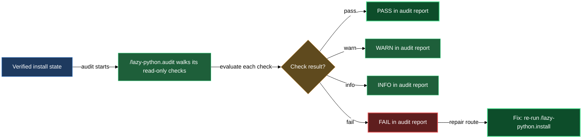

# Install and audit

Getting the lazycortex-python plugin working in a new repo is a two-verb operation: `/lazy-python.install` wires everything in, and `/lazy-python.audit` tells you whether it's all still healthy. Install is idempotent — you can re-run it after any plugin update without fear of overwriting your own work. Audit is read-only — it never changes anything, so it's safe to run at any time.

Both skills operate against one repository, so run them once per repo that adopts the plugin. Install resolves the repository root first: in an interactive run it is the git top level of your current directory (outside git it falls back to the current directory and warns you), and a headless run that is handed an explicit repo path uses exactly that path, never the directory it happens to run from.

## When you'd use this

- You've just enabled `lazycortex-python@lazycortex` in your `~/.claude/settings.json` and need to wire it into an existing Python project.
- You've updated the plugin from the marketplace and want to refresh the rule mirrors and wrapper scripts in a consumer repo.
- Something feels off — checks aren't running, `chk-py` is missing, or a rule file looks wrong — and you want a read-only diagnosis before you fix anything.
- You're onboarding a new machine or a new team member to a repo that already has the plugin and need to confirm all 14 invariants hold.
- Your expert jobs run in isolated git worktrees and `chk-py` / `tst-py` break there because the project venv is not reachable — install links it in, and audit Check 14 tells you when that link is missing.
- You're upgrading from a pre-2.0 install and need to know what changed in the `pyproject.toml` checker defaults.

## How it fits together

You start with `/lazy-python.install`. The install runs its steps in order, each targeting a different piece of the installation contract. Step 1 copies every plugin rule file (`lazy-python.style.md`, `lazy-python.docstrings.md`, `lazy-python.tests.md`, `lazy-python.failing-tests.md`) byte-identical into your project's `.claude/rules/` — these are plugin-managed mirrors that Claude Code loads automatically, and you must not hand-edit them: a mirror that differs from the shipped source is treated as stale and silently overwritten on the next install, so put your own content in your own rule file instead. A rule the plugin no longer ships is left in place; install never deletes your files, and it reports a per-rule receipt (installed, unchanged, or refreshed). Step 2 copies the `cfg-py`, `chk-py` and `tst-py` wrapper scripts verbatim into your `cli/` directory (`cfg-py` configures the project venv; `chk-py` and `tst-py` also configure it automatically when it is missing or stale), along with a small mypy plugin shim that lands at `cli/mypy/protected_access.py` (the protected-access check; your `pyproject.toml` references it by that relative path, and like the wrappers it is a plugin-managed mirror copied verbatim), and ensures `.venv/` is listed in your `.gitignore` (adding the line if absent). The wrappers are path-agnostic self-resolving scripts: they locate the active lazycortex-python plugin at exec time via Claude Code's install manifest, with dev-source and `$LAZYCORTEX_PLUGIN_DIRS` fallbacks — no absolute version-pinned path is baked in, and none is substituted into the wrapper at install time either, so the wrapper keeps working across the next `/plugin update` without a redeploy. The wrappers themselves carry no executable bit on purpose — a mode-blind git client (obsidian-git on Android, a Windows checkout) can strip a bit silently, so run them through the interpreter instead: `bash ./cli/cfg-py`, `bash ./cli/chk-py` and `bash ./cli/tst-py` from the repo root. Step 2b deploys the only files this plugin ever does mark executable — `~/.local/bin/cfg-py`, `~/.local/bin/chk-py` and `~/.local/bin/tst-py` — which live outside any repo, so no vault-sync client can touch their mode bit. Each walks up from your current directory to the nearest `cli/cfg-py` / `cli/chk-py` / `cli/tst-py` and runs it through `bash`, so typing bare `cfg-py` / `chk-py` / `tst-py` works from anywhere under a repo that ran Step 2, once `~/.local/bin` is on your `$PATH`. Install never edits your shell rc files; if `command -v chk-py` still fails after the step, it reports `path-warning` and leaves adding the directory to your `$PATH` to you. Step 3 probes for PyCharm's `inspect.sh`, and step 4 merges the seven always-on sections (`[tool.pcf]`, `[tool.toi]`, `[tool.pytest]`, `[tool.mypy]`, `[tool.protected_access]`, `[tool.pylint]`, `[tool.ruff]`) into your `pyproject.toml`: a section you don't have yet is appended whole, and a section you already have gets only the sub-keys the current template ships that yours is still missing spliced in — every sub-key you've already set stays untouched, so the merge is consumer-wins key-by-key, not just section-by-section. If your `[tool.mypy]` already has a `plugins` list, the merge appends `cli/mypy/protected_access.py` after your own entries. An edit it cannot make safely (a section without its own header line, a `plugins` value that is not a list, or a change that would not parse back to valid TOML) is not applied; install prints a `manual-edit:` line saying what to change by hand and relays it in its report. `[tool.protected_access]` carries the protected-access plugin's `exempt_paths` globs (by default every file under a directory named `tests`), which you can adjust in your own `pyproject.toml`. `[tool.pch]` for PyCharm offline inspections is added automatically when PyCharm is present and omitted otherwise — no prompt. Step 5 scaffolds four overlay stub files under `docs/guidelines/` with canonical `# Project additions to <topic>` headers; existing files are left alone. Step 6 runs core's `scaffold sync-plugin` verb against this plugin's own install location (asking you nothing), which copies both Python file templates — `python-template.py` for regular `**/*.py` files and `init-template.py` for `**/__init__.py` (the more specific glob wins, so a new package file gets the package-docstring skeleton and every other new file gets the plain one) — into `.claude/templates/python/` and upserts the matching entries in `lazy-core.scaffold.md` so new `.py` files start from the canonical skeleton; the verb's reply, one copy state per template plus the registry outcome, is quoted in install's report. Step 7 records `python.env_source` in `.claude/lazy.settings.json` when your repo ships a recognised bootstrap script (`cli/env`, `.env.sh`, or `scripts/env.sh`) — `chk-py` / `tst-py` source that script after the venv activates, so a repo that pulls secrets or provider credentials from its own wrapper keeps working under the plugin runners. Zero or one candidate script is handled silently; if more than one is found, install asks once which one to use and records your choice — that disambiguation, plus a direct contradiction in consumer-owned config, are the only two prompts this install ever raises. A value already on record is never re-asked or overwritten. Two closing steps wire up the plugin's dispatched agents: install seeds the `agent_models.lazycortex` group with the model tier for every subagent the plugin ships — core's `agent-models-seed` verb discovers them by a `lazycortex-python:` prefix filter over the shared tier source rather than a hardcoded list, so a new agent the plugin adds later is seeded without this step changing — then registers `lazy-python.code-reviewer` as an expert (`python.code-reviewer`) in `.claude/lazy.settings.json`. That registration never overwrites a field you've set yourself, but it does correct the entry's two install-managed fields (`agent`, `aspects`) if they're missing or have drifted from what the plugin ships — so an incomplete or stale entry from an older install self-heals on the next `/lazy-python.install` — while every other field, including anything you've set, is left exactly as recorded. The result is the same review dispatchable through the expert runtime as well as through `chk-py review`. The last step, Step 7.7, carries your project venv into job worktrees. A daemon job of an expert with `workspace: branch` runs in a fresh git worktree that holds only tracked files, so a gitignored venv inside your checkout would be missing there and `chk-py` / `tst-py` would break inside the job. Install resolves the venv the way the runners do (`[tool.lazy-python].venv` from `pyproject.toml`, else `<repo>/.venv`) and, when it lies inside the checkout, records its repo-relative path in the core setting `daemon.git.worktree_links` through core's `worktree-links-add` verb, so every job worktree carries it as a link. The receipt says `worktree-link-added`, or `worktree-link-already-present` on a re-run (the settings file is left untouched). A venv at an absolute path outside the checkout needs nothing (`worktree-link-not-needed`), because each worktree's own `pyproject.toml` already points at it. A relative venv path that climbs out of the checkout, such as `../venvs/proj`, cannot be linked: each worktree resolves it against its own root, and the link list carries no path outside the repository. Install reports that as a warning, and the fix is making `[tool.lazy-python].venv` an absolute path. If `pyproject.toml` does not parse, the step reports `worktree-link-failed` and writes nothing; and if `daemon.git.worktree_links` is not a list (or `daemon.git` is not an object), the verb answers with an error and writes nothing. The install never touches your `CLAUDE.md` — the plugin rules load from `.claude/rules/` regardless. The PostToolUse hook that runs `pcf.py` on every `.py` edit is not an install step; it auto-registers from the plugin's `hooks/hooks.json` manifest the moment the plugin is enabled.

Once the install completes, `/lazy-python.audit` is the instrument you reach for to verify the result. It walks all 14 invariants in order: Check 1 confirms the four mirrored rules are byte-identical to the plugin canon (a rule missing from `.claude/rules/` is `WARN`; a rule edited away from the canon is `FAIL`). Check 2 confirms every `${CLAUDE_PLUGIN_ROOT}/references/...` path cited from a mirrored rule resolves to an existing file. Check 3 confirms the plugin tree on disk carries every required artifact — the manifest and overview, four rules, six references, seven binaries, the PostToolUse hook script and its `hooks.json` manifest, the check-style skill, every agent under the plugin's `agents/` directory, and the templates (the `pyproject.toml` defaults, the `cfg-py` / `chk-py` / `tst-py` wrapper sources, the mypy protected-access shim source, `python-template.py`, `init-template.py`, and the scaffold manifest). Check 4 confirms all three wrappers (`cfg-py`, `chk-py`, `tst-py`) exist, open with a shebang line, and carry no unsubstituted placeholder; a missing wrapper is `WARN`, and an unsubstituted placeholder in a wrapper from a previous install is `FAIL` (a sign the install was interrupted before rendering completed). It no longer checks for an executable bit — the wrappers are invoked through the interpreter, not exec'd directly. Check 5 confirms the six always-on `pyproject.toml` checker sections are present (`pcf`, `toi`, `pytest`, `mypy`, `pylint`, `ruff`); `[tool.pch]` is optional (added only when PyCharm is present), so its absence is never a finding. Check 5 does not list `[tool.protected_access]`; the protected-access wiring is Check 13's job. Check 6 probes for `inspect.sh` (informational — its absence is always `WARN`, never `FAIL`). Check 7 confirms each of the four overlay files opens with the canonical header so writer agents can identify them. Check 8 confirms the scaffold registry entry for `python-template.py` is present in `lazy-core.scaffold.md`. Check 9 reports, informationally, whether a `lazy-python` pointer is in `CLAUDE.md` — never a finding, since install never writes one. Check 10 confirms the plugin ships a well-formed `hooks.json` declaring the PostToolUse hook. Check 11 probes the venv resolution chain (`$VIRTUAL_ENV` → `<repo>/.venv` → `[tool.lazy-python].venv` in pyproject → implicit fallback) and verifies that all four tools (`mypy`, `pylint`, `pytest`, `ruff`) plus the two pytest plugins (`pytest-clarity`, `pytest-sugar`) are available in whichever venv is found, or that the `uv`-driven fallback can bootstrap them on first `cfg-py` or `chk-py` run. The venv your repo targets (`[tool.lazy-python].venv`, else `<repo>/.venv`) must also be fresh: its `.lazy-python-cfg` stamp has to match a digest of the current `pyproject.toml` requirements (`requires-python`, dependencies, extras, dependency groups, `.python-version`, the tool list). A stale or stamp-less venv is a `WARN`; the repair is running `cfg-py` from an interactive session or console (it refuses in protected mode). Check 12 confirms a domain-groups dictionary exists once your sources carry `Domain(…)` blocks — the path is `.claude/lazy.settings.json[wiki.domains.dictionary]` when configured, else the conventional `docs/guidelines/domain-groups.md`. The style checker deliberately never reads the dictionary itself (it only matches the reserved `unfiled` literal), so marked sources with no dictionary would otherwise pass every checker while validating against nothing; this check catches that silently-unfiled state. Check 13 confirms the protected-access mypy plugin is wired: `[tool.mypy]` `plugins` in your `pyproject.toml` lists `cli/mypy/protected_access.py` (a comma-separated string of plugins counts as listing each entry, as mypy reads it), the shim file exists at that path, and its text matches the shipped template byte for byte. A missing entry, a missing file, or a stale shim is `WARN`; a `pyproject.toml` that is absent or not valid TOML is `FAIL`. Check 14 confirms job worktrees can reach your project venv. It only matters when an expert in `lazy.settings.json` has `workspace: branch`; with none, or with a venv at an absolute path outside the checkout, it passes. Otherwise, a venv inside the checkout must have its repo-relative path in `daemon.git.worktree_links`, or be named as a shell word of its own in `daemon.git.worktree_bootstrap_cmd` (a longer word such as `.venv-tools` does not count). The tracked settings file is read with its local overlay merged on top, the way the runtime merges them. A missing link is `WARN` and the repair is re-running `/lazy-python.install`, whose Step 7.7 lists the venv; a relative venv path that climbs out of the checkout is `WARN` and the fix is an absolute `[tool.lazy-python].venv`; a settings file or `pyproject.toml` that does not parse is `WARN` and is fixed by hand. Nothing is modified. None of the 14 checks inspects `python.env_source`, the `~/.local/bin/cfg-py` / `chk-py` / `tst-py` deployment, the agent-model tier seed, or the code-reviewer expert registration — those are install-time conveniences, not verified invariants. Each line of the final report carries that check's severity plus the repair route its own outcome names, and the report closes with an overall verdict — `audit: <PASS|WARN|FAIL> (<n> findings)` — followed by the counts `pass=<n> info=<n> warn=<n> fail=<n>`.

The connection between install and audit is intentionally simple for most of the 14 checks: the fix for any `FAIL` or `WARN` is to re-run install. Install is idempotent and always overwrites its own outputs, so a fresh run resets those checks to green. Check 13 follows the same pattern with one carve-out: if your `plugins` setting is a string that lacks the entry, or `tool` / `tool.mypy` is not a table, install cannot extend it safely, so the `WARN` names the edit to make by hand instead. Check 12 is the other exception — a `WARN` there means your sources marked knowledge but no dictionary exists to file it under, and install has no way to author that dictionary for you. The fix is `/lazy-python.knowledge-sweep`, which clusters the parked knowledge into candidate groups and writes the dictionary once you accept them.

## Common adjustments

**Bare `cfg-py` / `chk-py` / `tst-py` from anywhere.** `/lazy-python.install` Step 2b installs `~/.local/bin/cfg-py`, `~/.local/bin/chk-py` and `~/.local/bin/tst-py` — tiny finder wrappers that walk up from your current directory to the nearest `cli/cfg-py` / `cli/chk-py` / `cli/tst-py` and run it through `bash`. They're the only files this plugin ever marks executable, since `~/.local/bin` sits outside every vault and no mode-blind git client can strip their mode bit. If the bare command still isn't found after install, add `~/.local/bin` to your `$PATH` yourself — install reports `path-warning` in that case but never edits your shell rc files. Inside a repo where Step 2b hasn't run (or `~/.local/bin` isn't on `$PATH` yet), fall back to `bash ./cli/cfg-py` / `bash ./cli/chk-py` / `bash ./cli/tst-py` from the repo root; the `cli/` wrappers carry no exec bit on purpose.

**Updating after a plugin version bump.** Re-run `/lazy-python.install` in each repo. The rule mirrors, wrapper scripts, and scaffold templates are overwritten with the new plugin versions. A bare `/plugin update lazycortex-python@lazycortex` refreshes the plugin templates on disk but does not redeploy the `cli/` wrappers — only `/lazy-python.install` does that. Your `pyproject.toml` sections are preserved section-by-section and key-by-key: an already-present section is never overwritten, but if a version bump adds a new sub-key to one of the checker sections, the next install splices just that missing sub-key into your file — every sub-key you've already set stays exactly as you left it.

**Docstring sections and field names are now project-neutral (2.0 migration).** Earlier versions of `pcf` shipped built-in "Generation Rules" / "Value Ranges" docstring sections and a hardcoded `_field_filters` escape hatch for private-name tolerance. As of 2.0, `pcf` ships with no project-specific sections or names baked in — every project declares its own via `[tool.pcf]` in `pyproject.toml`: `extra_docstring_sections` (a repeatable `[[tool.pcf.extra_docstring_sections]]` table with `name`, `style`, `after`/`before` anchor, and optional `ref_exempt`) for custom docstring sections, `d2_exempt_marker_attrs` for the D2 private-attribute escape hatch, and `private_name_allowlist` for the D9 private-identifier allowlist. If your repo relied on the old built-in sections or `_field_filters`, re-run `/lazy-python.install` to get the current `pyproject-defaults.toml` template — it ships all three fields as commented-out examples in `[tool.pcf]` — then uncomment and adapt them to your project's own section names and field names. Step 4's merge only appends missing sections and sub-keys; it never removes or overwrites one you've already customised, so this migration is opt-in per repo.

**PyCharm inspections (pch).** The install probes for PyCharm's `inspect.sh` and adds `[tool.pch]` to `pyproject.toml` automatically when PyCharm is present — no prompt. On a machine without PyCharm the section is omitted (pch is meaningless there); the rest of the checker stack runs regardless. If you install PyCharm later, re-run `/lazy-python.install` — it skips sections already present and adds the missing `[tool.pch]` now that PyCharm is detected.

**Overlay guidelines.** After install, open the four stub files under `docs/guidelines/` and add your project-specific rules. Writer agents read canon first, then the overlay; the `# Project additions to <topic>` header must be preserved so agents recognise the file as an overlay rather than the canon. If audit's Check 7 reports `WARN` or `FAIL` on an overlay header, you can restore the header by hand — it's a single-line edit to the consumer file, and it's the one field the overlay check reads.

**PyCharm `inspect.sh` not found.** Check 6 and install Step 3 both probe for this script and report `WARN` when it's missing; the rest of the checker stack (`pcf`, `toi`, `mypy`, `pylint`, `ruff`, `pytest`) is unaffected. If you want `pch.py` to work, install PyCharm and ensure its `bin/inspect.sh` is on your `$PATH`.

**Venv.** Check 11 probes `$VIRTUAL_ENV`, then `<repo>/.venv`, then `[tool.lazy-python].venv` in `pyproject.toml`, then falls back to an implicit bootstrap via `uv`. If Check 11 reports `WARN` because a venv is missing some tools, or is stale against your `pyproject.toml` requirements (its `.lazy-python-cfg` stamp no longer matches, or is absent), run `cfg-py` from an interactive session or console — it refuses in protected mode — after installing `uv` if that is what's missing. `chk-py` and `tst-py` also reconfigure a missing or stale venv on their own. A `WARN` from Check 11 never blocks the rest of the checker stack.

**`python.env_source` disambiguation.** If your repo ships more than one recognised bootstrap script (`cli/env`, `.env.sh`, `scripts/env.sh`), `/lazy-python.install` asks once which one `chk-py` / `tst-py` should source after the venv activates, then records the choice as `python.env_source` in `.claude/lazy.settings.json` — this and a direct contradiction in consumer-owned config are the only two prompts install ever raises. A repo with zero or one candidate is handled silently and nothing is asked. Once a value is on record, re-running install never re-asks or overwrites it, and no audit check inspects the recorded value.

**New `.py` files start from the right skeleton.** Step 6 syncs two scaffold templates, not one: a plain `python-template.py` for regular files and a dedicated `init-template.py` for `**/__init__.py` (the package-docstring lives there now, not on every file). `lazy-core.scaffold` picks the more specific glob, so Claude starts a new `__init__.py` from the package skeleton and everything else from the plain one automatically — nothing to configure.

**Code-reviewer model tier and expert registration.** Install seeds the `agent_models.lazycortex` tier group with the model tier for every subagent the plugin ships, discovered by a `lazycortex-python:` prefix filter over the shared tier source rather than a hardcoded list — a new agent the plugin adds later is seeded automatically, with no change needed to install itself. It also registers `lazy-python.code-reviewer` as the `python.code-reviewer` expert in `.claude/lazy.settings.json`. The tier seed stays purely additive. The expert registration is additive on first run, but on a later run it also corrects the entry's two install-managed fields (`agent`, `aspects`) if they're missing or have drifted from what the plugin currently ships — an entry left incomplete or stale by an older install heals itself, while any field you've set yourself, such as `git_author`, is left untouched. Neither is checked by audit; if you need to reset either, re-run `/lazy-python.install`, which re-derives them from the plugin's shipped defaults.

**Domain-groups dictionary (Check 12).** Once you start marking domain knowledge in your sources with `Domain(…)` blocks, a dictionary has to exist to validate the group names against — otherwise every block sits under the reserved `unfiled` group and nothing catches a typo'd or made-up group name. Install does not create this dictionary — it has no way to know what groups your project actually needs. If audit's Check 12 reports `WARN`, run `/lazy-python.knowledge-sweep`: it clusters the parked `Domain(unfiled)` knowledge into candidate groups, writes the ones you accept into the dictionary (`.claude/lazy.settings.json[wiki.domains.dictionary]` when configured, else `docs/guidelines/domain-groups.md`), then sweeps the sources so every block lands under a real group.

**Protected-access mypy plugin (Check 13).** Install deploys the shim to `cli/mypy/protected_access.py` and adds it to `[tool.mypy]` `plugins` in your `pyproject.toml`. If Check 13 reports `WARN` because the entry or file is missing, or the shim is stale after a plugin update, re-run `/lazy-python.install`; it overwrites the shim from the shipped copy and appends the entry after your own plugins. Do not hand-edit the shim, since a differing copy is treated as stale. When your `plugins` value is a string without the entry, or `tool` / `tool.mypy` is not a table, install prints a `manual-edit:` line and Check 13 names the same edit; make that one change yourself, then re-run audit.

**Job worktrees and the venv (Check 14).** If you run experts with `workspace: branch`, each job gets a fresh worktree with tracked files only, so a gitignored in-checkout venv is absent there. Install Step 7.7 lists it in `daemon.git.worktree_links` for you; if Check 14 reports `WARN`, re-run `/lazy-python.install`. When the venv is a relative path outside the checkout, make `[tool.lazy-python].venv` an absolute path instead, since a worktree resolves a relative path against its own root. You do not edit the link list by hand: install writes it through core's `worktree-links-add` verb.

**Plugin not found.** If install aborts with a "plugin source not found" message, `${CLAUDE_PLUGIN_ROOT}` is unset or points at an incomplete tree. Confirm the plugin is enabled in `~/.claude/settings.json` and restart Claude Code, then re-run.

## How install and audit relate

### Install steps

```mermaid
%%{init: {'themeVariables':{'background':'transparent','lineColor':'#000','textColor':'#000','edgeLabelBackground':'#fff'},'themeCSS':'.edgeLabel{background-color:transparent!important}.edgeLabel p{background-color:transparent!important}','flowchart':{'diagramPadding':5,'useMaxWidth':true}}}%%
flowchart LR
  userInvokesInstall["User invokes /lazy-python.install"]
  mirrorRules["Mirror rules"]
  deployWrappers["Deploy wrappers"]
  detectPycharm{"PyCharm present?"}
  bootstrapPyproject["Bootstrap pyproject"]
  scaffoldOverlays["Scaffold overlays"]
  syncScaffoldTemplates["Sync scaffold templates: python-template.py for regular files, init-template.py for __init__.py"]
  recordEnvSource{"Record python.env_source: multiple candidate bootstrap scripts?"}
  disambiguateScripts["Disambiguate candidate bootstrap scripts"]
  venvLocation{"Project venv inside checkout?"}
  worktreeLinksAdd["worktree-links-add adds repo-relative venv path to daemon.git.worktree_links"]
  installedState["Verified installed-state artifacts"]

  userInvokesInstall -->|start| mirrorRules
  mirrorRules -->|next| deployWrappers
  deployWrappers -->|next| detectPycharm
  detectPycharm -->|yes, pch auto| bootstrapPyproject
  detectPycharm -->|no| bootstrapPyproject
  bootstrapPyproject -->|next| scaffoldOverlays
  scaffoldOverlays -->|next| syncScaffoldTemplates
  syncScaffoldTemplates -->|next| recordEnvSource
  recordEnvSource -->|multiple| disambiguateScripts
  recordEnvSource -->|single| venvLocation
  disambiguateScripts -->|script chosen| venvLocation
  venvLocation -->|inside checkout| worktreeLinksAdd
  venvLocation -->|absolute path outside checkout, no link needed| installedState
  worktreeLinksAdd -->|link recorded| installedState

  classDef entry fill:#1e3a5f,stroke:#4a90e2,color:#fff
  classDef guard fill:#5f4a1e,stroke:#e2a14a,color:#fff
  classDef action fill:#1e5f3a,stroke:#4ae290,color:#fff
  classDef success fill:#0d4d2a,stroke:#4ae290,color:#fff,stroke-width:2px
  class userInvokesInstall entry
  class detectPycharm guard
  class recordEnvSource guard
  class venvLocation guard
  class mirrorRules action
  class deployWrappers action
  class bootstrapPyproject action
  class scaffoldOverlays action
  class syncScaffoldTemplates action
  class disambiguateScripts action
  class worktreeLinksAdd action
  class installedState success
```

### Audit and repair

## See also

- **discipline** — the four rules and the reference guidelines that install puts in place and audit verifies.
- **checkers** — the `cfg-py`, `chk-py` and `tst-py` wrappers that Step 2 deploys, and the `python.env_source` script they source after the venv activates.
- **agents** — the four dispatched/manual review members, including `lazy-python.code-reviewer`, whose model tier and expert registration install now seeds and self-heals.
- **hook** — the PostToolUse hook that auto-registers from the plugin manifest; audit Check 10 verifies its manifest is well-formed.
