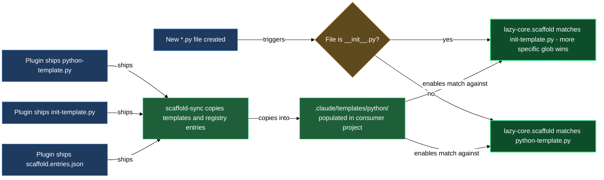

# Python file scaffold

Every Python file Claude composes starts from the same canonical skeleton rather than from the model's session memory. The scaffold block ships two template files and a manifest that `/lazy-python.install` copies into your project during Step 6 and registers with `lazy-core.scaffold`. From that point on, any new `*.py` file Claude creates begins from the project-local copy of the matching template — a regular module gets the correct import order and `TYPE_CHECKING` guard, with the module-docstring slot left open for a file that defines no classes, while a new `__init__.py` gets the package-docstring shape instead. The scaffold rule always picks the more specific template when both globs could match.

## What's in this block

**`python-template.py`** is the canonical module skeleton for regular source files. It encodes the conventions from `lazy-python.coding-guidelines.md` sections "Module Structure" and "Import Organization" directly into a starting shape: a `from __future__ import annotations` declaration, the import blocks in canonical order (typing, stdlib, third-party, local project, and the `TYPE_CHECKING`-guarded block for deferred annotations), a comment slot for module-level constants and TypeVars, and a separator-commented example class stub. The authoring note at the top states the template's own shape: a file that defines classes opens without a module docstring because each class documents itself, while a file that defines none — a CLI entry point, a worker script — may open with one in the same spot; `__init__.py` always carries one, scaffolded separately from `init-template.py`. That note is stricter than the canon, which requires a module docstring in `__init__.py` and permits one in any other module — and per the canon's own rule that scaffold templates may lag the guides and lose on conflict, the guideline wins where the two disagree. The same note instructs Claude to replace all placeholder markers and strip the scaffolding comment before adding real content.

**`init-template.py`** is the dedicated skeleton for `__init__.py` files. It encodes the canon's `__init__.py` File Patterns section: a module-level package docstring with a one-sentence summary and an optional one-to-three-sentence description of the package's role and member pattern, followed by `from __future__ import annotations` and the `from .submodule import *` wildcard-export pattern that must lead the import block. The authoring note inside the template tells Claude to replace the placeholders, omit empty sections entirely, and remove the note itself. It also states that the package docstring never enumerates the package's submodules, subpackages, or classes by name — the import chain is the inventory — and that a docstring is required in `__init__.py` but optional in other modules, so a regular source file that defines classes still scaffolds from `python-template.py` without one.

**`scaffold.entries.json`** is the manifest that tells the sync exactly what to install and how. It declares two entries under a `templates` key: `.claude/templates/python/python-template.py` mapped to the glob `**/*.py`, and `.claude/templates/python/init-template.py` mapped to the more specific glob `**/__init__.py`. When `/lazy-python.install` Step 6 runs the core `scaffold sync-plugin` verb, the sync reads this manifest, copies both templates to their consumer-local paths, and upserts a `lazycortex-python` registry key in the project's `lazy-core.scaffold.md` rule — so the scaffold rule fires on every new `.py` file you compose and resolves to the right template.

## How they work together

The three members are a template-pair-and-manifest set that do nothing in isolation inside the plugin but become active once they land in your project. When you run `/lazy-python.install`, Step 6 runs the core `scaffold sync-plugin` verb with the plugin's resolved install path and detected scope, asking you nothing. The sync reads `scaffold.entries.json` to discover what to install, copies `python-template.py` and `init-template.py` into `.claude/templates/python/` in your project, and upserts the glob-to-template mapping in your local `lazy-core.scaffold.md` rule under the `lazycortex-python` key. The `_local` key and any existing `lazycortex-core` key in your scaffold rule stay byte-for-byte unchanged — the upsert is surgical.

After the install, the scaffold rule is live and matches on two globs at once. The next time Claude composes any new `.py` file in your project, `lazy-core.scaffold` checks the filename first: an `__init__.py` matches the more specific `**/__init__.py` glob and starts from `init-template.py`, picking up the package-docstring shape; every other new `.py` file matches the broader `**/*.py` glob and starts from `python-template.py`. Either way the import order, the `from __future__ import annotations` line, and the file's canonical shape are in place before a single line of real code is written. Claude's task becomes filling in the blanks rather than reconstructing conventions from memory.

Both templates are install-managed mirrors, not consumer-owned config: the plugin owns their bytes end to end. If the plugin updates a template, re-running `/lazy-python.install` runs Step 6 again, and the sync byte-compares your consumer-local copy against the shipped source — `unchanged` when they match, `refreshed` when it overwrites a stale copy (a first copy reports `installed`). Install prints one line per template with its state, then the registry outcome (`registered`, `unchanged`, `created-and-registered`, `none`, `collision`, or `error`). Besides `installed`, `unchanged` and `refreshed`, a template can report `protected` or `failed`; `failed` means the write did not verify on re-read, and the sync exits non-zero and names the template, so re-run the install after fixing whatever blocked the write. The install report always carries the sync's own reply — a sync line with no registry outcome behind it means the step did not complete. There is no merge step and no preserved local edit; a copy that differs from the shipped source is treated as stale, not as a customisation, and is overwritten silently.

## Common adjustments

Do not hand-edit `.claude/templates/python/python-template.py` or `init-template.py` directly expecting the change to stick — as install-managed mirrors, both are overwritten the next time `/lazy-python.install` runs and finds them diverged from the shipped source. If you want different starting content, author your own template file and register it under the `_local` key in your project's `lazy-core.scaffold.md` instead: a `_local` entry wins over the plugin's `lazycortex-python` entry at equal glob specificity, and the sync never touches `_local` entries on any re-run. Use this to add project-specific header comments, swap the example class for a base class from your own codebase, or adjust the package-docstring shape `init-template.py` expects.

The globs the scaffold rule registers are intentionally broad (`**/*.py` and `**/__init__.py`). If you want a template applied only in a subtree (e.g. `src/**/*.py`), adjust the corresponding glob in your project's `lazy-core.scaffold.md` under the `lazycortex-python` key after install. That key is yours once written; subsequent sync runs will not overwrite it unless you explicitly re-run the sync.

## Where this fits

The templates cover only the starting shape of a file. The rules behind that shape live in the plugin's guideline canon, and your project's own deltas to it live in the overlay stubs that `/lazy-python.install` Step 5 creates under `docs/guidelines/python/` (`coding_guidelines.md`, `documenting_guidelines.md`, `testing_guidelines.md`, `checking_guidelines.md`). The overlay is read after the canon and wins on conflict, and an existing overlay file is never touched by a re-run. Both templates and the overlay are written by the same install run, but they are separate mechanisms: the templates are install-managed mirrors that get overwritten, while the overlay files are yours. When a template and a guideline disagree, the guideline wins.

## How the templates reach your project

