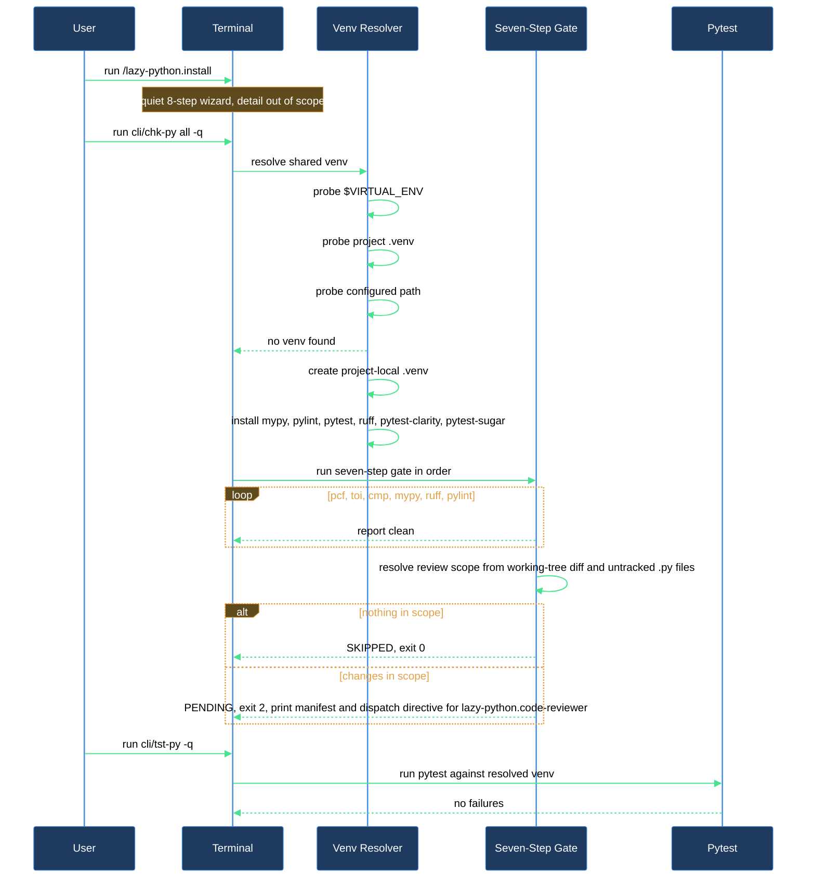

# Bootstrap the plugin in a clean repo and confirm the checker stack is wired up

This walkthrough is for anyone enabling `lazycortex-python` in a repo for the first time and wanting proof — not just an install report — that the checker stack actually works: the project-local venv builds, and the aggregator wrappers run clean end to end.

## Outcome

After this walkthrough you have:

- The plugin installed — the four rule mirrors in `.claude/rules/` (style, docstrings, tests, and failing-tests, which tells Claude to judge a failing test before touching either side and never to edit or exclude a test without your explicit yes), `cli/cfg-py` / `cli/chk-py` / `cli/tst-py` wrappers plus the mypy plugin shim at `cli/mypy/protected_access.py` (no exec bit required — the wrappers launch through `bash`), matching human-facing `~/.local/bin/cfg-py` / `chk-py` / `tst-py` copies, bootstrapped `pyproject.toml` sections, and overlay stubs all in place (see the **install-and-audit** block article for the full wizard).
- A project-local `.venv` at the repo root, configured from your `pyproject.toml`: an interpreter that satisfies `requires-python` (or `.python-version`), your project dependencies, extras and dependency groups, plus the checker tools `mypy`, `pylint`, `pytest`, `ruff`, `pytest-clarity`, and `pytest-sugar`. It is built automatically the first time you invoke either `chk-py` or `tst-py`, or on demand with `cfg-py`.
- A completed `chk-py all -q` run reporting all six deterministic steps clean — `pcf`, `toi`, `cmp`, `mypy`, `ruff`, `pylint` — and a completed `tst-py -q` run confirming the same venv's pytest works.
- Confidence that the venv resolver and the six-step gate are correctly wired before you start relying on them for real edits.

## What you need

- `lazycortex-core` installed and enabled in Claude Code (this plugin layers on its runtime).
- `lazycortex-python@lazycortex` installed and enabled — `enabledPlugins` in your `~/.claude/settings.json`.
- Python 3.12+ reachable on `$PATH`, and `uv` on `$PATH` so the project venv can be created or updated (`brew install uv` on macOS).
- A terminal at the repo root — the wrappers run standalone once deployed, no Claude Code session required.

## The journey

### Step 1 — Install the plugin

```
/lazy-python.install
```

This is a quiet, mostly prompt-free install — the only two prompts it can ever raise are a genuine file-sync conflict and, when your repo ships more than one recognised environment-bootstrap script, a one-time choice of which one `python.env_source` should record. The full step-by-step breakdown — rule mirroring, wrapper and mypy-shim deployment, the `~/.local/bin/cfg-py` / `chk-py` / `tst-py` human-facing copies, the PyCharm `pch` probe, `pyproject.toml` bootstrapping, overlay scaffolding, scaffold-template sync, `env_source` detection, and the closing agent-model-tier and code-reviewer-expert registration — is covered in the **install-and-audit** block article, not here.

**Verification gate**: the install ends with a one-line-per-step report. Confirm every line shows an outcome word (`installed`, `wrappers-deployed-4 + gitignore-ensured`, `pyproject-bootstrapped + pch-skipped-no-pycharm`, etc.) with no `ERROR`. Once that report is clean, `cli/cfg-py`, `cli/chk-py` and `cli/tst-py` exist at the repo root — run through `bash`, no exec bit needed, so a mode-blind sync client can never break them — and `~/.local/bin/cfg-py` / `chk-py` / `tst-py` are installed alongside them, so a bare `cfg-py` / `chk-py` / `tst-py` works from anywhere under the repo once `~/.local/bin` is on your `$PATH` (the install report calls out a `path-warning` if it isn't).

### Step 2 — Run the six-step gate and let it build the venv

From a plain terminal at the repo root:

```
bash ./cli/chk-py all -q
```

`chk-py` is the rendered wrapper around the plugin's shared `chk` aggregator, launched through `bash` — the tracked copy carries no exec bit on purpose, so it keeps working even after a git client that resets file modes to `100644`. If `~/.local/bin` is on your `$PATH` (Step 1's install put the human-facing copy there), the same run is just `chk-py all -q` typed from anywhere under the repo. `all` runs six deterministic checks in order — `pcf` (code format; pytest test files are exempt from its assert and magic-literal checks by default, and a `# waiver:` comment is honoured), `toi` (type-only imports), `cmp` (`py_compile` syntax check), `mypy`, `ruff`, and `pylint` — against `.` by default. Before the first check runs, the shared venv resolver looks for a usable venv in this order: an already-activated `$VIRTUAL_ENV` that carries the checker tools (used as is — nothing is installed into it), then the target venv — the `[tool.lazy-python] venv` path from `pyproject.toml` when set, otherwise `<repo>/.venv`. The target venv counts as ready only when it carries the checker tools and its configuration stamp still matches your `pyproject.toml` requirements; editing an unrelated section such as `[tool.ruff]` does not make it stale. On a freshly installed repo it does not exist yet, so the resolver configures it from `pyproject.toml`: `uv` picks an interpreter that satisfies `requires-python` / `.python-version`, then installs your project dependencies, every extra and dependency group, and the checker tools `mypy`, `pylint`, `pytest`, `ruff`, `pytest-clarity`, and `pytest-sugar`. A later run on a venv that went missing or stale is configured the same way — recreated if its interpreter no longer satisfies the project's Python requirement, otherwise updated in place.

The automatic configure has two opt-outs. In protected mode (`LAZYCORTEX_PROTECTED` set) nothing is installed and the run stops, telling you to run `cfg-py` from an interactive session instead. With `bootstrap-fallback = false` under `[tool.lazy-python]` the run also stops and points you at `cfg-py`. Either way, `bash ./cli/cfg-py` creates or updates the venv on request, without running any check.

The guideline-review phase (`chk-py review`) is deliberately **not** part of this run. It used to be the seventh step of `all`, but it now runs on its own cadence — recommended at the end of a logical unit of work, mandatory at the end of a full cycle of planned work — so its fixed per-dispatch cost (the whole guideline canon, every time) is paid once per unit of work rather than once per `chk-py all` invocation. It is pure stdlib and skips the venv entirely, so it also works from pre-commit and CI. See "After you're done" below for how to run it.

**Verification gate**: expect this run to take longer the first time (venv creation plus installing your project's dependencies and the checker tools — a repo with heavy dependencies takes more than the roughly 30–60 seconds a bare project needs); every later run reuses the venv and is fast. The output prints `>>> [N/6] <step> - ...` for each of the six steps. On a clean tree you should see all six report success with no `ERROR`, no `py_compile errors detected`, and no violation lines. If any check reports findings, those are real issues against your existing code, not an install problem — work through them (or point `bash ./cli/chk-py all -q <path>` at a single known-clean file first to confirm the plumbing) before treating the checker stack as verified.

### Step 3 — Confirm the shared venv also serves pytest

```
bash ./cli/tst-py -q
```

`tst-py` uses the same venv resolver as `chk-py`, so it activates the venv the previous step built or reused (and would configure it the same way if it were missing or stale), then runs `pytest -q` across everything under `tests/` (a bare `tst-py` and `tst-py all` are the same whole-suite run; `tst-py <module>` scopes to `tests/<module>/`). It also loads a small dedup plugin so a test collected twice through re-export shims runs only once. Because Step 2 already installed `pytest` (plus the `pytest-clarity` and `pytest-sugar` plugins) into `<repo>/.venv`, this step should activate instantly with no new installs. Same as Step 2, a bare `tst-py -q` works instead once `~/.local/bin` is on your `$PATH`.

**Verification gate**: on a repo with no `tests/` directory yet, `tst-py` refuses up front with a "does not exist" message instead of handing pytest a missing path — that is expected on a fresh repo and not a venv problem; create a `tests/` directory (or add your first test) and re-run. The same refusal fires for `tst-py <module>` when `tests/<module>/` is missing, and it lists the modules that do exist. On a repo with existing tests, confirm the run completes with `0 failed` (whatever the passed/skipped counts happen to be). Either outcome confirms the venv resolver and the pytest wiring both work. If a test does fail on a repo with existing tests, the failing-tests rule installed in Step 1 applies: the failure is judged first, and no test is edited or excluded from the run without your explicit yes. A hard error here (e.g. `pytest: command not found`) means the venv from Step 2 didn't build correctly and is worth re-running `bash ./cli/chk-py all -q` to diagnose before moving on.

## After you're done

`bash ./cli/chk-py all -q` (or bare `chk-py all -q` once `~/.local/bin` is on `$PATH`) is the routine gate to run before committing any real edit — it stays fast because it never touches the guideline-review phase. `bash ./cli/tst-py -q` (or `tst-py <module> -q` to scope to one `tests/<module>/` directory) is the routine test pass once you have tests to run.

`chk-py review` is the separate guideline-review pass — run it at the end of a logical piece of work, and mandatorily at the end of a full cycle of planned work. It resolves its scope from the working-tree diff plus any untracked `.py` files (or `chk-py review --base <ref>` to widen the scope to everything since a given commit, so a unit of work with intermediate commits gets reviewed as a whole rather than just its tail), builds a manifest of every applicable guideline layer, and prints a dispatch directive naming the `lazy-python.code-reviewer` agent — it never calls an LLM itself, so it also works unattended from pre-commit and CI. A manifested-but-undecided review exits `2` (`PENDING`): dispatch the named agent against the printed manifest and render its findings with `chk-py review --render <findings.json>` to close it.

The venv you built in Step 2 persists at the repo root and is reused by every future `chk-py` / `tst-py` run — it is reconfigured only when it goes missing or stale — after you change the dependencies, extras, dependency groups, or Python requirement in `pyproject.toml` — and `bash ./cli/cfg-py` reconfigures it on demand. If you ever suspect the install itself has drifted (missing wrapper, stale rule mirror, broken venv resolution) rather than the checker findings themselves, `/lazy-python.audit` — covered in the install-and-audit block article — is the read-only diagnostic to reach for before re-running install.

## Install-and-first-check flow


