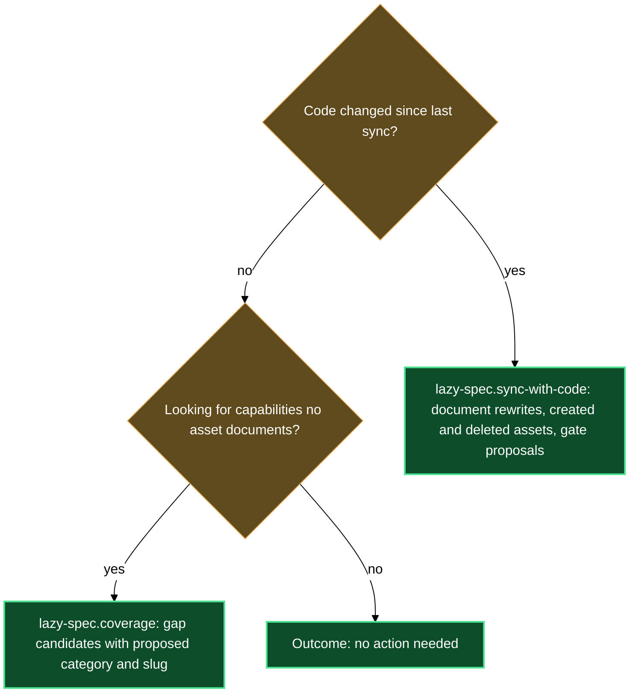

# Keeping specs aligned with source code

Specs drift from code as soon as the first commit lands without a corresponding update — and some capabilities never get a spec at all. The code-sync block gives you two targeted tools: one that brings the spec tree back in line with the code, and one for finding capabilities the spec tree never picked up in the first place. Together they prevent the documentation-decay loop where a document silently describes behavior the product no longer has, spec gates stall because nobody noticed the code already shipped, and whole features sit undocumented because nothing ever prompted a retro-spec.

Both skills require a code-bound product — a product with a `source` binding in `lazy.settings.json[products]`, naming the paths of this repository its code lives under. On a design-only product (specs ahead of code, no source paths), they no-op until you add its source paths via `/lazy-spec.product-config`.

## What's in this block

**`/lazy-spec.sync-with-code`** is the skill that makes the spec tree match the code. The code is the truth: whatever an authored document says that the code no longer does is rewritten, whatever the code does that no document says is written down, a code unit no asset covers gets an asset, and an asset whose code is gone is deleted. You can aim it at three scopes: with no argument it covers the whole tree (every product that carries a `source` binding); with a product key, or a source path under one, it covers that product and every product nested under it; with an asset (a status folder-note path, an asset directory, or a product plus a product-relative path) it reconciles that one asset against its owning product's code. Pass `--full` to compare every document in scope with the current code instead of only what recent commits touched; a product with no sync checkpoint yet always runs full.

For each product it finds the last-synced commit and lists every commit since then that touched the product's configured source paths — following the source tree through renames, so commits made before it was moved into those paths are not lost. Read-only agents then compare the product's documents with the code and report what drifted, what the code does that no document describes, what code no asset covers, which assets describe code that is gone, and which recorded decisions the code abandoned. The documents covered are the vision, design, architecture, use-cases and ui-design documents, the product `tech.md`, each status folder-note's one-line summary, and `decisions.md`. Writers then edit the affected sections in place, in the language each document is already written in, and add a line to the document's History section. A fact goes into the document at its own height: what an asset does into that asset's documents, what the product does as a whole into the product's, and the stack, versions and platforms into `tech.md` — which never receives architecture narrative. Source links appear only in `tech.md`, as root links to files.

Beyond rewriting, a sync run:

- **Refreshes diagrams, never adds them.** Only a diagram whose own heading was just rewritten is redrawn; a rewritten section with no diagram gets none.
- **Creates assets for uncovered code.** Each feature-sized unit of code that no asset describes is scaffolded as a new feature asset, with its documents authored from the code. You review the new folders in the run's diff rather than answering a question per candidate.
- **Deletes assets whose code is gone.** An asset none of whose described behavior exists in the code any more is removed; an asset with only part of its behavior gone is rewritten instead. A folder holding a nested asset that is not itself gone is reported, not deleted.
- **Marks abandoned decisions obsolete.** A recorded decision the code no longer follows is marked obsolete through the decisions registry — the record of what was chosen is never edited by hand.
- **Scaffolds missing folder-notes.** A folder with authored documents but no status folder-note gets one. If the asset type cannot be told from the folder, you are asked once.
- **Proposes gate and stage corrections.** When an open release's included assets objectively landed on the default branch and the release's plan gate already reads true, it proposes flipping the release's `spec_develop_done` (otherwise the release is reported as held at its plan gate). A design-only asset has no develop gate of its own: one whose code landed with no release carrying it is reported as implemented outside a release, for you to fold into the next one. A document whose stage is objectively wrong against the code gets a stage-correction proposal. Every change goes through `/lazy-spec.flip-gate` and `/lazy-spec.set-stage` after you confirm; the skill never edits gate frontmatter itself.
- **Runs the spec audit** at the end and reports its findings next to the diff, without fixing them.

An asset that holds an approved document is never touched silently. When the code disagrees with an approved asset, the skill asks once for the whole asset: `update` applies every finding for it and keeps each document's stage, `leave` skips the asset this run (a later `--full` run finds the same drift and asks again).

The same applies to an asset whose documents state a reviewed target design that the code has not reached yet — a recorded decision promoted from an approved design, which the code contradicts, together with the document sections that state the same design. The code may simply be behind a design someone reviewed, so the skill asks once per asset, whatever its stages read: `update` brings the asset in line with the code and marks its design records obsolete, `keep` leaves the asset untouched, lists it in the report as ahead of the code, and asks again on the next run that finds it. A reviewed design is never rewritten to match the code without your `update`.

Nothing a run wrote is committed until you have read the diff — rewrites, created and deleted assets, obsoleted decisions and the sync checkpoint alike — and said yes. A diff you reject is reverted path by path, checkpoint included, so the next sync sees the same window again.

**`/lazy-spec.coverage`** is the gap-scanner. Where sync keeps already-documented assets truthful, coverage looks for capabilities the code already has that no asset documents at all, and reports them for you to act on one by one. Run it with a product key when you want to know "what's missing from the specs" or "gap-scan this product against its code." It reads the code side from two existing knowledge maps — the project's structure map and its domain-group tree, each queried for a bounded slice, never swallowed whole — and the spec side from the product's existing asset folders, found by their status folder-notes. For the domain-group tree it takes only the groups the product's own source actually carries a domain block for, and reads each group's named mechanics and caller-visible contracts as capabilities the code already commits to; a group the code carries but the tree has not synced yet is noted as unsynced rather than silently dropped. It compares the two with judgment (a reworded but equivalent capability still counts as covered), then reports uncovered capabilities with a proposed asset type and slug: `feature` by default, `bug` when the evidence is a defect note rather than a capability, `change` when it is an increment on an already-documented asset. It is read-only by default: for each gap it asks one question, offering to materialize a retro-spec via `/lazy-spec.create-from-code` (only for `feature` gaps of a code-bound product), to print an `[!asset-proposal]` block you paste into a living doc yourself, or to skip; it never writes to the spec tree without you confirming each one, and a skipped gap leaves no trace and is reported again on the next run. On a product with neither a synced structure map nor a domain-group tree, it falls back to a shallow scan of the source tree's immediate subdirectories that carry their own entry point (a package init, an index file, a manifest, or a skill or agent file), so it still returns something rather than reporting nothing. When there is no code-side signal at all, it says so plainly and reports no gaps instead of a false "fully covered".

## How they work together

The two skills share the same code-bound product record and complement each other along the reactive/proactive line. `sync-with-code` is reactive — it translates commits landing into a spec update. `coverage` is proactive — it doesn't wait for an event; it periodically asks whether the spec tree is missing something the code has had all along, and lets you decide what to do about each gap. (`sync-with-code` also creates assets for uncovered code, without per-candidate questions; reach for `coverage` when you want to see and choose the gaps first.)

The canonical end-of-sprint rhythm is to run sync first, then periodically coverage. Run `/lazy-spec.sync-with-code <product>` to bring the sprint's changes into the documents (approve them by reading the diff before the commit) and advance any gate proposals grounded in the landed code. Run `/lazy-spec.coverage <product>` less often — after a stretch of code growth, or whenever you suspect the spec tree has fallen behind not just in staleness but in completeness.

You can also run either in isolation. Sync is for any moment source code has moved — mid-sprint, after a hotfix, after a revert. Coverage is for any moment you want a gap-scan rather than a truthfulness check — it never touches an existing asset's content, only proposes new ones.

**First sync.** A product with no sync checkpoint yet runs full: every document of the product is compared with the current code, whatever changed when. Once the run is committed, the checkpoint records HEAD and later runs only look at newer commits. An old checkpoint file left under the previous naming convention is renamed automatically on first read.

**Newly authored docs start parked.** When a sync run creates a document rather than editing one — a new asset's documents, for instance — it lands at `spec_stage: deferred`, a stage alongside `empty`, `draft`, `approved`, `rejected`, and `cancelled`. The sync run writes that stage and its `spec/deferred` tag itself, in the same still-uncommitted edit that creates the file, so the born-parked state is part of the diff you review. Nothing downstream (gates, the coordinator, another sync) reads a `deferred` doc until you move it to `draft` yourself with `/lazy-spec.set-stage <doc> draft`. A document the run only edits keeps whatever stage it already carried. This keeps a sync run from starting work on your behalf just because it noticed a gap.

**Syncing one asset instead of a whole product.** Pass an asset to `/lazy-spec.sync-with-code` and it reconciles just that asset's documents against the current code, with the owning product supplying the source binding and language. A bug asset is accepted too. An asset scope always runs full on its one asset and writes no checkpoint. Run it on demand before you trust an old design doc; `/lazy-spec.drive` and the spec coordinator can also use it as a pre-step.

**Nested products.** A product owns its spec subtree minus every nested product's subtree; each nested product is its own unit of work, so no document is reconciled twice.

**After sync, review the audit output.** `sync-with-code` runs `/lazy-spec.audit` at the end of each run and reports findings without auto-fixing. Review them as a follow-up step before you allow the commit.

**Coverage needs a code-bound product too.** A design-only product has no code side to gap-scan — `coverage` reports "no code binding — nothing to gap-scan" and stops. Add its source paths via `/lazy-spec.product-config` first if the product does have code behind it. This also applies to a nested product: coverage reads its visible asset types from its ancestor products, but a source binding is never inherited — a nested product needs source paths of its own to be code-bound, even when its parent already has them.

## Where this fits

The gates block provides the `/lazy-spec.flip-gate` and `/lazy-spec.set-stage` primitives that `sync-with-code` calls when they propose gate flips and stage corrections — code-sync surfaces the proposals; gates block skills execute the mutations.

The source-links block provides the root-link primitive `sync-with-code` relies on. Every source link produced during sync goes through `/lazy-spec.source-url` — a root link to a file, never to a folder.

`coverage`'s code-side signal comes from the project's structure map and domain-group tree (maintained outside this plugin) — when neither is configured, it still runs on a shallower fallback scan, but a richer map produces sharper gap candidates. When it does propose a retro-spec, materializing it through `/lazy-spec.create-from-code` reuses the authoring block's own scaffolding — coverage never writes an asset directly.

The **asset-to-release** walkthrough traces the full journey from asset creation through sync, finalize, and release — the code-sync block is the spine of that journey.

## How the two skills relate

