# Gates — driving asset readiness from design to release

Every spec asset tracks its progress at two levels that reinforce each other. Individual authored docs carry a `spec_stage` — the per-file readiness signal: an asset's `use-cases.md`, `design.md`, `ui-design.md`, `test-plan.md` or `bug.md`, a product's `tech.md` and `architecture.md`, and a release's `code-plan.md` and `test-plan.md`. The asset's status folder-note carries the gate booleans — the overall progression ladder. Every asset but a release is design-only: its note carries `spec_design_done`, `spec_released` and the `spec_cancelled` overlay, and nothing else. Only a release note (`releases/NNN/`) carries all six gates, `spec_design_done`, `spec_plan_done`, `spec_develop_done`, `spec_tests_passing`, `spec_built` and `spec_released`, because implementation, plans and tests happen in a release and nowhere else. This block's three members work together across both levels: `/lazy-spec.set-stage` is the sole writer of per-file stages, and `/lazy-spec.flip-gate` is the sole writer of gate booleans. `lazy-spec.gate-tick` decides neither; it is a background poller that only clears a finished expert job's marker and structurally checks the folder-note. Rebasing branch pins and proposing the release gate after a merge moved to the `code-sync` block — see "See also" below.

When an asset's start document (`design.md`, or a bug's `bug.md`) is approved in the review loop, `spec_design_done` closes without you flipping anything by hand — the decision belongs to `spec.coordinator`, the LLM persona woken directly by the doc's own approval commit (as well as by a commit that changes the asset's folder-note). It reads the readiness rules this block describes, then calls `/lazy-spec.flip-gate` itself. From there the asset waits for a release: the release that carries it sets its `spec_released` when you tick `Publish`. A release note's own middle gates close on its build — plan done once the build's architecture revision and the release's plans are settled, develop done on an accepted `code-report.md` and a merged build, tests passing on an accepted green `test-report.md`, built once the build has merged — and its `spec_released` closes by itself after that. The coordinator narrates where things stand in the folder-note's `# Status brief`. You never modify gate frontmatter by hand — you flip it yourself via `/lazy-spec.flip-gate`, or let the coordinator flip it once it has the signal.

**Where the coordinator actually runs.** The daemon that dispatches `spec.coordinator` runs in its own checkout — commonly a separate clone from the one you edit in Obsidian. Nothing you do reaches it until you commit AND push; nothing it decides reaches you until its own commit is pushed and you (or your vault's sync) pull. So "a commit wakes the coordinator" really means: you tick or edit → you commit and push → the daemon's own checkout pulls that commit in on its next iteration → the coordinator wakes, decides, and commits its own answer → the daemon pushes that commit → you pull it back. There is no faster path and no shared working tree.

## When you'd use this

- Marking a spec doc as in-progress, under review, or accepted as you author it.
- Checking why a gate has not advanced and manually flipping it once the prerequisite is met.
- Understanding what the background worker has already done — which stages it promoted, which gates it flipped, which callouts it dropped — after returning from a review session.
- Regressing a release's gate when its deploy is rolled back or its test suite breaks (`/lazy-spec.flip-gate --off`).
- Cancelling an optional doc (`tech.md`, `test-plan.md`, `use-cases.md`, `ui-design.md`, or a release's `code-plan.md`) when an asset needs no dedicated test cases, a release needs no separate plan, or an asset's behavior/interface is settled enough to skip a dedicated requirements or screens pass.
- Reading a `[!warning] Conflict with …` callout in the `## Conflicts` group of `# Gates` — the coherence check found two approved documents that contradict each other — and choosing `Resolve here` or `Not a conflict`.

## How it fits together

You reach for `/lazy-spec.set-stage` whenever you want to record a conscious authoring decision on a single doc: moving it from `empty` to `draft` when you start writing, or from `draft` to `approved` manually before the review machinery has run. You pass it one file path and one stage value from the closed set `empty | draft | approved | rejected | cancelled | deferred`. Add `--restamp` to `approved` when a document already at `approved` has been approved again in review: it rewrites `spec_approved_at` so the stamp records the re-approval and the coherence check that follows sees it (the coordinators pass it themselves; the flag is refused with any other stage). The skill rewrites `spec_stage` in frontmatter, keeps the `spec/<stage>` Obsidian tag in sync, and on `approved` stamps `spec_approved_at` (an ISO 8601 UTC datetime) on the doc itself; nothing is written to the folder-note. You never need to touch `spec_stage` or the mirror tag directly — the skill does both in a single edit and refuses any value outside the closed set, including the removed `review`, `done`, and `wtr` stages from older plugin versions. `deferred` is the park: a document you want to keep but not work on right now. Nothing automatic acts on a parked document — an approval landing on it moves nothing, no gate closes on it, nothing edits it, and no checkbox offers to write a replacement beside it. The coordinator still notices your commit and keeps the folder note tidy around it. What you get instead is a `Review <doc>` row on the folder note; ticking it unparks the document back to `draft` and reopens its review in one move. `draft` brings it back, whether you tick that row or run `/lazy-spec.set-stage <doc> draft` yourself; `/lazy-spec.set-stage <doc> cancelled` is the other way out, abandoning the parked document where it sits. Those are the only two exits: asking for `approved`, `rejected`, or `empty` on a parked document is refused rather than silently honoured, so unpark it with `draft` first. When the asset sits inside a group folder that has a container note (e.g. `bugs/bugs.md`), the same commit refreshes that note's stats summary so the bucket counts stay accurate — and because a group folder is transparent to the tally, the refresh climbs through every such shelf above it up to and including the product note, so a nested group folder's own note and the product's both stay current from one stage move. You never re-run a separate rollup step. An asset sitting straight at the product root refreshes the product's own note directly, since that note's stats region counts the product's children. Only the catalog root's own note is never refreshed from below. Approving a living doc — `use-cases.md`, `design.md`, `architecture.md`, `ui-design.md`, or `tech.md`, any type declared `stages: true` and `append_only: false` — also promotes its `[!decision]` blocks into the decisions registry via `lazy-spec.record-decision`, in the same commit; a refusal there (the asset is cancelled, halted, or released) is reported back to you rather than worked around, and `code-plan.md` / `test-plan.md` never trigger this since they aren't living docs. Before any of that runs, approving a doc whose body still carries a `[!decision-candidate]` callout — ticked or not, anywhere outside a code fence — is refused outright: fold the callout through the document's own review loop first, since deleting it by hand only hides the marker rather than resolving it.

A stage change on a system-level doc — `vision.md`, `design.md`, or `tech.md` sitting loose at a product root or at the vault's own content root, or `use-cases.md` / `ui-design.md` at a product root, rather than inside an asset folder — works the same way: the stamp lands on the document itself, and the level note beside it (the note carrying `spec_role: product` or `spec_role: catalog`) is left alone. That level note is owned by the catalog-level coordinator, not by you — read it, never hand-edit it.

A markdown attachment sitting beside an owner doc — one carrying `spec_owner_doc` in its own frontmatter — never takes a stage change directly: `/lazy-spec.set-stage` refuses it as a target, because its `spec_stage` is a mirror of the owner's, not an independent value. Every stage write on the owner doc cascades the same stage and the same `spec/<stage>` tag to each of its markdown attachments, folded into that one commit — skipping only an attachment that is currently in its own review (`review_active: true`), which the review coordinator re-stamps once that review finalizes. A doc with no attachments makes the cascade a silent no-op.

`lazy-spec.gate-tick` runs in the background on every daemon tick, dispatched per matched status folder-note by the runtime — but it only does two small, mechanical things now: it checks whether the asset's currently-active expert job bundle carries a terminal marker (`DONE`, `DEAD`, or `CANCELLED`), and it runs a structural check on the folder-note's frontmatter and section roster. A `DONE` job is cleared and a `job-done` wake is raised in its place; a `CANCELLED` job is simply cleared. A `DEAD` job is cleared too, but the asset is also marked `spec_halted: true` and a persistent `[!failure]` callout lands under `# Gates` — un-halting is something you do by hand, the worker never does it, and it leaves every launch checkbox alone for the coordinator to reconcile on its next wake. When no job has finished and the folder-note is structurally clean, the tick is a silent no-op. The structural check is read-only: it folds any violation (an unrecognized or mistyped frontmatter key, a missing or misordered required section) into the tick's result, and the repair belongs to `spec.coordinator`, never to the worker. It opens no review of its own — a finished job's report reaches review because `spec.coordinator`, woken by that very `job-done` flag, submits it; that is the only path any freshly-written document takes into review. It no longer promotes stages, evaluates gate readiness, or drops `[!ready]` callouts — that reasoning moved to `spec.coordinator`, woken by the separate `lazy-spec.coordinator-watch` routine on a pulled commit that changes the folder-note, clears its active-job marker, or lands a review approval directly on one of the asset's own docs. The coordinator walks the same sibling-doc-approval and gate-readiness logic this block still describes, then calls `/lazy-spec.set-stage` and `/lazy-spec.flip-gate` itself, narrating what it did (and what it's waiting on) in the folder-note's `# Status brief`.

You reach for `/lazy-spec.flip-gate` yourself when you need to advance or regress a gate explicitly — the most common case being a release's human-signal gates: after its build merges, after its tests go green, you run `/lazy-spec.flip-gate <release> spec_develop_done` (or the relevant gate). On a design-only asset the four middle gates (`spec_plan_done`, `spec_develop_done`, `spec_tests_passing`, `spec_built`) do not exist, and the primitive refuses to turn one on there. Otherwise it no longer checks readiness before flipping — it performs the mutation unconditionally, refusing only an unknown gate name, a gate the note's own ladder does not carry, opening a middle gate on a design-only note, and any flip on a cancelled asset other than the un-cancel itself — so satisfying the gate's actual precondition (design approved, a release's code-plan approved-or-absent, and so on) is on you when you call it directly; the skill's confirmation question is your own chance to double check before it commits. The skill asks that one confirmation question unless you pass `--auto`; pass `--off` to regress a gate, which is likewise unconditional except for the gate-name, note-ladder and cancelled-asset guards. A confirmed flip stamps `spec_<gate>_at` — an ISO 8601 UTC datetime — onto the folder-note itself, and `--off` drops that stamp again rather than leaving a stale one; neither direction writes a `# History` line.

**A re-approval moves nothing else; the coherence check catches contradictions.** Re-approving a document never sends a document written from it back to `draft` and never turns off a gate another document closed — the one gate a re-approval does lower is the asset's own `spec_released`, when its start document is re-approved after the release (see the end of this chapter): a `ui-design.md` or a `test-plan.md` stays `approved` when its asset's `design.md` is re-approved. Instead, after every approval and re-approval the coordinator runs `coherence-dispatch`, and the `spec.coherence-checker` agent compares the document with its approved neighbours — the documents the wiki links to and from it, together with the system documents of its product, its parent and its nested products, up to 150 KB of their text per check (the wiki's links first, then the product's own system documents, then the parent's and nested products'; the rest are left out, and `# History` notes how many — in the line that reports the check's conflicts, or, when not even the first document fits and no check runs, in a line of its own) — and reports the contradictions the document is part of. A contradiction it finds hangs as a `[!warning] Conflict with …` callout in the `## Conflicts` group of `# Gates`, on the folder-note of every document involved: one sentence naming the contradiction, then two boxes. `Resolve here` takes down that one conflict and sends that one document back to its writer with the conflict as the instruction, then through its review; `Not a conflict` takes down that one conflict and its copies on the other notes, and the pair is not raised again until one of the two documents is re-approved. A folder with an open conflict turns fuchsia. A conflict holds no gate shut and blocks neither `Rebuild` nor `Publish`.

The old fully-automatic tick-driven chain from a freshly approved `design.md` to a closed gate no longer exists as a fixed cycle count — it now runs as a `spec.coordinator` wake per pushed-and-pulled commit to the asset (its folder-note, or a sibling doc's own approval): one wake promotes `design.md`'s stage, a further wake (or the same one, depending on what else changed) evaluates and flips `spec_design_done`, reconciles the rows, and so on. Every mutation is still a separate atomic commit, and each one has to complete its own push-then-pull round trip before it is visible to whichever side reacts to it next — what changed is that an LLM decision, and a network hop, sit between each commit instead of a fixed two-tick cadence.

## Common adjustments

- **Stage a doc before submitting it for review.** Run `/lazy-spec.set-stage <path/to/design.md> draft`. The skill accepts any authored doc whose `spec_doc_type` is declared with `stages: true` — the document's type decides, never its filename or location, so a file named `pricing.md` carrying the `design` type is treated as a design document. Types declared `stages: false` (the shipped code and test reports and the decisions registry) carry no stage of their own and are rejected. Setting the stage a document already holds changes nothing and leaves `spec_approved_at` as it was.
- **Cancel an optional doc.** Run `/lazy-spec.set-stage <path/to/test-plan.md> cancelled` when the asset needs no test cases of its own. The skill refuses `cancelled` on `design.md`, `bug.md`, and the product's `architecture.md` (mandatory docs) — use it only on `tech.md`, `test-plan.md`, `use-cases.md`, `ui-design.md`, or a release's `code-plan.md`. `use-cases.md` and `ui-design.md` are opt-in requirements-scenario and interface documents available on a feature or change asset (never on a bug); like `test-plan.md` and a release's `code-plan.md`, they don't exist until authored and can be cancelled outright when the asset needs no dedicated pass. The same mandatory rule protects a product's or the project's own `design.md` (typed `system-design`) as a mandatory doc; its paired `tech.md` (typed `system-tech`) stays cancellable exactly like an asset's `tech.md`, and so does a product's own `ui-design.md` (typed `system-ui-design`) — the product's shared look is opt-in too, present only when the operator wants one, and it never exists at the content-root or on a product's paired asset docs.
- **Approve a doc that still carries an open decision-candidate.** `/lazy-spec.set-stage <path> approved` refuses when the body has a `[!decision-candidate]` callout — ticked or not — anywhere outside a code fence. Resolve it through the document's own review loop first, then re-run the approval; a hand deletion of the callout doesn't satisfy the check.
- **Flip a release's human-signal gate.** Run `/lazy-spec.flip-gate <release-dir> spec_develop_done` once the release's build has merged. When the build is rolled back, run `/lazy-spec.flip-gate <release-dir> spec_develop_done --off`.
- **Un-cancel an asset.** A cancelled asset (`spec_cancelled: true`) freezes every gate, on or off. Run `/lazy-spec.flip-gate <asset> spec_cancelled --off`: it is the one flip a cancelled asset accepts, and it returns the asset's cancelled documents to `draft`. Flip other gates afterwards.
- **Read a flip refusal.** `unknown gate` or `is not on the <role> ladder` means a typo or a gate from the other ladder (an asset gate on a level note, or the reverse); `is not on a design-only ladder` means a middle gate was asked on a note that is not a release's; `asset is cancelled` points to the un-cancel above. The refusal is final: do not retry with other arguments.
- **Undo a gate flipped by mistake.** The primitive trusts its caller and checks no readiness, so flip it back with `--off`, then confirm what the gate actually requires before flipping forward again.
- **Skip the confirmation prompt.** Pass `--auto` to `/lazy-spec.flip-gate` when scripting or orchestrating from another skill. Without `--auto` the skill asks one wizard question before acting.
- **Check what the coordinator last did on an asset.** Read the asset folder-note's `# Status brief` (its own rewritten-every-invocation narration) for its reasoning, and its frontmatter `spec_<gate>_at` stamps plus each doc's own `spec_approved_at` for exactly when a gate or stage last moved — `# History` records other coordinator actions (command completions and the like), but neither `/lazy-spec.set-stage` nor `/lazy-spec.flip-gate` write a line there. The daemon log records each `gate-tick` and `coordinator-watch` dispatch.
- **Fix a refusal about a missing or undeclared document type.** If `/lazy-spec.set-stage` says the document carries no `spec_doc_type`, run the type backfill the refusal names (it adds the key to every typed document in the catalog that lacks it) or add the key to that one document. If it says the type is not declared in the product's scope, correct the typo or declare the type through the product configuration rather than editing around it.
- **Recover from a halted asset.** When the folder-note shows a `[!failure]` callout under `# Gates` and `spec_halted: true`, a background expert job died. The tick worker does not clear the halt for you; read the callout, resolve the cause, and clear the halt yourself.
- **Re-open a rejected doc.** Run `/lazy-spec.set-stage <path/to/design.md> draft` — `rejected` is not terminal; moving back to `draft` re-opens the review loop.
- **Advance a doc that has markdown attachments beside it.** Run `/lazy-spec.set-stage` on the owner doc as usual — the cascade re-stamps every attachment's `spec_stage` and `spec/<stage>` tag in the same commit. Do not target the attachment itself; the skill refuses it and points you back at the owner.
- **Settle a conflict.** In the `## Conflicts` group of `# Gates`, tick `Resolve here` on the callout of the document you want rewritten, or `Not a conflict` when the two documents do not actually contradict each other. Either tick takes down only that one conflict, on every note it hangs on. A resolved document is checked again once it is approved.

## How the layers feed each other

Per-file `spec_stage` moves `empty → draft → approved` via `lazy-spec.set-stage`, and once an asset's start document reaches `approved`, `spec.coordinator` — not `lazy-spec.gate-tick` — auto-flips `spec_design_done`. The asset then waits for a release, and that release's `Publish` tick sets its `spec_released`. A release note climbs the full ladder on its build: `spec_plan_done` once the build's first step and its plans are settled, `spec_develop_done` and `spec_tests_passing` on accepted reports, `spec_built` once the build is merged, and `spec_released` on its own once tests pass and the build is merged.

```mermaid
%%{init: {'themeVariables':{'background':'transparent','lineColor':'#000','textColor':'#000','edgeLabelBackground':'#fff'},'themeCSS':'.edgeLabel{background-color:transparent!important}.edgeLabel p{background-color:transparent!important}','flowchart':{'diagramPadding':5,'useMaxWidth':true}}}%%
flowchart LR
  setStage["lazy-spec.set-stage"]
  stageEmpty["spec_stage: empty"]
  stageDraft["spec_stage: draft"]
  stageApproved["spec_stage: approved"]
  specCoordinator["spec.coordinator"]
  flipGate["lazy-spec.flip-gate"]
  humanSignal["Human signal"]
  designDone["Asset gate: spec_design_done"]
  releasePublish["Release's Publish"]
  specReleased["Asset gate: spec_released"]
  releaseLadder["Release note: full six-gate ladder"]

  setStage -->|moves spec_stage| stageDraft
  stageEmpty -->|author writes| stageDraft
  stageDraft -->|approve| stageApproved
  stageApproved -->|feeds design-only gates| specCoordinator
  humanSignal -->|signals| specCoordinator
  specCoordinator -->|auto-flips via| flipGate
  flipGate -->|sets| designDone
  designDone -->|awaits| releasePublish
  releasePublish -->|sets| specReleased
  specCoordinator -->|auto-flips six gates| releaseLadder

  classDef entry fill:#1e3a5f,stroke:#4a90e2,color:#fff
  classDef action fill:#1e5f3a,stroke:#4ae290,color:#fff
  classDef service fill:#1e4a5f,stroke:#4abce2,color:#fff
  classDef guard fill:#5f4a1e,stroke:#e2a14a,color:#fff
  classDef sub fill:#2e2240,stroke:#7e63a8,color:#fff
  classDef success fill:#0d4d2a,stroke:#4ae290,color:#fff,stroke-width:2px
  class stageEmpty entry
  class stageDraft action
  class stageApproved action
  class setStage service
  class flipGate service
  class specCoordinator service
  class humanSignal entry
  class designDone guard
  class releasePublish sub
  class releaseLadder sub
  class specReleased success
```

The diagram above traces only the forward climb. Apart from the one case below, a gate moves backward only when the document that closed it is no longer `approved` — it re-entered review or was rejected; a re-approval of another document never lowers it. A re-approved start document of a released asset turns its `spec_released` off, and the asset waits for the next release.

## See also

- `authoring` block — create the spec assets whose docs flow into these gates; also owns `lazy-spec.record-decision` and the decisions registry that `spec_stage: approved` promotes into.
- `code-sync` block — `lazy-spec.sync-with-code` proposes gate and stage corrections from code state — see that chapter for the full flow.
- `asset-to-release` walkthrough — full journey of a single asset from creation through its release.
