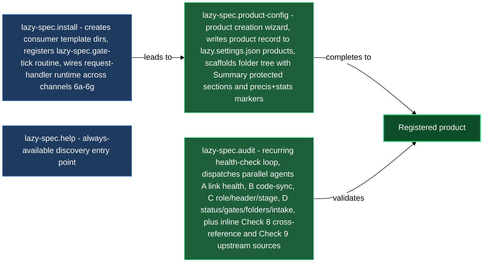

# Bootstrapping, configuring products, and auditing spec health

Before you author a single spec asset, several things need to be in place: the plugin's consumer directories and daemon routines must be wired, the project-wide vault spec (`vision.md`) must exist, at least one product must be registered with a path and (optionally) the paths of this repository its code covers, and you need a way to check that both the plugin itself and the spec content stay consistent as the codebase and the team evolve. This block covers all of that: `/lazy-spec.install` sets up the plugin and seeds the vault spec draft, `/lazy-spec.product-config` walks you through creating or editing a product record, `/lazy-spec.audit` audits a registered product's spec for validity and drift, and `/lazy-spec.help` is the always-available reference for the plugin's full skill surface when you need to recall a verb mid-session.

Running `/lazy-spec.install` then `/lazy-spec.product-config` in order is the fastest path from "just installed the plugin" to a fully wired product ready for the gate-and-review cycle. All three action skills are also independently re-runnable: `lazy-spec.install` is idempotent, `lazy-spec.product-config` has an edit mode, and `lazy-spec.audit` is read-only by default — safe to run at any time. `/lazy-spec.help` is even simpler: it prints a static reference block and touches nothing, so run it whenever you want a refresher on which verb does what.

## When you'd use this

`<specs-cli>` stands for the specs plugin's `bin/lazycortex-specs` file — the copy that `~/.claude/plugins/installed_plugins.json` records as installed for `lazycortex-specs@lazycortex`, or `plugins/claude/lazycortex-specs/` in a checkout that authors the plugin. Never locate it by searching the plugin cache: the cache keeps every version ever installed, so a search can land on a stale copy. Every verb runs through the interpreter, `"${LAZYCORTEX_PYTHON:-python3}" <specs-cli> <verb>`: the file carries no exec bit and is not on `PATH`.

- Setting up the plugin for the first time in a project: run `/lazy-spec.install` to create the per-context template override directories — one per shipped asset type (release included), one per level (product-root and vault-root), the linear base, and the request inbox — mirror the plugin's `spec.decisions.md` rule into `.claude/rules/`, register the `lazy-spec.gate-tick`, `lazy-spec.coordinator-watch`, `lazy-spec.coordinator-deletes`, `lazy-spec.collect`, and `lazy-spec.runtime-gc` daemon routines, wire the full request-handler runtime (the open and apply channels plus the `spec.coordinator` expert, the review class for `requests/*.md`, and the review classes for every spawned doc kind), seed the `agent_models` tier for `spec.coordinator`, seed the project-wide vault spec draft if it doesn't already exist, create or bring up to schema the catalog root's level note and every registered product's, and register the plugin's own `Bash("${LAZYCORTEX_PYTHON:-python3}" *)` permission so dispatched experts can call it under `dontAsk` mode — then run `/lazy-spec.product-config` yourself when you want to register your first product (install only reports whether one is registered and never asks).
- Registering a new product (code-bound or design-only): run `/lazy-spec.product-config` to walk through the product's stable key, its spec folder, the repository paths its code covers, language, icon, per-role guidelines, whether it needs asset types of its own, its workflow mode (full or spec-only), and — for a product that owns releases — the release implementer, version manifest and deploy targets. The skill writes the product record and the product's level note and `vision.md` (group folders such as `changes/` or `bugs/` appear lazily the first time you scaffold an asset into one). It asks nothing about review experts: the shared review classes `/lazy-spec.install` seeds already cover the product, and a product-specific reviewer is added later through `/lazy-review.configure`.
- Registering a nested product — one whose spec folder sits inside another product's own `spec_path` tree (a sub-brand, a bounded module of a larger product, or a semantic area a code-generation pass split out): run `/lazy-spec.product-config` and give the child's own key with a `spec_path` under the parent's — the wizard recognises the nesting from the path alone and, for every field the parent's already-registered chain already answers (language, guidelines, asset types, workflow mode), skips the question and inherits the ancestor's value instead of re-asking; answering that same step yourself for the child overrides the inherited value. A nested product under an owner that declares a `source` owns no releases and may only narrow that source: a path outside the owner's source paths is refused. Nesting can go arbitrarily deep — the innermost product always owns whichever part of the tree its own `spec_path` covers.
- Registering your first-ever product, before the vault spec exists: `/lazy-spec.product-config` refuses in create mode until `<content-root>/vision.md` — the project-wide vault spec — is on disk, OR a pre-existing `<content-root>/design.md` without a vision does (the legal pre-vision state, migrated by the operator by hand — a product is a consequence of it either way). Run `/lazy-spec.install` first (or again); its Step 6.9 seeds a starting draft through `"${LAZYCORTEX_PYTHON:-python3}" <specs-cli> seed-doc` from the `system-vision` type's template only when neither file exists, and leaves an existing draft (or a pre-vision `design.md`) untouched.
- Adding source paths to a design-only product you previously registered: run `/lazy-spec.product-config` in edit mode — it detects the existing record and lets you add the source binding without touching other fields.
- Checking spec health after a sprint, a branch merge, or a period of active coding: run `/lazy-spec.audit <product>` to dispatch four parallel scan agents — link health, code-sync (code-bound products only), role/type and stage violations, and gate/folder/intake integrity — then surface findings grouped by severity, each with the verb or skill that repairs it. The audit never writes; running the repairs is your move.
- Migrating an older catalog after a plugin update: re-run `/lazy-spec.install` — its one-shot backfills stamp `spec_doc_type` / `spec_asset_type` onto documents and assets that predate typing, strip a stale `spec_doc_type` key an earlier release may have left on a product's or the catalog root's own level note, and rename any lingering `dev-plan` / `dev-report` document-type usage to `code-plan` / `code-report`. The same run also moves any product-root, vault-root, or research-design template you previously overrode by composite filename under the linear base (`spec.docs/system-vision.md`, `vault-design.md`, `research-design.md`, and their siblings) into its new context folder (`spec.product/vision.md`, `spec.vault/design.md`, `spec.research/design.md`) — a target already present at the destination is reported as a conflict and left for you to resolve by hand, both files untouched. It also migrates the retired readiness flag: a leftover `spec_draft` key is dropped from asset status notes, and on a release note the old built-and-tested meaning of `spec_released` moves to `spec_built`; a note it cannot classify is left untouched and listed for you. All of it runs idempotently and without committing on your behalf.
- Forgetting which skill does what, mid-session: run `/lazy-spec.help` — it prints the full skill surface grouped by phase (bootstrap, authoring, gates & lifecycle, request processing, sync & validation, primitives) with a one-line description for each verb, plus links to this help chapter's walkthroughs, troubleshooting, and FAQ. It makes no changes and needs no arguments.

## What's in this block

**`/lazy-spec.install`** bootstraps the plugin in your project and leaves it ready for product creation. It creates the per-context template override directories — `.claude/templates/spec.feature/`, `spec.change/`, `spec.bug/`, `spec.content/`, `spec.research/` for the shipped asset types, `spec.product/` and `spec.vault/` for the identical vision/design/tech trio at the product-root and project-wide vault-root levels, `spec.docs/` for the linear base, and `spec.release/` for release notes, and `spec.request/` for the request inbox — so you can customize scaffold templates per product later; each asset-type and level folder also holds an optional `<compound-key>/` per-product override sub-folder. A template is resolved by its context folder plus its own filename rather than by a per-category composite name, and the template's own frontmatter declares its document type — there is no separate `template` field to set. It also mirrors the plugin's own `spec.decisions.md` rule into `.claude/rules/` so the decisions-registry conventions load into every session, re-syncing it on every later run. It reads or seeds the repo's default authoring language into the `spec` settings section — and stops with `aborted:vault-root-not-subdir`, writing and asking nothing, when `spec.vault_root` points at the repository root, an absolute path, or a path that climbs out through `..`, because the spec catalog must live in a sub-directory (the default is `specs`); move the catalog into one, set it as the vault root, and re-run. It registers the `lazy-spec.gate-tick` md-scan routine (a pure poller — active-job polling plus a structural note-check, nothing more) with `change_gate: false` — required, not a tuning knob, since everything the routine polls (the job-marker sidecar, a job bundle's terminal marker under `.experts/.jobs/`) lives outside the asset's own folder, so a directory-gated scan would never re-run on a finished job; with the gate off, `lazy-spec.gate-tick` itself re-scans every live status note on every tick and reaches those markers directly — and the `lazy-spec.coordinator-watch` git-watch routine that wakes `spec.coordinator` once a non-bot commit reaches the daemon's own checkout (which is typically not the checkout you edit in — your gesture has to be committed and pushed before this routine ever sees it) and touches an asset's status folder-note, its commands section, an answered question, or any typed document under a registered product. It also registers the `lazy-spec.coordinator-deletes` routine, a second git-watch that covers what `lazy-spec.coordinator-watch` cannot see: a commit that deletes a spec document. Without it the owning folder-note would keep launch rows and a `# Status brief` describing a document that no longer exists. A deletion by a non-bot author wakes the note that still owns the deleted file's place — the asset's status folder-note while the asset folder stands, the owning product's level note when the whole asset folder went with it, or the level's own note when a level document is deleted from a product root or the content root; a bot-authored deletion, or a path no product owns, wakes nothing. It also registers the `lazy-spec.collect` routine — a lightweight postman that sweeps the runtime's job-marker sidecar every tick and re-runs the same per-note check for any note still carrying a recorded marker, the specs-side analog of `lazy-review.collect`; it runs alongside `lazy-spec.gate-tick`'s own `change_gate: false` sweep as a dedicated delivery channel on the same 60-second cadence, rather than being the only route to a finished job's marker. It registers the `lazy-spec.runtime-gc` schedule routine too, which once a day drops the per-note rows that the dispatch-cursor and stage-lag sidecars keep for notes that have since been deleted or moved (on a checkout without a daemon, the same cleanup runs by hand through the plugin's `runtime-gc` verb, with a `--dry-run` preview). It wires the request-handler runtime across five channels: the mechanical open routine (`lazy-spec.request-open`, fires on naked request files), the mechanical apply routine (`lazy-spec.request-apply`, fires post-finalize on approved requests), the `spec.coordinator` expert entry, the review class for `requests/*.md` (with a `terminal.routing` writer naming `spec.catalog-coordinator`, run in its routing mode), and the review classes for every spawned doc kind (vision, use-cases, design, system-vision, system-design, system-tech, system-use-cases, system-architecture, system-test-plan, ui-design, system-ui-design, code-plan, test-plan, bug, content-design, research-design, plus each tool's own report kind — code-report, test-report, data-report, docs-report, research-report), shared across products — the `system-vision`, `system-design`, and `system-tech` classes specifically cover the product-root and project-wide (content-root) `vision.md` / `design.md` / `tech.md` set, distinct from the asset-level `vision` and `design` classes that review a feature's or change's own `vision.md` / `design.md`, and the `system-use-cases` class covers the optional product-root `use-cases.md` — the product's own actors and cross-asset scenarios, gated by its own `spec_use_cases_done` level gate — distinct from the asset-level `use-cases` class that reviews a feature's or change's own `use-cases.md`; the `content-design` class covers the `design.md` of a content asset — the designer writes it, the editor polishes it, and the data writer validates it in a `Data writer review` section, judging whether each decision can be expressed in the project's data schema and whether the design carries no value copied out of the data (the architect has nothing to judge there, since a content asset has no code structure). It also attaches the mandatory expert-signals protocol to every review class it wrote, since that per-class `protocols` list is the only route by which this plugin's wire contract reaches the writers `lazycortex-review`'s coordinator dispatches; discovery itself is that plugin's own repo-wide watch routine, and a leftover `lazy-review.scan` registration from the retired sieve model is reported for the operator to clear by re-running `/lazy-review.install`, never touched here. It then offers optional protocols for the spec writer routine, and registers the `lazy-spec.upstream-tick` schedule routine once a `spec.upstream` source is configured, so the fetch/detect pass over external design sources runs unattended instead of relying on you to remember `/lazy-spec.upstream-run`. Three one-shot backfills round out a fresh or upgraded install: `spec_doc_type` is stamped onto every catalog document that predates typing, `spec_asset_type` is stamped onto every asset's status note, and any document still carrying the retired `dev-plan` / `dev-report` type names is renamed to `code-plan` / `code-report` — all three are idempotent, and none of them commits, leaving the writes in your worktree to fold into your own commit. A fourth one-shot migration moves a product-root, vault-root, or research-design template you overrode by composite filename under the old linear base into its new context folder (see the "Migrating an older catalog" bullet above), reporting a conflict rather than overwriting when the destination already holds a file. It also retires a leftover single-document `class: research` review class from an earlier release — research assets now carry a `design.md` (reviewed under `research-design`) and a `research.md` report (reviewed under `research-report`), each with its own class, so the old one-class shape is removed rather than left to shadow the new pair. The `spec_doc_type` pass also takes back a stale key an earlier plugin release wrote onto a product's or the catalog root's own level note — no level-note schema has ever had room for that key, and `lazy-spec.audit` FAILs on it — stripping it wherever it is still recorded, alongside the count of documents it stamps. Because a product is now a consequence of the project-wide spec rather than a standalone record, the skill also seeds that spec: if `<content-root>/vision.md` — the vault spec — doesn't already exist, it seeds one there through `"${LAZYCORTEX_PYTHON:-python3}" <specs-cli> seed-doc` from the `system-vision` type's template as a starting draft, icon and colour already in place (stating what the project is and why it exists); in the same step it creates or repairs the catalog root's level note (and each registered product's), adding only what is missing and never disturbing your `# Coordinator rules` or the rendered `# Summary`. An existing draft, in any state, is left untouched — and so is a pre-existing `<content-root>/design.md` without a vision, since a vault migrated before the vision document existed is a legal state the skill never seeds over, only the operator migrates it by hand. This file gates the later product registration (a separate `/lazy-spec.product-config` run — install never offers it), since `/lazy-spec.product-config` refuses to register a first product without one of the two. The skill seeds the `agent_models` tiers for the plugin's `spec.coordinator` subagent, and — when `lazycortex-wiki` is installed — ensures the vault's `product` and `category` tag axes exist, seeds each wiki scope that already covers a registered product with a sensible default (curate drafts, deferred, and approved documents from their first draft; skip empty scaffolds, rejected and cancelled documents, the request inbox, and plan/report working papers) and sets `index_badges` to `spec_stage`, so the wiki's topics index shows each entry's stage and you can tell a draft from an approved document without opening it. Nothing is seeded into the wiki's terms and structure scan routines — the stage filter lives on the scope alone. The seed fills in only what a scope does not already have, so a filter, exclude list, or badge list you narrowed yourself is kept on every re-run; a scope seeded with the approved-only default of earlier releases is carried over to the new default by core's settings migration, not by this skill. The skill does nothing at all when the wiki plugin is absent. Finally, because expert subprocesses run under Claude Code's `dontAsk` permission mode, the skill registers a `Bash("${LAZYCORTEX_PYTHON:-python3}" *)` allow-pattern in `settings.local.json` — without it, every cross-skill CLI call `spec.coordinator` or another dispatched expert makes is silently denied. Every write follows a silent-merge policy — absent targets are created, cleanly mergeable targets are merged, only genuine conflicts ask a question. The skill is fully idempotent: re-running after a plugin update surfaces any new wiring requirements without overwriting anything you have customized.

**`/lazy-spec.product-config`** is the product-registration wizard. It asks one question at a time, each with its context printed first, and the product's narrative prose follows the product's own language. In create mode it first confirms the project-wide vault spec exists: `<content-root>/vision.md` must be on disk, OR a pre-existing `<content-root>/design.md` without a vision does (the legal pre-vision state, since the split into products is a consequence of that repo-wide spec, not the other way around). If neither file is present, the wizard aborts with `aborted:no-vault-spec` and points you at `/lazy-spec.install`, whose seeding step creates the vision draft; edit mode skips this check, since a registered catalog predates the requirement. Once that's settled, it walks you through these steps, in order:

- **Product key and spec path.** The key is an arbitrary stable string you choose (e.g. `chapter`), never derived from the folder and never renamed afterwards; the vault-relative `spec_path` can be any folder shape, since the plugin reads no meaning from path segments, but its last segment may not be a reserved name (`vision`, `design`, `ui-design`, `tech`, `use-cases`, `decisions`). A `spec_path` you place under an existing product's own `spec_path` registers a *nested* product instead of a sibling — legal at any depth, with the innermost product owning whichever part of the tree its own `spec_path` covers. For a nested product the wizard walks the ancestor chain and, for every later step whose value an ancestor already supplies, records `inherited` instead of asking, unless you explicitly answer that step for the child, in which case your answer wins.
- **Language.** An optional override of the repo-wide authoring language for this product's prose; fixed headers and frontmatter keys stay English.
- **Source.** Whether the product has code in this repository, and if so the repo-relative paths it covers (a missing path can be kept as a forward declaration). A design-only product records no source, and code-grounded steps are skipped until you add one in edit mode. A nested product whose owner declares a `source` owns no releases and may only declare paths inside the owner's source paths.
- **Dependencies.** For a sourced product, a read-only scan of imports in the covered paths proposes dependencies; you accept or skip each one individually. Edit mode appends to the existing list and never clobbers it.
- **Icon.** A Lucide name or an emoji for the product folder; declining still yields the default `LiPackage`. The colour is not asked: a product root carries a neutral default, and a per-product override is something you set by hand.
- **Guidelines.** An optional dict of repo-relative paths keyed by dispatched role (`planner`, `tester`, `developer`, `architect`, `designer`, `data-writer`, `researcher`, and so on, plus a wildcard `*` that applies to every role) whose contents — preceded by the catalog-wide `spec.guidelines` every product inherits, then the enclosing products' own — are folded into the context of every expert job on the product's documents: the launch-checkbox jobs the coordinator dispatches, and the review rounds that `lazycortex-review`'s coordinator dispatches. Which role a launch checkbox dispatches under decides which paths reach it: the code-plan checkbox runs under `planner`; the test-plan checkbox and a release's `Test` job run under `tester`; a release's `Build` job runs under `developer`; the architecture checkbox and a build's architecture revision run under `architect`; and the `*` paths ride along with every one of those jobs. A style guide or a `docs/structure.md` map therefore reaches the right expert without any per-job wiring; a path that doesn't resolve surfaces as a warning on the asset's `# History` line rather than failing silently.
- **Asset types.** Whether the product needs asset types of its own beyond the shipped feature, change, bug, content, research, and release set. Choosing to declare them writes nothing here: you run `/lazy-spec.add-asset-type <compound-key>` once per type after the wizard finishes.
- **Workflow mode.** `full` (the default, nothing written) or `spec-only`, where the product owns no releases and each asset's `spec_released` flips only on your explicit word.
- **Release settings.** Only for a product that owns releases (it has a source, no enclosing product declares one, and the mode is `full`): the expert that leads every release build (inherited from the configured chain, an explicit expert, or a chain of the product's own), the manifest file whose version field a published release reads and writes, and up to two deploy targets (`staging`, `production`) with their commands and addresses.

On save the skill writes the product record into `lazy.settings.json[products]` — only the fields you actually settled — and scaffolds the product root: its level note (`<spec_path>/<leaf>.md`), owned by `spec.catalog-coordinator` rather than left as a plain operator container. It runs the `catalog-note backfill` verb for the product, which stamps `spec_role: product`, the five level gates (`spec_vision_done`, `spec_use_cases_done`, `spec_design_done`, `spec_ui_design_done`, `spec_tech_done`) plus `spec_halted: false`, the managed paint keys, and the coordinator's own body sections — `# Summary` (carrying the précis and stats markers the plugin keeps fresh between `<!-- spec:precis:* -->` / `<!-- spec:stats:* -->` markers), `# Gates`, `# Attachments`, `# Status brief`, `# Coordinator rules`, `# Coordinator commands`, `# History` — adding only what is missing on a note that already exists, so nothing you wrote into `# Coordinator rules` or the rendered `# Summary` is disturbed. The wizard then authors the précis line and refreshes the stats of the product's note and of every folder-note above it, up to the catalog root, because a new product changes each one's product count. In create mode it also seeds the product's own `vision.md`: the same seeding guard as the vault-level draft, writing `<spec_path>/vision.md` from the `spec.product/vision.md` template only when neither that file nor a pre-vision `<spec_path>/design.md` already exists, never over a product migrated before the vision document landed. Group folders such as `changes/` or `bugs/` are NOT created upfront — they, and their own folder-notes, appear lazily the first time `/lazy-spec.create-asset` lands an asset in one. It also ensures the vault-root `requests/` inbox exists (shared by all products) and carries its own protected `# Summary` folder-note. The wizard writes no review classes: the vault-wide classes `/lazy-spec.install` seeds — one per doc kind, with wildcard globs spanning every product and asset type — cover each new product, and a product-specific reviewer is added as a `<kind>@<key>` class through `/lazy-review.configure`. It closes by running `/lazy-spec.audit` on the new product to confirm everything is consistent. In edit mode it reads the existing record first, confirms it is the product you meant (the key and `spec_path` stay fixed), and writes only the fields you change — adding a source binding, extending dependencies, or switching language, icon, guidelines, mode, or release settings — without touching the product's `asset_types` / `tool_types` declarations or any other field.

**`/lazy-spec.audit`** audits a registered product's spec for validity and drift. Before dispatching its agents, it resolves the product's *effective record* — the product's own declared `asset_types` / `tool_types` merged over whatever its ancestor products declare, when the product is nested, then merged over the plugin's shipped defaults — since without that merge a nested product's inherited type or tool would resolve as "declared nowhere" and every asset using it would falsely fail as unknown-typed; its folder walk also stops at any nested product's own level note, so everything under a folder-note carrying `spec_role: product` is that nested product's own asset tree, enumerated and judged only by that nested product's own audit run, never folded into the parent's report. It also refuses a nested product whose `source` lies outside the source paths of the product that owns the releases. It dispatches four parallel Explore agents in a single pass: Agent A checks wikilink health, source links, and the decisions-registry's own links (bare wikilinks, broken targets, root links to folders or to missing files, leftover forge links into this repository, dangling decision anchors); Agent B diffs the tech-doc surface against current code for code-bound products (missing routes, removed functions, changed constants, new files); Agent C validates every authored document's declared type (`spec_doc_type`) against the product's own type declarations, header section shape, and the per-file stage closed set together with its `spec/<stage>` tag mirror — every folder-note is excluded from typing entirely, whether it's an asset's status note or a level note of a product or of the catalog root, and a `spec_doc_type` key found on any of them (including a stale one an older plugin release may have written onto a level note) is itself a finding — under an active coordinator it is usually gone before the audit ever sees it, since both coordinators now strip an unrecognised `spec_*` key off their own note the moment they wake on it, and the same `/lazy-spec.install` backfill still clears any that linger, in bulk, across the whole catalog; it also enforces the asset status folder-note's protected H1 roster — the shipped template scaffolds seven, in order (`# Summary`, `# Gates`, `# Attachments`, `# Status brief`, `# Coordinator rules`, `# Coordinator commands`, `# History`), and of those the audit requires six on every note (`# Summary`, `# Gates`, `# Status brief`, `# Coordinator rules`, `# Coordinator commands`, `# History`) and treats `# Attachments` as optional on an asset note, so a note scaffolded before that section existed is not a finding for lacking it — and it enforces the `# Summary` section on every container folder-note, whose required shape depends on the note: a product root carries both a précis marker and a stats marker, every other container carries the stats marker alone, and a leftover précis marker on one of those is a warning rather than a failure; Agent D checks the flat gate booleans by note kind — a design-only note carries only `spec_design_done`, `spec_released` and `spec_cancelled` (a middle gate key present on it is a stale-key finding, and `spec_released` true ahead of `spec_design_done` a precedence violation), while a release note walks the five-gate ladder in strict order — gate-to-document coupling resolved against the asset's own declared type and tool playbooks (so what closes a gate differs per asset type and per tool, not a single hardcoded table), top-level folder validity, operator-zone folder-note shape — including the `# Coordinator rules` layer, which now covers container folder-notes as well as the product folder-note (the same rule chain `spec.coordinator` reads top-down before deciding anything) — request intake schema, and the two level notes `spec.catalog-coordinator` owns (the catalog root's and each product's own, the same note `/lazy-spec.product-config` seeds): each must resolve a `product` / `catalog` role and carry the five level gates (`spec_vision_done`, `spec_use_cases_done`, `spec_design_done`, `spec_ui_design_done`, `spec_tech_done`) correctly coupled to its `vision.md` / `use-cases.md` / `design.md` / `ui-design.md` / `tech.md` siblings — a gate true with its optional document simply absent is healthy, only a gate out of step with a document that exists at the wrong stage is a finding. Agent D also flags a living document that reached `approved` (or any document carrying `review_result: approved` / `approved-with-concerns`) while its body still holds a leftover `[!decision-candidate]` callout — ticked or not — as a FAIL: the writer round never folded the operator's verdict, so the approval shipped a questionnaire; the fix is reopening the document's review at the writer round (`lazy-review.start`), never a hand deletion. A companion WARN catches a document whose acceptance already closed while an `[!asset-proposal]` callout still sits in its body unmaterialized — the fix is waking the asset's coordinator (a `# Coordinator commands` line naming the proposal) so it scaffolds, links, or reopens the target and replaces the callout with the wikilink. A document's required-sections check resolves against the live template for its own type and context (`"${LAZYCORTEX_PYTHON:-python3}" <specs-cli> template resolve --context <asset type> --product <key> <file>`) rather than a hardcoded section list, so a template you have customized is what the audit actually checks against. An inline Check 8 runs cross-product — it verifies the vault-root `requests/requests.md` inbox note's protected `# Summary` section and flags any loose `changelog.md` files. A further inline Check 9 covers `upstream/` — every configured `spec.upstream` source's fetch health and every mirrored unit's note consistency — and stays silent entirely when no `spec.upstream` source is configured. The role/type check also FAILs a content asset whose `design.md` still carries `spec_doc_type: design` from before the `content-design` type existed — it would be reviewed by the feature-design class with the architect as validator instead of by its own; the fix is a hand edit setting that one frontmatter value to `content-design`. A guideline-path check WARNs on any declared path — under a product's `guidelines` or the catalog-wide `spec.guidelines` — that does not resolve to a file, so a stale path is caught before it silently drops context from a launch-checkbox job. A further inline Check 10 reports, INFO-only and never blocking, whether `lazycortex-wiki` is installed and configured — the research surface the plugin's architect, designer, and planner experts lean on for cheaper, better-grounded lookups — without fixing or installing anything itself. A final inline Check 11 confirms the project-wide vault spec exists: with neither `<content-root>/vision.md` nor a pre-vision `<content-root>/design.md` on disk it surfaces `[WARN] vault-spec-missing`, pointing you back at `/lazy-spec.install` to seed the draft; a `design.md` present without a `vision.md` is the legal pre-vision state and surfaces only `[INFO] pre-vision vault` — migrate it to `vision.md` by hand when ready. A catalog registered before this requirement existed is not refused for it, only flagged. The skill is fully read-only — it surfaces what is wrong, names the repair route per finding, and stops. Stage and gate repairs route to the canonical skills (`lazy-spec.set-stage`, `lazy-spec.flip-gate`), frontmatter repairs to `"${LAZYCORTEX_PYTHON:-python3}" <specs-cli> note-set-key` / `note-drop-key` and the backfill verbs, a Check 9 `dangling-request-link` finding to `"${LAZYCORTEX_PYTHON:-python3}" <specs-cli> upstream-doctor --apply` — the doctor's one repair mode, which releases every unit frozen on a request that no longer resolves back onto `drifted` (when its `processed/` snapshot exists) or `new`, clears the stale link, leaves the mirrored content alone, and reports any unit whose snapshot directory is empty as skipped rather than guessing — and the rest are hand edits the report describes. `/lazy-core.doctor` delegates to this audit and is the one place a fix/waive loop over the merged findings lives.

**`/lazy-spec.help`** is the plugin's static reference command — it prints the whole skill surface grouped by phase (bootstrap, authoring, gates & lifecycle, request processing, sync & validation, and the resolver primitives other skills call internally) with a one-line description for each verb, plus links out to this help chapter's walkthroughs, troubleshooting, and FAQ. It makes no tool calls beyond printing the block, changes nothing, and needs no arguments — run it any time you have forgotten which skill flips a gate, which one seeds a doc, or where a given primitive is dispatched from. Because it is pure static text, it never goes stale mid-session and is safe to run as often as you like.

## How they work together

The first time you work in a project, run `/lazy-spec.install`. It checks that the plugin is enabled, creates the consumer template directories, seeds the authoring language if needed, seeds the project-wide vault spec draft (`vision.md`) at the content root when neither it nor a pre-vision `design.md` already exists, and registers the daemon routines and full request-handler wiring. At the end it only reports whether a product is already registered; it never asks about one. Run `/lazy-spec.product-config` yourself once install finishes — that is the only way a product gets registered. Re-running install after a plugin update also re-syncs the mirrored `spec.decisions.md` rule, re-seeds agent-model tiers, re-runs the `spec_doc_type` / `spec_asset_type` backfills — including stripping any stale `spec_doc_type` key a prior release left on a level note — and moves any composite-named level or research-design template override into its new context folder, safe to do at any time, since every pass is idempotent.

`/lazy-spec.product-config` is the heavier step. Before anything else, in create mode, it checks that the vault spec install seeded actually exists — a product is registered as a consequence of the project-wide spec, not independently of it, so a missing `vision.md` (and no pre-vision `design.md`) at the content root aborts the wizard with `aborted:no-vault-spec` rather than registering a product with nothing above it; fill in the draft and re-run. Past that gate, the wizard collects the information install cannot derive: what the product is called, where its spec lives, whether it has source code, which guidelines its experts should read, and whether it owns releases. When the spec_path you give sits inside another registered product's own spec_path, the wizard treats this as registering a nested product rather than duplicating or editing the parent — it walks the ancestor chain and pre-fills language, guidelines, asset types, and workflow mode from whichever ancestor already declares them, asking only for what the child doesn't inherit or what you choose to override locally. When you give it source paths — the folders of this repository the product's code covers — it runs a dependency scan in the background. On save, the skill runs the `catalog-note backfill` verb to write the product's level note — `spec_role: product`, the five level gates (`spec_vision_done`, `spec_use_cases_done`, `spec_design_done`, `spec_ui_design_done`, `spec_tech_done`), and the coordinator's own sections (`# Summary` carrying the description the wizard writes immediately and the level coordinator keeps current afterwards, plus stats markers the daemon refreshes as assets are added and gates flip, `# Gates`, `# Attachments`, `# Status brief`, `# Coordinator rules`, `# Coordinator commands`, `# History`) — the same note `spec.catalog-coordinator` maintains from then on; it also seeds the product's own `vision.md` from the same template, guarded the same way as the vault-level draft so a pre-vision `design.md` is never overwritten. Group folders and their own folder-notes are seeded lazily as you actually scaffold assets into them. The shared review classes `/lazy-spec.install` seeds — one per doc kind, with wildcard globs covering every product and asset type — mean registering a product adds no classes of its own; a product that needs different reviewers gets a `<kind>@<key>` class through `/lazy-review.configure`. The `lazy-spec.coordinator-watch` routine needs no per-product wiring at this step: a registered product's documents join the watch automatically once they sit under the routine's own vault-wide `path_filter`, and the daemon dispatches a single coordinator worker call per tick covering every changed file, whatever the number of registered products. The skill ends with a `/lazy-spec.audit` call, so the product arrives in a verified state. It also ensures the vault-root `requests/` inbox exists as a shared folder-note with the same protected `# Summary` structure.

After that, `/lazy-spec.audit` is a recurring check you run on demand: after any significant coding sprint, after merging a branch, or whenever you suspect drift. For a nested product, it first resolves the effective record it inherits from its ancestors before checking any type or tool, and stops its own folder walk at the nested product's boundary, so each product in a nested tree is judged — and reported — under its own run, never folded into an ancestor's or a descendant's. For a code-bound product, Agent B diffs the tech-doc surface against the current code and reports undocumented routes, removed functions, and changed constants. For all products, Agent C catches the consistency errors that accumulate during active development — a stage whose mirror tag was not updated, a missing or duplicated protected section on a status folder-note, a document whose declared type no longer resolves against the product's own type declarations, a broken wikilink introduced by a rename, or a `spec_doc_type` key that has no business sitting on a level note in the first place. Agent D catches gate-model violations: a gate flipped manually without its owning document (per the asset's own type and tool playbooks) actually approved, a precedence violation (a later gate true while an earlier is false), and a status folder-note whose declared asset type or tool names something no declaration covers. It also catches an approved document that still carries an unfolded decision-candidate callout, or an accepted document whose asset-proposal callout was never replaced by the coordinator's own materialization. A wiki-companion check runs alongside, INFO-only, nudging you toward `lazycortex-wiki` when it would sharpen the experts' research without ever installing or configuring anything on its own. A vault-spec check runs too, confirming the content-root `vision.md` (or a legal pre-vision `design.md`) still exists — WARN if neither does, since a registered product is nominally a consequence of it. Every run is read-only: you get the full report with no side effects, each finding naming the verb, skill, or hand edit that clears it.

`/lazy-spec.help` sits outside this lifecycle entirely — it is a stateless lookup you can run before, during, or after any of the above whenever you need a reminder of what a given skill does; it never needs a product to be registered, or the plugin's config to be in any particular state.

## Common adjustments

- **Add group-wide constraints for a category of assets.** Add a `# Coordinator rules` section to the category's container folder-note (e.g. `bugs/bugs.md`, or `changes/changes.md`) — `spec.coordinator` now reads it for every asset filed under that container, the same way it already reads the product folder-note's own section. Run `/lazy-spec.audit` to confirm the section carries the `#protected/spec/coordinator-rules` tag.
- **Switch a product to spec-only mode.** Run `/lazy-spec.product-config` in edit mode and pick `spec-only` at the workflow-mode step — the product then owns no releases: its assets run the same design-only ladder, and each one's `spec_released` flips only on your explicit word once its start document is approved, instead of being set by a release's `Publish` (`lazy-spec.spec-only-playbook.md`). Absent the choice, the product stays in full mode, where a release ships its assets.
- **Change the authoring language for a product.** Run `/lazy-spec.product-config` in edit mode and pick a different language at the language step. The record is updated; all subsequent prose-generating skills use the new language for that product.
- **Change the review experts assigned to a product's docs.** `/lazy-spec.product-config` no longer asks about review experts. The shared review classes `/lazy-spec.install` seeds cover every product; to give one product its own reviewers, run `/lazy-review.configure` and add a `<kind>@<key>` class for it.
- **Declare an asset type of the product's own.** After the initial product registration, run `/lazy-spec.add-asset-type <compound-key>` — it is a separate skill, not inline in `lazy-spec.product-config`. The `lazy-spec.product-config` report mentions this if you chose to declare types at Step 9. The wizard writes the declaration — icon, start document, default tools, default folder, playbook — into `products[<key>].asset_types` and creates nothing on disk beyond a playbook stub when you choose to write your own; the type's folder appears at the first asset scaffolded into it. The new type's docs are covered automatically by the vault-wide shared review classes — `lazy-spec.add-asset-type` never touches `review.classes`.
- **Register a product nested inside another product's spec tree.** Run `/lazy-spec.product-config` and give the child its own settings key with a `spec_path` sitting under the parent's own `spec_path`. The wizard detects the nesting from the path alone and pre-fills language, guidelines, asset types, and workflow mode from whichever ancestor in the chain already declares them — answer only the fields where the child genuinely needs to diverge, and that answer wins over what it would otherwise inherit. `/lazy-spec.audit` then treats the nested product as its own boundary: its assets are enumerated and reported only under the nested product's own audit run, never folded into the parent's.
- **`/lazy-spec.product-config` aborts with `aborted:no-vault-spec`.** This means the project-wide vault spec — `<content-root>/vision.md` — doesn't exist yet, and no pre-vision `<content-root>/design.md` satisfies the gate either, so a product cannot be registered as a consequence of a spec that isn't there. Run `/lazy-spec.install`; it seeds a starting draft through `"${LAZYCORTEX_PYTHON:-python3}" <specs-cli> seed-doc` from the `system-vision` type's template when neither file is present, and leaves an existing draft (or pre-vision `design.md`) untouched. Fill the draft in (or just let it sit as a stub — presence is the only gate, not approval state) and re-run `/lazy-spec.product-config`.
- **Re-run install after a plugin update.** Run `/lazy-spec.install` again. It surfaces any new wiring requirements (new routines, new review classes, new settings keys) and merges them in silently. Already-present entries are left untouched; orphaned entries from removed features are kept, never deleted.
- **Install reports a conflict moving a template into its new context folder.** This means a composite-named override under the old linear base (`.claude/templates/spec.docs/system-vision.md`, `vault-design.md`, `research-design.md`, and their siblings) collides with a file already sitting at the destination context folder (`spec.product/`, `spec.vault/`, `spec.research/`). Install moves neither file and reports both paths. Decide which version you want to keep under the new context path, delete or rename the other by hand, then re-run `/lazy-spec.install` to finish the move.
- **Work through spec errors.** Run `/lazy-spec.audit <product>` for the report, then run the route it names beside each finding — `lazy-spec.set-stage` for a stage, `lazy-spec.flip-gate` for a gate, the `lazycortex-specs` note and backfill verbs for frontmatter, hand edits for the rest. `/lazy-core.doctor` delegates to this audit and drives a fix/waive loop over the merged findings when you want one pass over everything.
- **Run doctor across all registered products.** Run `/lazy-spec.audit` with no product argument and choose "all products" — it iterates every key in `lazy.settings.json[products]` and produces a per-product report.
- **The audit reports a missing protected section on a folder-note.** This means one of the six plugin-owned H1 sections (`# Summary`, `# Gates`, `# Status brief`, `# Coordinator rules`, `# Coordinator commands`, `# History`, each with its own `#protected/spec/*` tag) is absent from a status folder-note, or a `# Summary` section is absent from a container folder-note, or that section lacks the markers its own kind of note requires — both on a product root, the stats marker alone on a group container. Re-run `/lazy-spec.product-config` in edit mode to regenerate the folder-notes, or add the missing skeleton manually and re-run `/lazy-spec.audit` to confirm it clears.
- **Doctor reports a `spec_doc_type` key on a level note.** A product's or the catalog root's own folder-note has no room for a `spec_doc_type` key — an earlier plugin release derived one from the `product` / `catalog` role and wrote it there by mistake, and `lazy-spec.audit` FAILs on it as an `unknown-key`. Under an active coordinator this usually clears itself on the note's next wake — the coordinator now strips an unrecognised `spec_*` key from its own note the same way doctor's own fix would. If it's still there, re-run `/lazy-spec.install`; its `spec_doc_type` backfill strips the stale key from every level note it finds, in the same pass that stamps missing keys onto ordinary documents.
- **Give one dispatched role extra context.** Run `/lazy-spec.product-config` in edit mode and step through the guidelines question — add or change per-role paths (a role token such as `planner`, `tester`, `developer`, `architect`, `designer`, `data-writer`, or the wildcard `*`); paths declared catalog-wide under `spec.guidelines` reach every product ahead of its own, and each declared path's contents are folded into that role's next expert job on the product's documents — a launch-checkbox job or a review round run by `lazycortex-review`'s coordinator. A path that doesn't resolve surfaces as a warning on the asset's `# History` line, never a silent drop.
- **Launch-checkbox labels the audit does not recognise.** The audit holds no fixed list of checkbox labels: which boxes an asset carries is declared by its type and tool playbooks (a release note, for example, carries `Write code-plan`, `Write test-plan`, `Rebuild` and `Publish`, and a research asset `Start research`). A `[!gate]` block with no label, or a checkbox line outside any `[!gate]` callout, is a FAIL; a label that none of the asset's playbooks accounts for is only a WARN for you to judge.
- **Re-sync typing and permissions after a plugin update.** Re-run `/lazy-spec.install` — its one-shot backfills stamp `spec_doc_type` and `spec_asset_type` onto anything that predates typing, strip a stale `spec_doc_type` key an earlier release may have left on a product's or the catalog root's own level note, and rename lingering `dev-plan` / `dev-report` document types to `code-plan` / `code-report`; the same run also confirms the `Bash("${LAZYCORTEX_PYTHON:-python3}" *)` permission is registered in `settings.local.json`, without which dispatched experts running under `dontAsk` mode silently lose every call into the plugin's own CLI. All of it is idempotent.
- **Forgot which skill does what.** Run `/lazy-spec.help` — it prints the plugin's full skill surface grouped by phase, with a one-line description per verb, and no side effects; nothing to configure and nothing it can leave in a bad state.
- **Pull design content from another repo instead of writing everything locally.** That's `spec.upstream`, not this block — see the [FAQ](faq.md) for the current shape.

## See also

- [authoring](authoring.md) — create spec assets (features, changes, bugs, operator-defined categories) and capture raw ideas into the requests inbox.
- [gates](gates.md) — advance assets through readiness gates and per-file stages after the product is registered.
- [new-product-from-code](walkthroughs/new-product-from-code.md) — end-to-end walkthrough: register a product, generate its spec from code, and scaffold the first feature.

## How the pieces fit together

