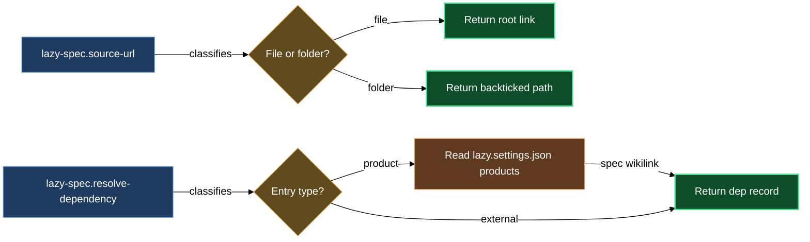

# Source links — root links and dependencies

A product's code lives in the same repository as its spec catalog, so a spec document links to code with a plain in-repo link written from the repository root: `[flip_gate.py](/plugins/claude/lazycortex-specs/bin/flip_gate.py)`. Obsidian opens such a link to a code or markdown file directly. The source-links block keeps every emitter on that one form through two small primitives.

`/lazy-spec.source-url` builds the link: give it a repo-relative path without a leading slash (a path ending in `/`, or one that is a directory in the working tree, counts as a folder) and it returns `[<basename>](/<path>)` for a file, or the path in backticks for a folder. `/lazy-spec.resolve-dependency` turns one entry of a product's `dependencies` array — another product, or an external tool — into a record with a spec link and, for an external tool, its source URL.

## When you'd use this

- A spec document carries a code link that opens nothing, or a folder link that made Obsidian create an empty note, and you want to know what the right form is.
- `/lazy-spec.audit` reports a root link to a folder or a root link to a missing file, and you want to fix it by hand. The audit does not report forge links into this repository: the catalog migration rewrites those into root links.
- You're running `/lazy-spec.product-config` and it asks about dependencies — the wizard calls `/lazy-spec.resolve-dependency` to classify each entry, so knowing the two entry shapes (`product:`, `external:`) helps you answer accurately.

## How it fits together

`/lazy-spec.source-url` is the only place that writes a code link. A link always starts with `/` and is relative to the repository root, never to the document holding it. It points at a file, never at a folder: Obsidian reads a link to a folder as a new note and creates it, so the skill hands back a folder as `` `path/to/folder/` `` text instead. The link always opens the file in the current tree — there is no branch in it and nothing to rewrite after a branch merges. A spec mirror in another repository carries the link as written, and there it does not resolve, because the code is not copied along.

Source links belong in the product `tech.md`, in `code-plan.md` and `test-plan.md`, and in the `## Related code / logs` section of a `bug.md`. Design, vision, use-cases, ui-design and architecture documents describe behaviour and shape and carry no code links.

`/lazy-spec.resolve-dependency` handles the dependency side. A product's `dependencies` array in `lazy.settings.json` accepts two entry shapes. A `product:` entry names another product by compound key; the skill looks it up and returns a wikilink to its design doc — that product's code is in this repository too, so the wikilink is all the navigation the record carries. The record also lists the product's own code locations as `code_paths`, each one a backticked path and never a link, because a link to a folder makes Obsidian create a note there; a design-only product has no `source` and so no `code_paths`. An `external:` entry already has `spec_url` and `dev_url` spelled out — the skill validates that all three fields (`name`, `spec_url`, `dev_url`) are present and returns them as-is, with the spec link as a plain markdown link. The output is always `{kind, spec_link, dev_link?, local_spec_path?, code_paths?}`, with `dev_link` present only for an external tool and `code_paths` present only for a product that has a `source`.

## Common adjustments

**Linking to a file by hand** — write `[<name>](/<repo-relative path>)`. Any display text works; the target must start with `/` and name a file. Do not append a line fragment such as `#L42`, and if the path contains spaces, encode them yourself — the skill passes the path through verbatim and never encodes it.

**Naming a folder** — write its path in backticks, `` `src/chapter/` ``, without a link.

**Adding or editing a product dependency** — run `/lazy-spec.product-config` in edit mode to extend the `dependencies` array. The wizard accepts both entry shapes (`product:`, `external:`) and calls `/lazy-spec.resolve-dependency` to validate each entry before writing. A dependency on code of this repository is a `product:` entry naming the product that owns that code. You do not edit the `products` section by hand.

## When resolution stops

- **Malformed dependency entry, or product not found** — each `dependencies` entry must match exactly one of the two shapes, and a `product:` key must be registered. Correct the entry or register the missing product through `/lazy-spec.product-config`. Entries are resolved one per call; the primitive never fetches the links it returns.

`/lazy-spec.source-url` refuses nothing and does not check that a file exists; `/lazy-spec.audit` reports a link whose target is missing.

## How the two skills compose

## See also

- [install-and-audit](install-and-audit.md) — register products via `/lazy-spec.product-config`, the only writer for the settings this block reads, and run `/lazy-spec.audit`, which reports broken code links.
- [code-sync](code-sync.md) — `/lazy-spec.sync-with-code` is the primary caller of `/lazy-spec.source-url` in normal operation.
- [asset-to-release](walkthroughs/asset-to-release.md) — walkthrough that exercises source-link generation as part of the full gate journey.
