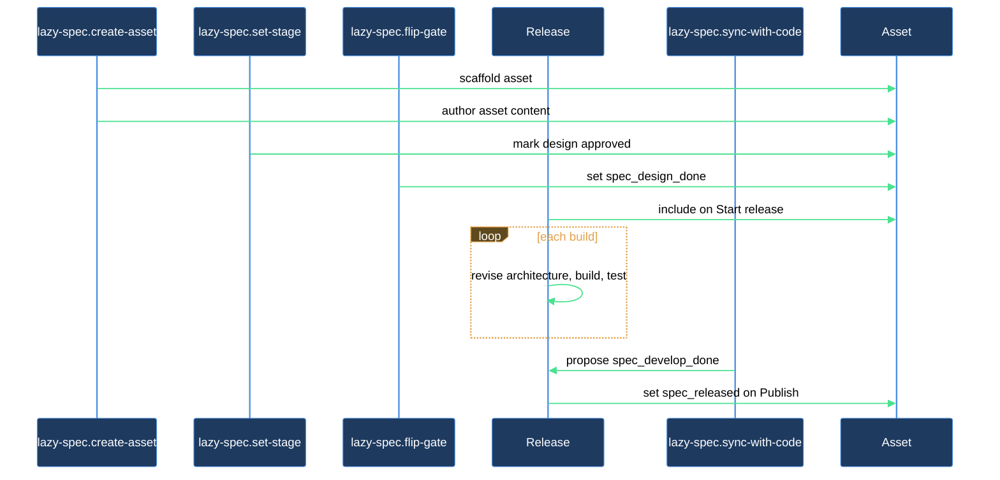

# How do I take an asset from creation all the way to release?

This walkthrough is for anyone who has a product registered in the spec system and wants to carry a single asset — a feature, change, or bug — through its complete lifecycle: from a blank scaffold to its publication in a product release. Four skills divide the work: `lazy-spec.create-asset` builds the scaffold and authors the docs; `lazy-spec.set-stage` records when a doc moves from draft to approved; `lazy-spec.flip-gate` advances the flat readiness gates; and `lazy-spec.sync-with-code` keeps the spec current with code commits and proposes gates grounded in what actually landed. The implementation itself happens in a release of the product, which you start and publish with two ticks on the folder-notes.

## Outcome

After completing this journey you have:

- A fully authored spec folder for the asset (`vision.md` approved when you opted into one — the shipped `feature` and `change` types offer it as an opt-in `Write vision` row, and a mandatory vision applies only to a type that declares it — plus `design.md` approved, and the asset's test cases in `test-plan.md` when you chose to write them).
- Both of the asset's gates, `spec_design_done` and `spec_released`, set to `true` in its status folder-note, and the version tag of the release that shipped it.
- Approval moments on the docs and gates (`spec_approved_at`, `spec_<gate>_at`) stamped in frontmatter, plus one commit per step. None of the four skills in this journey append a `# History` line to the folder-note — that journal is reserved for the coordinator's own commands, expert-job outcomes, and answered questions.

## What you need

- `lazycortex-specs` installed (`/lazy-spec.install` already run).
- A product registered in `lazy.settings.json[products]` via `/lazy-spec.product-config`.
- For the sync phase: the product must have a `source` binding — `source.paths` naming where its code lives in this repository.
- The asset type you want to create (`feature`, `change`, `bug`, `content`, `research`, or a type the product declares itself) must be valid for the product — either one of the plugin's shipped types or declared via `/lazy-spec.add-asset-type`.

## The journey

### Step 1 — Create the asset

Run `/lazy-spec.create-asset <product> <asset-type> <slug> [--path <dir>]`, where `<product>` is the compound key for your registered product, `<asset-type>` is `feature`, `change`, `bug`, or an operator-declared type, and `<slug>` is a lowercase-with-hyphens name for this asset. `--path` names the folder under the product root the asset lands in; leave it off and the type's own `default_path` decides.

`lazy-spec.create-asset` opens a wizard (2–5 questions, one at a time) to gather scope, behavior, and edge-case detail for the category. Before scaffolding, it also settles the document set for the type: a mandatory definition document REPLACES the type's own start doc when the type declares one — no shipped type does; only a type you declare with a mandatory vision seeds `vision.md` this way, so its goals are approved before `design.md` even exists — and a multiSelect question offers whichever opt-in documents the type playbook allows (`vision.md` where it is opt-in, e.g. a `feature` or a `change`; `use-cases.md`; `ui-design.md`), each with a one-line description of what it's for. Declining one leaves it available as a later launch checkbox, never a gap. For a `change`, one clarifying question also asks which existing asset(s) it modifies — the answer is recorded as `spec_targets` on the freshly-scaffolded folder-note, and once the change's own design is approved, that design cascades into each named target's own docs. After you answer, it scaffolds the asset folder at `<spec_path>/<slug>/` by default, or at `<spec_path>/<folder>/<slug>/` when the type or the caller named a folder, and authors every doc the resolved set named, each starting at `draft` stage: `vision.md` standing in for the start doc on a mandatory-vision type (only one you declared — `design.md` isn't created yet), or the type's own start doc directly otherwise (`design.md` for a `feature` or a `change`, `bug.md` for a `bug`), plus any opt-in documents you selected. It also fills in the folder-note's `# Summary` précis. Any real decision fork the clarification settled lands in the authored prose as a `[!decision]` callout, ready to transfer into the product's `decisions.md` once you approve the doc it lives in (Step 2 below). The scaffold draws no diagrams of its own — once a doc's prose is settled, ask for one explicitly via `/lazy-diagram.draw` if it needs a picture. The folder-note (`<slug>.md`) is created with its gates (`spec_design_done`, `spec_released`) at `false` and an empty `# History` H1 section — scaffolding and per-file stage seeding are not journaled events, so nothing is appended there yet. `test-plan.md` — the asset's test cases — stays opt-in in a stronger sense: the scaffold never creates it, and a `Write test-plan` row offers it once the design is approved. Plans, code and reports belong to the release (Steps 4–6).

**Verification gate:** confirm the asset folder exists, the doc Step 1 actually seeded carries `spec_stage: draft` — `vision.md` for a type that declares a mandatory vision (`design.md` doesn't exist yet; Step 2 below is what creates it), or the type's own start doc otherwise, which for the shipped `feature`, `change` and `bug` types is `design.md` or `bug.md` — the folder-note's `# Summary` précis is filled in (not a placeholder), and the folder-note lists its gates as `false`.

If the skill refuses naming an unknown product, run `/lazy-spec.product-config` to register it, then re-invoke. If it refuses naming an unknown category, run `/lazy-spec.add-asset-type` to declare it, then re-invoke.

### Step 2 — Review and approve the design doc

If Step 1 seeded a mandatory `vision.md` in place of the start doc (only a type you declared with a mandatory vision does this), review and approve it first: read `vision.md` and iterate on its prose (the skill authored a first draft; refinement is yours), then run:

```
/lazy-spec.set-stage <vision.md path> approved
```

Approving the vision is what unblocks `design.md` — the playbook holds the design doc back until the vision is approved. If a daemon runs in this project, `spec.coordinator` would ordinarily have seeded `design.md` — at `spec_stage: draft` — the moment it saw the vision approved, through its own launch row; this step is what you'd otherwise wait for. Continue with the rest of this step once `design.md` exists.

For a type with no mandatory vision (every shipped type: `feature`, `change`, `bug`), `design.md` — or the type's own start doc — already exists from Step 1; skip straight to reviewing it below. If you opted into a `vision.md` on such a type anyway, review and approve it the same way, on its own schedule — `vision.md` and `design.md` advance independently, each through its own `set-stage` call, so approving one never forces the other.

`design.md` describes the intended behavior only — it never writes in "not yet supported" or half-built code paths as if they were spec limitations. If a section feels narrower than you expected, that's an explicit scope decision from the wizard answers, not a reflection of what the code currently does.

Read `design.md` and iterate on its prose as needed (the skill authored a first draft; refinement is yours). When the design is ready for implementation, run:

```
/lazy-spec.set-stage <design.md path> approved
```

`lazy-spec.set-stage` rewrites `spec_stage: approved` in the frontmatter, mirrors the `spec/approved` tag in lock-step, and stamps `spec_approved_at: <ISO 8601 UTC datetime>` on `design.md` itself. It writes files and commits nothing of its own: every path it touched (the document, its attachments, the container notes, the decision registries) travels in the commit of whoever called it. A refusal writes nothing and is reported as it stands; never work around it by editing the frontmatter by hand. No history line is written — `# History` journals operator commands, expert-job outcomes, answered questions and halts, one bullet each under `#### YYYY-MM-DD` day headings. It accepts only the closed set `empty | draft | approved | rejected | cancelled | deferred`; anything outside that set is rejected with a clear error. `deferred` is a special case in that set — it parks a document out of the automation's reach (no gate reads it, nothing edits it further) and has exactly two ways out: `draft` brings it back, `cancelled` abandons it. You won't need it for a straight run through this journey, but if you ever need to shelve `design.md` mid-flight, `/lazy-spec.set-stage <design.md path> deferred` is how; `spec.coordinator` and every gate proposal ignore the doc until you un-park it.

Approving `design.md` carries three side effects along in the same commit, none of which need a separate step from you:

- **Attachments cascade.** Any markdown attachment sitting beside `design.md` (one carrying `spec_owner_doc: design.md`) picks up `spec_stage: approved` too — unless it's mid-review itself, in which case its own review cycle owns it until that finishes.
- **The enclosing container notes refresh.** The enclosing group note (`bugs/bugs.md`), or the product note for an asset sitting at the product root, refreshes its stats: its bucket counts update to reflect the new stage. A plain grouping folder between the asset and the product is transparent to the tally, so every such shelf above the asset is refreshed too, up to and including the product note. Only the catalog root's own note is never refreshed from below.
- **Decisions promote automatically.** If `design.md` carries any `[!decision]` callouts, approving it transfers them into the product's `decisions.md` — each callout in `design.md` becomes a reference link, and a `**Supersedes.**` command on one of them stamps the superseded decision's own file `superseded-by`.

`lazy-spec.set-stage` refuses a few requests rather than guess:

- **Open decision-candidates.** Approving a document that still carries a `[!decision-candidate]` callout is refused with the line number. Fold the callout through the document's review first; never delete it by hand.
- **Attachments.** An attachment (a doc carrying `spec_owner_doc`) mirrors its owner's stage, so set the stage on the owner instead.
- **Parked documents.** A `deferred` document accepts only `draft` or `cancelled`.
- **Cancelling a mandatory document.** `cancelled` is accepted only on a system tech document, a `code-plan` or a `test-plan`. On any other file, `design.md` included, the request is refused with "cancelled not allowed on <file>".
- **A misplaced `--restamp`.** The optional `--restamp` flag is valid only together with `approved`; it rewrites `spec_approved_at` on a document that is already approved (the coordinators use it when a document comes out of a review approved again). With any other stage it is refused.
- **Stage-less types.** A document whose type carries no stage (for example a code report, a test report, or `decisions.md`) has nothing to set.

**Verification gate:** open `design.md`'s frontmatter and confirm `spec_stage: approved` and a `spec_approved_at` stamp are present.

### Step 3 — Flip the design-done gate

With the design doc approved, `spec_design_done` is ready to advance:

```
/lazy-spec.flip-gate <asset> spec_design_done
```

`lazy-spec.flip-gate` asks one confirmation question (naming the asset and gate, and explaining what the flip signals). On yes, it subprocesses the primitive, which writes `spec_design_done: true` on the folder-note and stamps `spec_design_done_at` beside it, unconditionally — the primitive itself no longer checks whether `design.md` is actually `approved`, so if you jump ahead here, nothing stops you; go back and finish Step 2 first if you skipped it. The flip is refused only for an unknown gate name, a gate the note's own ladder does not carry, opening one of the four middle gates (`spec_plan_done`, `spec_develop_done`, `spec_tests_passing`, `spec_built`) on a design-only asset, or any flip on a cancelled asset (the one exception is un-cancelling it). A flip you regret is walked back with `--off`, then re-checked against what the gate really requires. (If a daemon runs in this project, `spec.coordinator` would ordinarily have flipped this gate on its own the moment it saw `design.md` approved — this step is what you'd otherwise wait for.)

### Step 4 — Start a release

With `spec_design_done` closed, the asset's own ladder is done: it is design-only, and from here it waits for a release. Its folder-note shows it as awaiting a release, and it stands in the delta of the product that owns releases. On that product's folder-note the coordinator hangs a `Start release` row while the delta is non-empty and no release is open. Tick it: the product coordinator creates `releases/NNN/` with a status note of its own, lists your asset among the release's included assets, derives the version, and wakes the release. Your asset now shows as in a release.

Everything about implementation — plan, build, tests, deploy — happens on the release's note, never on the asset's. Each build runs in two steps. First the architect revises the product's `architecture.md` against everything the release includes: an unchanged document lets the build continue, a revised one goes through review and the build waits for its approval. Then one `Build` job by the product's release implementer writes the work — delegating each foreign tool's share to that tool's expert — and journals it in the release's `code-report.md`. If you want a plan reviewed before the build, tick the `Write code-plan` row on the release note.

The release's `spec_plan_done` closes once the first step is settled and its `code-plan.md` is absent or approved; `spec_develop_done` closes once `code-report.md` is accepted and the build's branch is merged; then the tester runs — against `staging` when the product declares it — and an accepted green `test-report.md` closes `spec_tests_passing`.

**Verification gate:** the asset's folder-note still carries only `spec_design_done: true` and `spec_released: false`, and the release note under `releases/NNN/` lists the asset among its included assets.

### Step 5 — Sync with code after the build

Once the release's build has landed on the default branch, run:

```
/lazy-spec.sync-with-code <product>
```

`lazy-spec.sync-with-code` treats the code as the truth. It walks the commits since the last sync, and brings every authored document in scope in line with what the code now does: `vision.md`, `design.md`, `architecture.md`, `use-cases.md`, `ui-design.md`, the product `tech.md`, and each folder-note's `# Summary` précis. A statement the code made false is rewritten, behavior no document described is written down, and edits are made in place section by section. Design, vision, use-cases and ui-design documents never gain source links or code names; `tech.md` is limited to what the manifests and configuration prove (stack, versions, platforms). Each edited document gets one line in its own `# History` section naming the synced window and what changed. When a rewrite lands under a heading that already carries a diagram, sync redraws that diagram to match; it never draws one where none existed.

Beyond rewrites, the same run creates an asset for a feature-sized code unit no asset covers (every document it creates is born at `spec_stage: deferred`, so nothing acts on it until you move it to `draft`), deletes an asset whose code is gone, and marks a recorded decision obsolete when the code abandoned it. Before touching an asset that holds an approved document, it asks once for the whole asset: `update` applies every finding and keeps each document's stage, `leave` skips the asset until a later `--full` run asks again. An asset whose documents state a reviewed target design that the code has not reached yet is asked the same way, once per asset and whatever its stages read: `update` brings the asset in line with the code and marks its design records obsolete, `keep` leaves it untouched and listed in the report as ahead of the code, to be asked again on the next run that finds it. Sync never rewrites a reviewed target design without your `update`. A folder that has authored documents but no status folder-note gets one scaffolded with its gates `false` (asking you for the asset type when the folder does not settle it), and the sync never sets a gate during that scaffold.

Nothing is committed until you have read the whole diff and said yes; you approve the run as a whole, never edit by edit. The sync also inspects every folder-note and, when commits on the default branch objectively implement an open release's included assets AND the release's `spec_plan_done` already reads `true`, proposes flipping the release's `spec_develop_done` via one confirmation question (`confirm` or `skip`). An asset whose code landed with no release carrying it is reported as implemented outside a release, for you to fold into the next one. On confirm, it invokes `lazy-spec.flip-gate` for you. If a document's `spec_stage` is plainly wrong against the code (for example a design still `draft` for a feature that has fully shipped), it proposes the correction the same way and applies it through `lazy-spec.set-stage` only on your yes. After the run it executes `/lazy-spec.audit` and reports its findings next to the diff without fixing them. The checkpoint `.state/lazy-spec.sync-<product>.json` is rewritten as part of the same uncommitted change set, so it rides in the commit you approve. A first sync with no checkpoint, or a run with `--full`, compares every document with the current code instead of only what the commit window touched.

That `spec_plan_done` check is `sync-with-code`'s own readiness gate, not something the underlying `flip-gate` primitive enforces on its own. While the release's plan gate is still open, sync doesn't propose the flip at all — it reports the release as held at its plan gate instead.

**Verification gate:** the release note reads `spec_develop_done: true`, and `spec_tests_passing: true` once its test report is accepted.

To sync just this one asset, run `/lazy-spec.sync-with-code <asset>` (a status folder-note path, an asset directory, or `<product> <product-relative-path>`) instead of the bare product key. Asset mode always runs full on that one asset against its owning product's code, reconciles the documents the asset carries and its folder-note précis the same way, and writes no checkpoint. A bug asset is accepted too. Other scopes are the whole tree (no argument, every code-bound product) or a product together with the products nested under it.

Any document a sync run creates from scratch (rather than edits) is written by the sync itself already parked at `spec_stage: deferred` (with the matching `spec/deferred` tag), so it sits inert until you move it to `draft` yourself with `/lazy-spec.set-stage <doc> draft`. Documents the run merely edits keep the stage they carry.

### Step 6 — Publish

Once the release's tests pass and its build is merged, its own `spec_released` closes by itself and a `Publish` row hangs on the release note — with the `staging` address beside it when the product declares one, so you can look before you tick. Tick it. When the product declares a `production` target the release deploys there first; a failed deploy writes a line in the release's `# History`, changes nothing else, and `Publish` comes back for a retry. On success every included asset gets `spec_released: true` with its `spec_released_at` stamp, its `spec_draft` cleared and the release's version tag `release/<x-y-z>`, the new version is written into the product's manifest, and all of it lands in one commit. From that commit the release is frozen: any later edit goes into the next release.

**Verification gate:** your asset's folder-note reads `spec_design_done: true` and `spec_released: true`, each with its `_at` stamp, and carries the release's version tag.

## After you're done

The asset is now released. Its folder-note carries its two `true` gates, each stamped with its `_at` moment, and the tag of the version that shipped it. Apart from the history lines sync adds to the documents it edits, no `# History` line on the asset's folder-note accumulated from this journey; the audit trail is those stamps plus the commit each step made along the way.

To revisit the asset, re-approve its `design.md` after a revision: a re-approved start document of a released asset turns its `spec_released` off, and the asset waits for the next release while the released version keeps its tag. `/lazy-spec.set-stage <doc> draft` re-opens a doc for editing. A doc parked with `/lazy-spec.set-stage <doc> deferred` comes back the same way — `draft` unparks it, and `cancelled` is its only other exit. Each operation updates the matching stamp and lands in its own commit, so the audit trail stays complete.

Run `/lazy-spec.audit <product>` periodically to catch drift: missing stage mirrors, stale links, gate inconsistencies, or docs that gained new content without a stage transition.

## How the journey flows


