# Domain knowledge lookup

Some codebases carry their design knowledge in comments — a `Domain(…)` block explaining a mechanic, a formula, an invariant, sitting next to the code it describes. That knowledge is useless to anyone who has to read the whole codebase to find it. This block turns those comments into a small generated reference tree (`docs/domains/` by default) and gives you a query skill that hands back a group's overview, one document's section, or every excerpt matching a term — never the whole tree, never a whole document you didn't ask for.

The tree itself is generated, not hand-written. Each group is a folder: a folder note that opens it, plus one document per `Domain(…)` comment in that group. A synthesising agent reads each comment, verifies every formula and rule against the code the comment describes, and writes the document. You never edit those files directly — you either query them or trigger a regeneration.

## When you'd use this

- Looking up what a term means, or how a mechanic works, without reading the implementation.
- Checking a formula or invariant before changing code that depends on it.
- Getting an overview of a domain group — which documents it holds and how they relate — before diving into a bigger task.
- Finding out where a comment in the code and the code's actual behaviour disagree.
- Refreshing the generated docs right after `Domain(…)` markers changed, when you're not waiting for the background routines.

## How it fits together

You ask `/lazy-wiki.domains group <group-key> [<doc-slug>] [<section>]` for a slice of one group, or `/lazy-wiki.domains term "<text>"` to search the whole tree. The query narrows in steps:

- **Group only** — returns the folder note's overview paragraph and its `Documents` list. Each line names one document and links its file, so you can ask for one of them next.
- **Group and `<doc-slug>`** — `<doc-slug>` is a document's file name without `.md` (for example `late-fee`), taken from the Documents list. With no section, you get the document's title and the list of `##` sections it actually has.
- **Group, `<doc-slug>` and `<section>`** — returns just that one section. A document always has `Principles`, `Mechanics` and `Related`; it has `Terms`, `Contracts` or `Discrepancies` only when it has such content. A section name is matched case-insensitively, and it only makes sense together with a document slug.
- **Term** — greps the index, every folder note and every document case-insensitively, on whole words, and returns the matching excerpts with their file paths — never a full file.

Both modes assume the tree already exists. If it doesn't, the skill tells you to run `/lazy-wiki.configure domains` (first-time setup) and `/lazy-wiki.domain-sync` (to generate it) before it can answer anything. If a group, a document or a section isn't found, the answer says so and lists what does exist (the group list in `domains.md`, the folder note's Documents list, or the document's sections).

## What a generated document holds

A document is the size of its comment. Under the title and a short caption it carries:

- **Terms** — definitions for the vocabulary the comment or the code it describes uses, when there is any.
- **Principles** — what is always true: for a code rule, the rule itself; for a business rule, its invariants.
- **Mechanics** — how it works: how a check recognises a case, or the procedure and formula. A fact lives in either Principles or Mechanics, not both.
- **Contracts** — one bullet per attributed `Contract:` guarantee, each anchored back to `path:symbol` so you can jump to the code it governs. Left out entirely when the comment carries none.
- **Discrepancies** — one bullet for each place where the comment says one thing and the code does another: what the comment claims, what the code does, and the anchor. The document states what the comment says in its other sections; the disagreement is marked, not resolved. Left out when there are none.
- **Related** — links to the group's folder note first, then sibling documents, then documents or folder notes of other groups, each with a one-line gloss.

The explaining sections never mention file paths, class names or line numbers; only Contracts and Discrepancies carry anchors. Formulas are recorded in math notation. A document with discrepancies is tagged `domains/discrepancy`, and the `domains.md` index lists those documents under its own `Discrepancies` section, so you can see every known comment-versus-code disagreement in one place. Where the two disagree, the code is the truth.

The index also gets a note for any folder that sits above groups without being a group itself, listing the groups and sections directly inside it.

## Keeping the tree current

When your project runs the background daemon, a git-watch routine and a weekly full sweep keep the tree current automatically as `Domain(…)` and `Contract:` comments change — you don't have to do anything. The writer only ever returns its files; a collect routine places them, refreshes the `domains.md` index, and commits.

When you're not running the daemon, or you just changed a batch of markers and want the docs current right now, `/lazy-wiki.domain-sync [<group-key>]` does the same work synchronously. With a group key, only that group's folder is written and cleaned; the index is still rebuilt from the whole tree. A run goes through these steps:

1. **Plan** — detects which groups changed since the last generation. If nothing changed, the run reports the tree as in sync and stops. The plan also reports groups used in code but missing from the dictionary (they are never generated) and comments that don't open with a `# # <title>` line (they have no document; each is named by file and line).
2. **Write** — dispatches the domain-spec writer once per changed group. It writes the group's folder note plus a document for every comment whose knowledge changed. The skill checks that every returned file exists and is non-empty before landing any of a group's files; a group with a missing file is skipped whole and picked up on the next run, so you never get a folder note describing documents that weren't rewritten.
3. **Remove orphans** — deletes documents whose comment was removed or retitled, whose group no longer has any comments, whose group left the dictionary, or that are a leftover of the earlier one-file-per-group layout. Docs deleted because their group left the dictionary are named in the report, so an unintended deletion is visible in the run that made it.
4. **Repair** — fixes what needs no writer: contract anchors whose file moved, `Related` links whose target no longer exists, and `Contracts` bullets citing a guarantee no attributed contract accounts for.
5. **Rebuild the index** — regenerates `domains.md` from the whole tree.
6. **Commit** — one commit under your identity covering everything touched.

The report ends with the unknown groups, the untitled comments, the unlisted-group deletions, and every discrepancy the writers found (comment claim, code behaviour, anchor).

## Tags, language and captions

Every generated file carries a `tags:` line in its frontmatter, drawn from your project's repository-wide tag-axis vocabulary (`wiki.tag_axes`, the same vocabulary a wiki scope narrows from). On a regeneration the writer carries a file's existing tags forward unchanged; it only adds a tag when the file now covers an aspect none of its current tags reflect, and it checks the advisory tag-values dictionary first so a new value reuses wording already in use elsewhere rather than coining a near-duplicate. The tags exist for the wiki's own classification, not as another query key.

Source comments stay English regardless of the project's documentation language — the writer translates them into the target language you configured (via `/lazy-wiki.configure domains`), keeping terms the code itself uses verbatim in English and favouring a term the project has already agreed on over a literal rendering. Each document and folder note opens with a short italic caption under its title, pulled from the wiki plugin's own shared caption library for the target language; a language the library has no caption for falls back to an English one automatically.

## Common adjustments

- **First-time setup** — run `/lazy-wiki.configure domains` to point the plugin at your code globs, dictionary, output directory, and target language; nothing works until this is done.
- **Forcing an immediate refresh** — run `/lazy-wiki.domain-sync` instead of waiting for the background routines, e.g. right after a batch of `Domain(…)` edits or a terminology sweep.
- **A group reports "not in the domain tree"** — the group key is new, misspelled, or not yet generated; check the group list in the `domains.md` index.
- **A group reports "not a document of"** — the slug names no file in the group's folder; take it from the folder note's Documents list.
- **A group reports "not a section of this document"** — only Principles, Mechanics and Related always exist; re-query with a section the answer listed.
- **New groups show up as "unknown"** during a sync — the dictionary doesn't list them yet. Add the group to the dictionary via `/lazy-wiki.configure domains`, or run a knowledge sweep to have code markers refiled under accepted groups automatically.
- **A comment has no document** — a sync reports it as untitled because it doesn't open with a `# # <title>` line; add the title line to the comment in the code and sync again.
- **Documents vanished after a sync** — the report names them under the unlisted-group deletions: their group left the dictionary. Restore the group key and sync again to bring them back, or accept the removal and refile the code's comments under the new name with a knowledge sweep.
- **`/lazy-wiki.audit` reports a domain doc using an axis your project never declared** — a generated doc's `tags:` frontmatter carries a `wiki/<axis>/…` tag whose axis isn't in `wiki.tag_axes`. That's not fixed by re-running the sync; extend the axis vocabulary via `/lazy-wiki.configure vault`, or treat it as a typo and let the next regeneration replace the tag once the doc's coverage genuinely changes.

## How the domain tree stays current

```mermaid
%%{init: {'themeVariables':{'background':'transparent','lineColor':'#000','textColor':'#000','edgeLabelBackground':'#fff'},'themeCSS':'.edgeLabel{background-color:transparent!important}.edgeLabel p{background-color:transparent!important}','flowchart':{'diagramPadding':5,'useMaxWidth':true}}}%%
flowchart LR
  codeComments["Code Domain(…)/Contract: comments"]
  domainPlanDetection["Domain-plan detection"]
  dispatchWriter["Dispatch domain-spec writer per changed group"]
  writeFolderNote["Write group's folder note"]
  writeDocuments["Write documents of changed comments under docs/domains/#lt;group folder#gt;/"]
  orphanRemoval["Orphan removal"]
  repairAnchorsLinks["Anchor and link repair"]
  rebuildIndex["domains.md index rebuild"]
  domainsTree["Generated docs/domains tree"]
  lazyWikiDomains["/lazy-wiki.domains"]
  answerQueries["Answer group, document, section and term queries"]

  codeComments -->|feed| domainPlanDetection
  domainPlanDetection -->|dispatch per changed group| dispatchWriter
  dispatchWriter -->|write| writeFolderNote
  dispatchWriter -->|write| writeDocuments
  writeFolderNote -->|then clean| orphanRemoval
  writeDocuments -->|then clean| orphanRemoval
  orphanRemoval -->|then repair| repairAnchorsLinks
  repairAnchorsLinks -->|then rebuild| rebuildIndex
  rebuildIndex -->|complete| domainsTree
  lazyWikiDomains -->|read| domainsTree
  lazyWikiDomains -->|produce| answerQueries

  classDef entry fill:#1e3a5f,stroke:#4a90e2,color:#fff
  classDef action fill:#1e5f3a,stroke:#4ae290,color:#fff
  classDef store fill:#5f3a1e,stroke:#e2904a,color:#fff
  classDef success fill:#0d4d2a,stroke:#4ae290,color:#fff,stroke-width:2px

  class codeComments entry
  class lazyWikiDomains entry
  class domainPlanDetection action
  class dispatchWriter action
  class writeFolderNote action
  class writeDocuments action
  class orphanRemoval action
  class repairAnchorsLinks action
  class rebuildIndex action
  class domainsTree store
  class answerQueries success
```

## See also

- [install-and-audit](install-and-audit.md) — bootstrap the plugin before configuring domain generation.
