# Terms

A wiki scope can carry a terms dictionary — a directory with one markdown file per term. The file's `# <term>` title line is a concept the project has agreed a name for, and the text under it is the definition. The point is narrow but easy to lose without tooling: once a second name for the same thing spreads across a handful of documents, nobody can un-write it. This block is the three pieces that keep that from happening — a lookup a writer consults before coining a word, a curator that grows the dictionary from finished documents and links every use of a term to its file, and an audit that catches the drift that slips through anyway.

A document points at a term with a wikilink of the form `[[<dir>/<stem>|<text>]]`, where `<dir>/<stem>` is the term file's path without `.md` and `<text>` is the word as the sentence uses it. The dictionary is therefore also a link target: a reader of any document can follow a term to its definition.

The pieces never fight over the same file. `lazy-wiki.terms` only reads the dictionary, mid-document, and never writes to it. `lazy-wiki.terms-curator` owns the dictionary and the term links, and it works only after a document is finished. The terms section of `/lazy-wiki.audit` writes nothing at all; it surfaces divergences and lets you decide which side is right.

## When you'd use this

- You're writing a document in a scope that has a terms dictionary configured, and you're about to name a concept — you want to know if the project already has a word for it, and what its link target is, before you pick your own.
- You want the dictionary to grow on its own as documents get written, and the uses of each term to turn into links, without a separate step to remember.
- You suspect a document and the dictionary have drifted onto different words for the same thing, or that the dictionary has grown a stale or duplicate entry, and you want that confirmed and fixed.
- You're setting up a new scope and need to decide which documents feed the dictionary and where the dictionary directory lives.

## How it fits together

**Lookup, at write time.** `lazy-wiki.terms` is what a writing expert (or you, mid-session) calls before naming something. You hand it the path of the document being written; it resolves which scope's dictionary serves that path from `.claude/lazy.settings.json[terms.scopes]` (merged with the local settings layer when one exists). A document that a scope excludes as a term source is still served — it gets its answers; only a document matching the scope's `link_exclude` globs keeps its text verbatim, and for that one the skill answers with words and definitions only and returns no link target. If no scope serves the document, or the matching scope still carries its old single-file dictionary, the skill says so out loud and the writer places no term links — a silent nothing would read as "the dictionary had no answer", which is a different fact.

It runs in one of three modes. All of them read just the term titles first, so the whole dictionary never enters the caller's context; only the files of terms that turned out to be candidates are read afterwards.

- **Look up one term** — returns the definition and the link target, or says the dictionary does not carry the term (an answer, not an error).
- **Check a name before using it** — the mode that keeps synonyms out. It picks candidates by meaning, reads just their definitions, and rules:
  - no candidate names your concept — the word is new. Use it; the curator enters it later, and you build its link target from the file-name rule;
  - a candidate names the same concept — take the existing term exactly as written, even when your word reads better, since a second name for one thing is what the dictionary exists to prevent;
  - a candidate is the qualified name of the concept you were about to call by its bare everyday word (`input field` where you meant `field`) — take the qualified term;
  - a candidate is itself still a bare common word standing for a project entity — write the qualified form in your document and link it; the bare title is not named in your document, and the curator renames it;
  - a candidate names a neighbouring concept — pick a different word for yours and make the difference readable from your text.
- **List the terms of a document** — returns every term of the scope that serves the document, each with its link target, so a writer can bring every use of a term in the document up to a link, including text it did not change.

When a name is genuinely ambiguous, the skill takes the existing term: a dispatched expert has no operator to ask, a merge of drifted definitions can happen afterwards, and a new synonym spread across documents cannot be recalled. When the dictionary and an upstream document a job carries disagree on a name, the dictionary wins, and your document carries no note about the disagreement. The skill never edits the dictionary — deciding that a term deserves an entry, or that its definition needs widening, is the curator's call once the document is finished.

**Curation, after the fact.** `lazy-wiki.terms-curator` owns the dictionary directory and the term links, and decides everything about them; a verb it calls writes the files. When documents under a terms scope change and the scope's `lazy-wiki.terms-scan-<scope-id>` routine fires — or a sweep covers a scope — the curator runs in `curate` mode. A run carries a **batch**, not one document: every document of one directory that changed in the same wave, because a directory's documents describe one subject and their terms are decided against each other. A single changed document still arrives as a batch of one and behaves identically. The curator reads the surviving documents of the batch as one body of text, so a concept that two or more of them name is one candidate, not one per file. Candidates come from three places: a legacy `## Terms` section a document may still carry (each `**term** — definition` line names a candidate with the definition the document gives), a link a writer placed on a term before the dictionary had it, and the rest of the body.

What earns a term: an existing entity of this project that either was invented inside the project and means nothing to an outsider without explanation, or is an ordinary word standing for a concrete thing this project has — which then enters under a qualified name, never as the bare everyday word. An industry-general word tied to no project entity does not enter. A term is a name, not a common word: when the word has an everyday meaning in the scope's language, the title carries a qualifying noun taken from the definition (`input field`, not `field`). A definition says what the thing is — no examples, no usage notes, no history — within three physical lines.

For each candidate the curator decides:

- **add** — no term names it and it earns one;
- **extend** — a term names the same thing but its definition does not cover the shade these documents introduced; the definition widens, the title stays;
- **rename** — a term is a bare common word for a project entity and the documents name it in a qualified form; the title becomes the qualified form, and links to the old term file follow the rename in every document the curator may edit;
- **split** — a term's name is taken by a neighbouring concept; a second term lands under a different name and both definitions are reworded to name each other, so a later audit can tell a fresh split from an unused term;
- **reject** — a document links or lists a word that does not earn a term.

An add or rename whose title gives the file name of a term already there is applied as an extend of that term, and the curator reports the join so the audit can later ask for the definitions to be rewritten into one.

Then it links. Every unlinked use of a dictionary term in a batch document gets named for linking — the terms the batch just added or renamed included. Each inflected form of a word is its own operation, and the code links every occurrence of that exact word in the document, ignoring letter case. The curator follows a rule of caution: a missed link beats a wrong one. A word that in one place means something other than the term goes on the operation's skip list, as does every occurrence whose sense it cannot tell; a word that stands in a document for two different terms is linked to neither by that batch. Nothing is linked inside a heading, a callout title, a checkbox line, an HTML comment, inline code, a fenced block, the text of another link, a bare web address, a protected section, the frontmatter, or a legacy `## Terms` section, and never a part of a hyphenated compound. Links whose term file does not exist are retargeted when the term was renamed or already exists under a different file name. A link a writer placed on the wrong term is retargeted when every link of that document to the same file is wrong; otherwise it stays until a writer or you correct it.

The curator applies the whole batch in one call and commits **once for the whole batch** — forty documents in one directory produce one commit, not forty. The write judges each operation on its own and applies the ones it accepts; a refused operation, or one that matched nothing, is handed back. The curator then corrects its errors in at most one retry; what a final call still refuses is recorded in the error ledger against the documents it concerns. It never edits a document itself, and the write leaves alone a document with uncommitted changes, and a document under an open review round (unless the request explicitly includes review documents), since an edit from outside the round would be counted against it.

The curator writes definitions in the vault's configured language. At the start of every run, in either mode, it reads that language from your settings — never from the request and never by guessing from the prose around it. A definition already in the dictionary keeps the language it has and is never retranslated, and a title follows the form your documents actually use, so a scope whose documents use a different language than the configured one keeps its titles as written. There are no synonyms, aliases or translations in the dictionary: two language forms of one concept are a divergence to report, not a second entry.

**Audit, on demand.** The terms section of `/lazy-wiki.audit` runs for every scope whenever the audit runs, alongside the rest of the wiki audit; with no terms scopes configured it says so and moves on. It checks format and configuration itself, by reading:

- `config` — the scope's directory does not exist yet (informational: the dictionary is empty, and the directory appears with the first term); the scope still carries its old single-file dictionary and so is served nothing until it is migrated; two scopes' `paths` overlap, since one document must belong to one dictionary; the scope's `lazy-wiki.terms-scan-<id>` routine is absent, or its `path_filter` no longer matches the scope's `paths`.
- `format` — a term file whose name is not the stem its title gives (links are built from the title, so such a file is never found); two term files whose names differ only in letter case; a definition longer than three physical lines; a definition made of two paragraphs, which the curator is to rewrite into one.
- `legacy` — a document in a migrated scope still carries a `## Terms` heading. Its lines go once the curator has passed the document, so the route is one curator job for it; a document waiting on an open review round is passed after the round ends, and a document the scope excludes as a term source is reported informationally, with a migration verb that removes such a section whole.

Then, for the judgment calls a program can't make, it dispatches `lazy-wiki.terms-curator` in `report` mode — no job directory this time, just the scope id, the dictionary directory, the scope's `paths`, and its `source_exclude` in the prompt — and gets back `divergence` (a document and the dictionary disagree on the word for one concept — including two language forms of the same concept, and a document using the bare everyday word for a term the dictionary carries under its qualified name), `missing` (a document names a project entity the dictionary doesn't carry), `duplicate` (two entries describe one concept), and `dead` (no document links to the term's file and none uses its word; a term whose definition names a sibling is a fresh split, never reported as dead). The curator narrows by searching before it reads and opens only the disputed documents, so the corpus is not read whole. Report mode writes nothing, and the audit itself repairs nothing; every finding carries the route that fixes it. `/lazy-core.doctor` can drive the repair loop and walk you through the findings one at a time, since which side of a divergence is "right" is your call, not a default. Two things are never edited whichever repair you pick: a document with `review_active: true`, and anything inside an upstream mirror tree.

`<wiki-cli>` stands for the wiki plugin's `bin/lazycortex-wiki` file — `${CLAUDE_PLUGIN_ROOT}/bin/lazycortex-wiki`, where Claude Code substitutes the variable with the root the skill's plugin was loaded from, so no lookup is needed. Outside a skill, use the install path recorded for the plugin in `~/.claude/plugins/installed_plugins.json`, or `plugins/claude/lazycortex-wiki/` in a checkout that authors the plugin; never search the plugin cache for it. Every verb runs through the interpreter, `"${LAZYCORTEX_PYTHON:-python3}" <wiki-cli> <verb>`: the file carries no exec bit and is not on `PATH`.

**Applying a settled divergence.** The decision is yours; carrying it out on the document is not a judgment call, and `"${LAZYCORTEX_PYTHON:-python3}" <wiki-cli> terms-apply <document> --from "<the document's word>" --to "<the dictionary's term>"` does it. It replaces whole-word occurrences in prose only — the frontmatter block, every fenced code block, every inline code span, every link target, and the protected `# See also` section come through byte-for-byte — and leaves the rewrite uncommitted in your worktree. It refuses, with exit 1 and the reason on stderr, on a document carrying `review_active: true`, on one inside a scope's mirror tree, and on a replacement that contains the word it replaces (which could never settle). Running it a second time reports `noop`. It decides nothing: the direction comes from you, and the other half of a divergence — renaming or widening the term — stays a hand edit of its term file, where the curator is the only other writer. A renamed term file takes the links pointing at it along by hand.

The other findings are fixed by hand edits of the dictionary: `missing` adds the term file, `duplicate` merges two terms into one (keeping the name the corpus actually uses and pointing the dropped term's links at the kept one), `dead` deletes the term file or leaves it when the concept is real and simply unwritten yet, and `format` renames the file to its title's stem, keeps one of two case-twins, or rewrites the definition to at most three lines.

## Common adjustments

- **No terms dictionary configured for a scope yet, or you want to change which documents feed it** — run `/lazy-wiki.configure terms`. It's the wizard for which documents the dictionary serves, where the dictionary directory lives, which documents count as term sources, and which documents keep their text verbatim; the skills in this block only read that configuration, they don't write it. A newly added scope is swept once so its existing documents get curated.
- **`lazy-wiki.terms` says no dictionary serves your document** — the document's path isn't covered by any scope's `paths` globs in `terms.scopes`, the `terms` section doesn't exist yet, or the matching scope still carries its old single-file dictionary. Run `/lazy-wiki.configure terms` to add or widen a scope; for an unmigrated scope the audit names the migration route.
- **The dictionary directory is missing** — it is not an error: git keeps no empty directory, so a scope with no terms yet has none, and the first term brings it back. Nothing in this block creates it up front.
- **The dictionary isn't picking up new terms automatically** — check that the scope's `lazy-wiki.terms-scan-<scope-id>` routine is registered; `/lazy-wiki.audit` reports this as a `config` finding, and `/lazy-wiki.install` seeds any routine that's missing (absent-only, so an existing one is left alone).
- **You suspect drift but don't want to wait for the next commit** — run `/lazy-wiki.audit [<scope-id>]` directly; the terms section runs every time, alongside the rest of the wiki audit.

## How the pieces fit together

```mermaid
%%{init: {'themeVariables':{'background':'transparent','lineColor':'#000','textColor':'#000','edgeLabelBackground':'#fff'},'themeCSS':'.edgeLabel{background-color:transparent!important}.edgeLabel p{background-color:transparent!important}','flowchart':{'diagramPadding':5,'useMaxWidth':true}}}%%
flowchart LR
  writingExpertCallsTerms["Writing expert calls lazy-wiki.terms mid-document"]
  readsAndReturnsDefinitions["Reads dictionary, returns matching definitions, never writes"]
  documentCommitTriggersScan["Document commit triggers terms-scan routine"]
  dispatchCuratorCurate["Dispatches lazy-wiki.terms-curator, curate mode, with directory's batch"]
  decideConceptAction{"Add, extend, rename, or split candidate concept?"}
  editsDictionaryCommitsBatch["Edits dictionary, commits once for whole batch"]
  auditChecksFormatScope["lazy-wiki.audit terms section checks format and scope config"]
  dispatchCuratorReport["Dispatches lazy-wiki.terms-curator, report mode"]
  curatorReportsFindings["Reports divergence, missing, duplicate, dead findings"]
  doctorPresentsFindings{"lazy-core.doctor presents each finding to operator"}
  operatorAppliesChosen["Operator applies only what they choose"]
  termsDictionaryFile["Shared terms dictionary file"]

  writingExpertCallsTerms -->|queries, lookup or check mode| readsAndReturnsDefinitions
  readsAndReturnsDefinitions -->|reads| termsDictionaryFile
  documentCommitTriggersScan -->|triggers| dispatchCuratorCurate
  dispatchCuratorCurate -->|reads batch as one body plus dictionary headings, one candidate per concept| decideConceptAction
  decideConceptAction -->|add| editsDictionaryCommitsBatch
  decideConceptAction -->|extend| editsDictionaryCommitsBatch
  decideConceptAction -->|rename| editsDictionaryCommitsBatch
  decideConceptAction -->|split| editsDictionaryCommitsBatch
  editsDictionaryCommitsBatch -->|writes and commits batch| termsDictionaryFile
  auditChecksFormatScope -->|reads| termsDictionaryFile
  auditChecksFormatScope -->|dispatches| dispatchCuratorReport
  dispatchCuratorReport -->|reads for meaning checks, writes nothing| curatorReportsFindings
  curatorReportsFindings -->|surfaces| doctorPresentsFindings
  doctorPresentsFindings -->|operator accepts| operatorAppliesChosen
  doctorPresentsFindings -->|operator declines| curatorReportsFindings

  classDef entry fill:#1e3a5f,stroke:#4a90e2,color:#fff
  classDef guard fill:#5f4a1e,stroke:#e2a14a,color:#fff
  classDef action fill:#1e5f3a,stroke:#4ae290,color:#fff
  classDef success fill:#0d4d2a,stroke:#4ae290,color:#fff,stroke-width:2px

  class writingExpertCallsTerms entry
  class readsAndReturnsDefinitions success
  class documentCommitTriggersScan entry
  class dispatchCuratorCurate action
  class decideConceptAction guard
  class editsDictionaryCommitsBatch success
  class auditChecksFormatScope entry
  class dispatchCuratorReport action
  class curatorReportsFindings action
  class doctorPresentsFindings guard
  class operatorAppliesChosen success
  class termsDictionaryFile action
```

<!-- /lazy-diagram.draw lands the fence here; do not author a code block manually. -->

## See also

- [audit](audit.md) — The full `/lazy-wiki.audit` integrity sweep this block's audit half belongs to, including the checks that aren't about terminology.
- [curation](curation.md) — The sibling curator that classifies and links wiki nodes; a different expert, same one-writer-per-file discipline.
